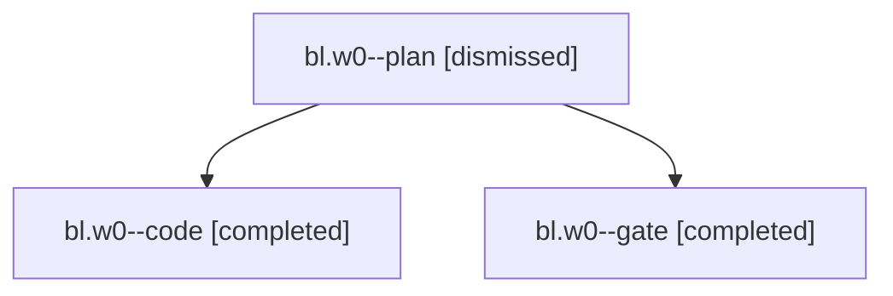

# Session: bl.w0

[Agent Hoods](../README.md) / [bbugyi200](../users/bbugyi200/README.md) / [apollo](../users/bbugyi200/machines/apollo/README.md) / [bl](../users/bbugyi200/machines/apollo/hoods/bl/README.md) / bl.w0

Owner: `bbugyi200.apollo` · Hood: `bl` · Members: 3

## Lineage

The diagram is an optional enhancement; the ordered table below contains the same lineage in accessible text.

| Role | Agent | State | Model / provider | Timing | Commits | Prompt | Chat |
|---|---|---|---|---|---:|---|---|
| plan | bl.w0--plan | dismissed | opus / claude | 2026-10-31T09:11:09.749437 → 2026-10-31T09:15:59.584947 | 0 | [Prompt](../agents/bbugyi200.apollo.bl.w0--plan/prompt.md) | [Chat](../agents/bbugyi200.apollo.bl.w0--plan/chat.md) |
| code | bl.w0--code | completed | grok-4.6 / grok | 2026-10-31T13:17:56.198602+00:00 → 2026-10-31T14:38:49.589710+00:00 | [1](../agents/bbugyi200.apollo.bl.w0--code/README.md#commits) | [Prompt](../agents/bbugyi200.apollo.bl.w0--code/prompt.md) | [Chat](../agents/bbugyi200.apollo.bl.w0--code/chat.md) |
| gate | bl.w0--gate | completed | opus / claude | 2026-10-31T13:16:58.761022+00:00 → 2026-10-31T13:17:37.786577+00:00 | 0 | — | [Chat](../agents/bbugyi200.apollo.bl.w0--gate/chat.md) |

## Commits

| Role | Repo | Commit | Subject | Committed |
|---|---|---|---|---|
| code | — | `c33fc08` | feat(gcal): refresh the Events stamp on every new-minute sync | 2026-10-31 10:38:00 EDT |

## Neighbors

| Agent | Relation | State |
|---|---|---|
| [bl](bbugyi200.apollo.bl.md) (session · 3) | ancestor | completed 2, dismissed 1 |
