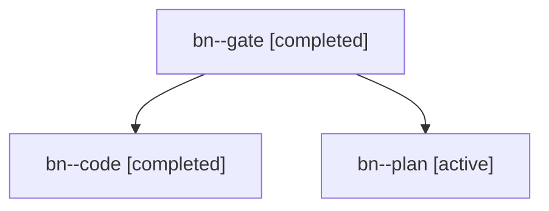

# Session: bn

[Agent Hoods](../README.md) / [bbugyi200](../users/bbugyi200/README.md) / [apollo](../users/bbugyi200/machines/apollo/README.md) / [bn](../users/bbugyi200/machines/apollo/hoods/bn/README.md) / bn

Owner: `bbugyi200.apollo` · Hood: `bn` · Members: 3

## Lineage

The diagram is an optional enhancement; the ordered table below contains the same lineage in accessible text.

| Role | Agent | State | Model / provider | Timing | Commits | Prompt | Chat |
|---|---|---|---|---|---:|---|---|
| gate | bn--gate | completed | opus / claude | 2026-10-31T14:05:51.411010+00:00 → 2026-10-31T14:06:34.823305+00:00 | 0 | — | [Chat](../agents/bbugyi200.apollo.bn--gate/chat.md) |
| code | bn--code | completed | muse-spark-1.3-contributor / muse | 2026-10-31T14:06:54.378528+00:00 → 2026-10-31T14:43:48.859769+00:00 | [1](../agents/bbugyi200.apollo.bn--code/README.md#commits) | [Prompt](../agents/bbugyi200.apollo.bn--code/prompt.md) | [Chat](../agents/bbugyi200.apollo.bn--code/chat.md) |
| plan | bn--plan | active | opus / claude | 2026-10-31T13:27:15.490333+00:00 | 0 | [Prompt](../agents/bbugyi200.apollo.bn--plan/prompt.md) | [Chat](../agents/bbugyi200.apollo.bn--plan/chat.md) |

## Commits

| Role | Repo | Commit | Subject | Committed |
|---|---|---|---|---|
| code | bob-cli | [`5e2d085`](https://github.com/bobs-org/bob-cli/commit/5e2d0856f3539fb632d418c6c1da3761cc3655dd) | docs: Alt+N inbox routing and due-row walk advance (nav 2.63.0) | 2026-10-31 10:43:29 EDT |
