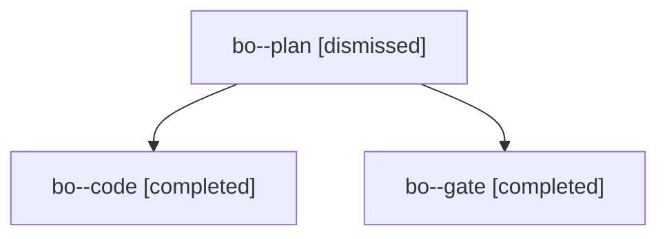

# Session: bo

[Agent Hoods](../README.md) / [bbugyi200](../users/bbugyi200/README.md) / [apollo](../users/bbugyi200/machines/apollo/README.md) / [bo](../users/bbugyi200/machines/apollo/hoods/bo/README.md) / bo

Owner: `bbugyi200.apollo` · Hood: `bo` · Members: 3

## Lineage

The diagram is an optional enhancement; the ordered table below contains the same lineage in accessible text.

| Role | Agent | State | Model / provider | Timing | Commits | Prompt | Chat |
|---|---|---|---|---|---:|---|---|
| plan | bo--plan | dismissed | opus / claude | 2026-10-31T10:19:23.712886 → 2026-10-31T10:27:40.199847 | 0 | [Prompt](../agents/bbugyi200.apollo.bo--plan/prompt.md) | [Chat](../agents/bbugyi200.apollo.bo--plan/chat.md) |
| code | bo--code | completed | sonnet / claude | 2026-10-31T14:33:45.697469+00:00 → 2026-10-31T15:23:41.287948+00:00 | [1](../agents/bbugyi200.apollo.bo--code/README.md#commits) | [Prompt](../agents/bbugyi200.apollo.bo--code/prompt.md) | [Chat](../agents/bbugyi200.apollo.bo--code/chat.md) |
| gate | bo--gate | completed | opus / claude | 2026-10-31T14:32:42.629822+00:00 → 2026-10-31T14:33:23.504086+00:00 | 0 | — | [Chat](../agents/bbugyi200.apollo.bo--gate/chat.md) |

## Commits

| Role | Repo | Commit | Subject | Committed |
|---|---|---|---|---|
| code | — | `061824f` | feat(pomodoro-homes): label home chips by root parent | 2026-10-31 11:23:18 EDT |
