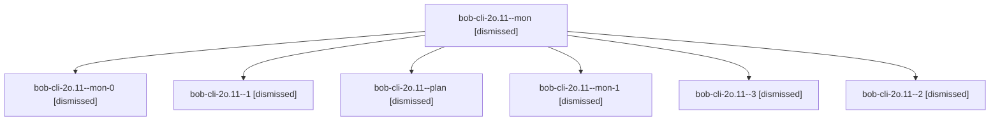

# Session: bob-cli-2o.11

[Agent Hoods](../README.md) / [bbugyi200](../users/bbugyi200/README.md) / [apollo](../users/bbugyi200/machines/apollo/README.md) / [bob-cli-2o](../users/bbugyi200/machines/apollo/hoods/bob-cli-2o/README.md) / bob-cli-2o.11

Owner: `bbugyi200.apollo` · Hood: `bob-cli-2o` · Members: 7 · Bead: [bob-cli-2o.11](https://github.com/bobs-org/bob-cli--beads/blob/main/pages/bob-cli-2o/bob-cli-2o.11.md)

## Lineage

The diagram is an optional enhancement; the ordered table below contains the same lineage in accessible text.

| Role | Agent | State | Model / provider | Timing | Commits | Prompt | Chat |
|---|---|---|---|---|---:|---|---|
| mon | bob-cli-2o.11--mon | dismissed | muse-spark-1.3-contributor / muse | 2026-09-29T19:47:02.299434 → 2026-09-29T19:48:26.732215 | 0 | — | [Chat](../agents/bbugyi200.apollo.bob-cli-2o.11--mon/chat.md) |
| mon-0 | bob-cli-2o.11--mon-0 | dismissed | muse-spark-1.3-contributor / muse | 2026-09-29T19:50:09.240482 → 2026-09-29T19:51:29.766009 | 0 | — | [Chat](../agents/bbugyi200.apollo.bob-cli-2o.11--mon-0/chat.md) |
| 1 | bob-cli-2o.11--1 | dismissed | muse-spark-1.3-contributor / muse | 2026-09-29T19:48:45.879043 → 2026-09-29T19:50:39.964371 | 0 | [Prompt](../agents/bbugyi200.apollo.bob-cli-2o.11--1/prompt.md) | [Chat](../agents/bbugyi200.apollo.bob-cli-2o.11--1/chat.md) |
| plan | bob-cli-2o.11--plan | dismissed | muse-spark-1.3-contributor / muse | 2026-09-29T19:35:31.847304 → 2026-09-29T19:47:27.512342 | 0 | [Prompt](../agents/bbugyi200.apollo.bob-cli-2o.11--plan/prompt.md) | [Chat](../agents/bbugyi200.apollo.bob-cli-2o.11--plan/chat.md) |
| mon-1 | bob-cli-2o.11--mon-1 | dismissed | muse-spark-1.3-contributor / muse | 2026-09-29T19:52:59.792327 → 2026-09-29T19:57:09.958788 | 0 | — | [Chat](../agents/bbugyi200.apollo.bob-cli-2o.11--mon-1/chat.md) |
| 3 | bob-cli-2o.11--3 | dismissed | muse-spark-1.3-contributor / muse | 2026-09-29T19:57:30.021655 → 2026-09-29T19:59:02.813107 | 0 | [Prompt](../agents/bbugyi200.apollo.bob-cli-2o.11--3/prompt.md) | [Chat](../agents/bbugyi200.apollo.bob-cli-2o.11--3/chat.md) |
| 2 | bob-cli-2o.11--2 | dismissed | muse-spark-1.3-contributor / muse | 2026-09-29T19:51:49.547287 → 2026-09-29T19:53:24.126924 | 0 | [Prompt](../agents/bbugyi200.apollo.bob-cli-2o.11--2/prompt.md) | [Chat](../agents/bbugyi200.apollo.bob-cli-2o.11--2/chat.md) |

## Neighbors

| Agent | Relation | State |
|---|---|---|
| [bob-cli-2o.1](../agents/bbugyi200.apollo.bob-cli-2o.1/README.md) | bob-cli-2o hood | dismissed |
| [bob-cli-2o.10](../agents/bbugyi200.apollo.bob-cli-2o.10/README.md) | bob-cli-2o hood | dismissed |
| [bob-cli-2o.12](../agents/bbugyi200.apollo.bob-cli-2o.12/README.md) | bob-cli-2o hood | dismissed |
| [bob-cli-2o.13](../agents/bbugyi200.apollo.bob-cli-2o.13/README.md) | bob-cli-2o hood | dismissed |
| [bob-cli-2o.2](../agents/bbugyi200.apollo.bob-cli-2o.2/README.md) | bob-cli-2o hood | dismissed |
| [bob-cli-2o.3](../agents/bbugyi200.apollo.bob-cli-2o.3/README.md) | bob-cli-2o hood | dismissed |
| [bob-cli-2o.4](../agents/bbugyi200.apollo.bob-cli-2o.4/README.md) | bob-cli-2o hood | dismissed |
| [bob-cli-2o.5](../agents/bbugyi200.apollo.bob-cli-2o.5/README.md) | bob-cli-2o hood | dismissed |
| [bob-cli-2o.6](../agents/bbugyi200.apollo.bob-cli-2o.6/README.md) | bob-cli-2o hood | dismissed |
| [bob-cli-2o.7](../agents/bbugyi200.apollo.bob-cli-2o.7/README.md) | bob-cli-2o hood | dismissed |
| [bob-cli-2o.8](../agents/bbugyi200.apollo.bob-cli-2o.8/README.md) | bob-cli-2o hood | dismissed |
| [bob-cli-2o.9](bbugyi200.apollo.bob-cli-2o.9.md) (session · 3) | bob-cli-2o hood | dismissed 3 |
| [bob-cli-2o.land](bbugyi200.apollo.bob-cli-2o.land.md) (session · 3) | bob-cli-2o hood | completed 1, dismissed 2 |
