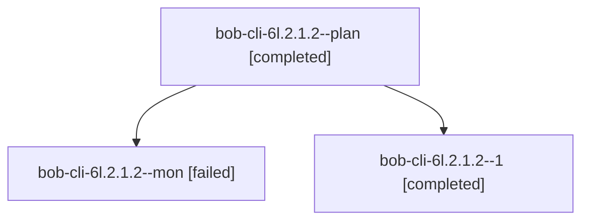

# Session: bob-cli-6l.2.1.2

[Agent Hoods](../README.md) / [bbugyi200](../users/bbugyi200/README.md) / [apollo](../users/bbugyi200/machines/apollo/README.md) / [bob-cli-6l](../users/bbugyi200/machines/apollo/hoods/bob-cli-6l/README.md) / bob-cli-6l.2.1.2

Owner: `bbugyi200.apollo` · Hood: `bob-cli-6l` · Members: 3 · Bead: [bob-cli-6l.2.1.2](https://github.com/bobs-org/bob-cli--beads/blob/main/pages/bob-cli-6l/bob-cli-6l.2.1.2.md)

## Lineage

The diagram is an optional enhancement; the ordered table below contains the same lineage in accessible text.

| Role | Agent | State | Model / provider | Timing | Commits | Prompt | Chat |
|---|---|---|---|---|---:|---|---|
| plan | bob-cli-6l.2.1.2--plan | completed | gpt-6-luna / codex | 2026-10-11T12:31:59.917748+00:00 → 2026-10-11T12:48:54.059581+00:00 | 0 | [Prompt](../agents/bbugyi200.apollo.bob-cli-6l.2.1.2--plan/prompt.md) | [Chat](../agents/bbugyi200.apollo.bob-cli-6l.2.1.2--plan/chat.md) |
| mon | bob-cli-6l.2.1.2--mon | failed | gpt-6-luna / codex | 2026-10-11T12:47:14.187954+00:00 → 2026-10-11T12:50:07.050767+00:00 | 0 | — | [Chat](../agents/bbugyi200.apollo.bob-cli-6l.2.1.2--mon/chat.md) |
| 1 | bob-cli-6l.2.1.2--1 | completed | gpt-6-luna / codex | 2026-10-11T12:50:08.459293+00:00 → 2026-10-11T13:01:11.926541+00:00 | [1](../agents/bbugyi200.apollo.bob-cli-6l.2.1.2--1/README.md#commits) | [Prompt](../agents/bbugyi200.apollo.bob-cli-6l.2.1.2--1/prompt.md) | [Chat](../agents/bbugyi200.apollo.bob-cli-6l.2.1.2--1/chat.md) |

## Commits

| Role | Repo | Commit | Subject | Committed |
|---|---|---|---|---|
| 1 | bob-cli | [`e27fe70`](https://github.com/bobs-org/bob-cli/commit/e27fe7020e80c1856899cc757f4b0c1e0675076d) | feat(stats): build single-pass vault and journal index | 2026-10-11 08:58:30 EDT |

## Neighbors

| Agent | Relation | State |
|---|---|---|
| [bob-cli-6l.2](../agents/bbugyi200.apollo.bob-cli-6l.2/README.md) | ancestor | waiting |
| [bob-cli-6l.2.1.1](../agents/bbugyi200.apollo.bob-cli-6l.2.1.1/README.md) | bob-cli-6l.2.1 hood | completed |
| [bob-cli-6l.2.1.3](../agents/bbugyi200.apollo.bob-cli-6l.2.1.3/README.md) | bob-cli-6l.2.1 hood | completed |
| [bob-cli-6l.2.1.4](bbugyi200.apollo.bob-cli-6l.2.1.4.md) (session · 3) | bob-cli-6l.2.1 hood | completed 2, failed 1 |
| [bob-cli-6l.2.1.4](../agents/bbugyi200.apollo.bob-cli-6l.2.1.4/README.md) | bob-cli-6l.2.1 hood | active |
| [bob-cli-6l.2.1.5](../agents/bbugyi200.apollo.bob-cli-6l.2.1.5/README.md) | bob-cli-6l.2.1 hood | completed |
| [bob-cli-6l.2.1.6](../agents/bbugyi200.apollo.bob-cli-6l.2.1.6/README.md) | bob-cli-6l.2.1 hood | completed |
| [bob-cli-6l.2.1.land](bbugyi200.apollo.bob-cli-6l.2.1.land.md) (session · 3) | bob-cli-6l.2.1 hood | completed 2, failed 1 |
| [bob-cli-6l.1](../agents/bbugyi200.apollo.bob-cli-6l.1/README.md) | bob-cli-6l hood | completed |
| [bob-cli-6l.3](../agents/bbugyi200.apollo.bob-cli-6l.3/README.md) | bob-cli-6l hood | completed |
| [bob-cli-6l.4](../agents/bbugyi200.apollo.bob-cli-6l.4/README.md) | bob-cli-6l hood | completed |
| [bob-cli-6l.5](bbugyi200.apollo.bob-cli-6l.5.md) (session · 3) | bob-cli-6l hood | failed 3 |
| [bob-cli-6l.5.1.1](../agents/bbugyi200.apollo.bob-cli-6l.5.1.1/README.md) | bob-cli-6l hood | completed |
| [bob-cli-6l.5.1.2](../agents/bbugyi200.apollo.bob-cli-6l.5.1.2/README.md) | bob-cli-6l hood | completed |
| [bob-cli-6l.5.1.3](../agents/bbugyi200.apollo.bob-cli-6l.5.1.3/README.md) | bob-cli-6l hood | active |
| [bob-cli-6l.5.1.4](../agents/bbugyi200.apollo.bob-cli-6l.5.1.4/README.md) | bob-cli-6l hood | waiting |
| [bob-cli-6l.5.1.land](../agents/bbugyi200.apollo.bob-cli-6l.5.1.land/README.md) | bob-cli-6l hood | waiting |
| [bob-cli-6l.6](../agents/bbugyi200.apollo.bob-cli-6l.6/README.md) | bob-cli-6l hood | waiting |
| [bob-cli-6l.land](../agents/bbugyi200.apollo.bob-cli-6l.land/README.md) | bob-cli-6l hood | waiting |
