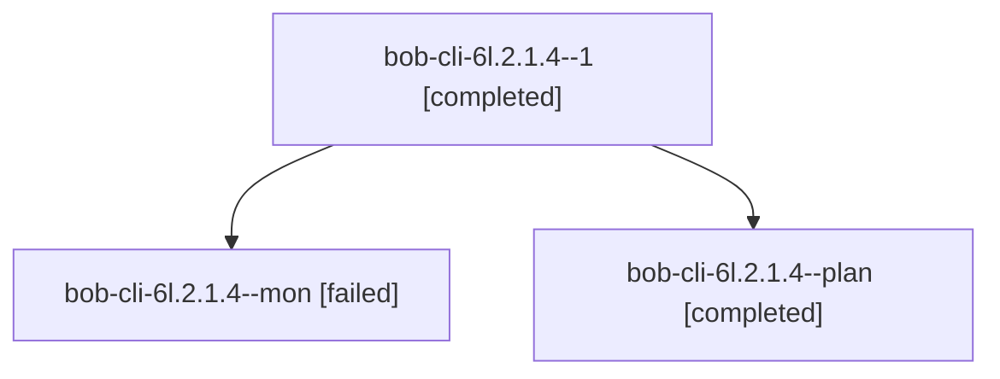

# Session: bob-cli-6l.2.1.4

[Agent Hoods](../README.md) / [bbugyi200](../users/bbugyi200/README.md) / [apollo](../users/bbugyi200/machines/apollo/README.md) / [bob-cli-6l](../users/bbugyi200/machines/apollo/hoods/bob-cli-6l/README.md) / bob-cli-6l.2.1.4

Owner: `bbugyi200.apollo` · Hood: `bob-cli-6l` · Members: 3 · Bead: [bob-cli-6l.2.1.4](https://github.com/bobs-org/bob-cli--beads/blob/main/pages/bob-cli-6l/bob-cli-6l.2.1.4.md)

## Lineage

The diagram is an optional enhancement; the ordered table below contains the same lineage in accessible text.

| Role | Agent | State | Model / provider | Timing | Commits | Prompt | Chat |
|---|---|---|---|---|---:|---|---|
| 1 | bob-cli-6l.2.1.4--1 | completed | gpt-6-luna / codex | 2026-10-11T13:26:05.109171+00:00 → 2026-10-11T13:29:43.235012+00:00 | [1](../agents/bbugyi200.apollo.bob-cli-6l.2.1.4--1/README.md#commits) | [Prompt](../agents/bbugyi200.apollo.bob-cli-6l.2.1.4--1/prompt.md) | [Chat](../agents/bbugyi200.apollo.bob-cli-6l.2.1.4--1/chat.md) |
| mon | bob-cli-6l.2.1.4--mon | failed | gpt-6-luna / codex | 2026-10-11T13:22:24.829526+00:00 → 2026-10-11T13:26:05.425195+00:00 | 0 | — | [Chat](../agents/bbugyi200.apollo.bob-cli-6l.2.1.4--mon/chat.md) |
| plan | bob-cli-6l.2.1.4--plan | completed | gpt-6-luna / codex | 2026-10-11T13:11:56.303390+00:00 → 2026-10-11T13:23:15.220946+00:00 | 0 | [Prompt](../agents/bbugyi200.apollo.bob-cli-6l.2.1.4--plan/prompt.md) | [Chat](../agents/bbugyi200.apollo.bob-cli-6l.2.1.4--plan/chat.md) |

## Commits

| Role | Repo | Commit | Subject | Committed |
|---|---|---|---|---|
| 1 | bob-cli | [`346d4bf`](https://github.com/bobs-org/bob-cli/commit/346d4bf3fe438bccb75c1953be9ac544e06d4d18) | feat(stats): evaluate vault-derived metrics | 2026-10-11 09:28:02 EDT |

## Neighbors

| Agent | Relation | State |
|---|---|---|
| [bob-cli-6l.2](../agents/bbugyi200.apollo.bob-cli-6l.2/README.md) | ancestor | waiting |
| [bob-cli-6l.2.1.1](../agents/bbugyi200.apollo.bob-cli-6l.2.1.1/README.md) | bob-cli-6l.2.1 hood | completed |
| [bob-cli-6l.2.1.2](bbugyi200.apollo.bob-cli-6l.2.1.2.md) (session · 3) | bob-cli-6l.2.1 hood | completed 2, failed 1 |
| [bob-cli-6l.2.1.3](../agents/bbugyi200.apollo.bob-cli-6l.2.1.3/README.md) | bob-cli-6l.2.1 hood | completed |
| [bob-cli-6l.2.1.5](../agents/bbugyi200.apollo.bob-cli-6l.2.1.5/README.md) | bob-cli-6l.2.1 hood | completed |
| [bob-cli-6l.2.1.6](../agents/bbugyi200.apollo.bob-cli-6l.2.1.6/README.md) | bob-cli-6l.2.1 hood | completed |
| [bob-cli-6l.2.1.land](bbugyi200.apollo.bob-cli-6l.2.1.land.md) (session · 3) | bob-cli-6l.2.1 hood | completed 2, failed 1 |
| [bob-cli-6l.1](../agents/bbugyi200.apollo.bob-cli-6l.1/README.md) | bob-cli-6l hood | completed |
| [bob-cli-6l.3](../agents/bbugyi200.apollo.bob-cli-6l.3/README.md) | bob-cli-6l hood | active |
| [bob-cli-6l.4](../agents/bbugyi200.apollo.bob-cli-6l.4/README.md) | bob-cli-6l hood | waiting |
| [bob-cli-6l.5](../agents/bbugyi200.apollo.bob-cli-6l.5/README.md) | bob-cli-6l hood | waiting |
| [bob-cli-6l.6](../agents/bbugyi200.apollo.bob-cli-6l.6/README.md) | bob-cli-6l hood | waiting |
| [bob-cli-6l.land](../agents/bbugyi200.apollo.bob-cli-6l.land/README.md) | bob-cli-6l hood | waiting |
