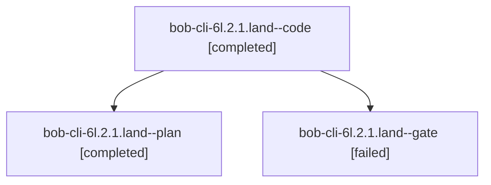

# Session: bob-cli-6l.2.1.land

[Agent Hoods](../README.md) / [bbugyi200](../users/bbugyi200/README.md) / [apollo](../users/bbugyi200/machines/apollo/README.md) / [bob-cli-6l](../users/bbugyi200/machines/apollo/hoods/bob-cli-6l/README.md) / bob-cli-6l.2.1.land

Owner: `bbugyi200.apollo` · Hood: `bob-cli-6l` · Members: 3 · Bead: [bob-cli-6l.2.1](https://github.com/bobs-org/bob-cli--beads/blob/main/pages/bob-cli-6l/bob-cli-6l.2.1.md)

## Lineage

The diagram is an optional enhancement; the ordered table below contains the same lineage in accessible text.

| Role | Agent | State | Model / provider | Timing | Commits | Prompt | Chat |
|---|---|---|---|---|---:|---|---|
| code | bob-cli-6l.2.1.land--code | completed | grok-4.6 / grok | 2026-10-11T15:30:43.317535+00:00 → 2026-10-11T16:55:22.524817+00:00 | [1](../agents/bbugyi200.apollo.bob-cli-6l.2.1.land--code/README.md#commits) | — | [Chat](../agents/bbugyi200.apollo.bob-cli-6l.2.1.land--code/chat.md) |
| plan | bob-cli-6l.2.1.land--plan | completed | opus / claude | 2026-10-11T15:05:55.158921+00:00 → 2026-10-11T16:55:22.524817+00:00 | 0 | [Prompt](../agents/bbugyi200.apollo.bob-cli-6l.2.1.land--plan/prompt.md) | [Chat](../agents/bbugyi200.apollo.bob-cli-6l.2.1.land--plan/chat.md) |
| gate | bob-cli-6l.2.1.land--gate | failed | opus / claude | 2026-10-11T15:30:14.158872+00:00 → 2026-10-11T15:30:28.541508+00:00 | 0 | — | [Chat](../agents/bbugyi200.apollo.bob-cli-6l.2.1.land--gate/chat.md) |

## Commits

| Role | Repo | Commit | Subject | Committed |
|---|---|---|---|---|
| code | bob-cli | [`625e973`](https://github.com/bobs-org/bob-cli/commit/625e973c43de2bd51b33f562af6e3cc50c90b6db) | fix(stats): land Daily Stats engine correctness for bob-cli-6l.2.1 | 2026-10-11 12:52:17 EDT |

## Neighbors

| Agent | Relation | State |
|---|---|---|
| [bob-cli-6l.2](../agents/bbugyi200.apollo.bob-cli-6l.2/README.md) | ancestor | waiting |
| [bob-cli-6l.2.1.1](../agents/bbugyi200.apollo.bob-cli-6l.2.1.1/README.md) | bob-cli-6l.2.1 hood | completed |
| [bob-cli-6l.2.1.2](bbugyi200.apollo.bob-cli-6l.2.1.2.md) (session · 3) | bob-cli-6l.2.1 hood | completed 2, failed 1 |
| [bob-cli-6l.2.1.3](../agents/bbugyi200.apollo.bob-cli-6l.2.1.3/README.md) | bob-cli-6l.2.1 hood | completed |
| [bob-cli-6l.2.1.4](bbugyi200.apollo.bob-cli-6l.2.1.4.md) (session · 3) | bob-cli-6l.2.1 hood | completed 2, failed 1 |
| [bob-cli-6l.2.1.4](../agents/bbugyi200.apollo.bob-cli-6l.2.1.4/README.md) | bob-cli-6l.2.1 hood | active |
| [bob-cli-6l.2.1.5](../agents/bbugyi200.apollo.bob-cli-6l.2.1.5/README.md) | bob-cli-6l.2.1 hood | completed |
| [bob-cli-6l.2.1.6](../agents/bbugyi200.apollo.bob-cli-6l.2.1.6/README.md) | bob-cli-6l.2.1 hood | completed |
| [bob-cli-6l.1](../agents/bbugyi200.apollo.bob-cli-6l.1/README.md) | bob-cli-6l hood | completed |
| [bob-cli-6l.3](../agents/bbugyi200.apollo.bob-cli-6l.3/README.md) | bob-cli-6l hood | completed |
| [bob-cli-6l.4](../agents/bbugyi200.apollo.bob-cli-6l.4/README.md) | bob-cli-6l hood | completed |
| [bob-cli-6l.5](bbugyi200.apollo.bob-cli-6l.5.md) (session · 3) | bob-cli-6l hood | failed 3 |
| [bob-cli-6l.5.1.1](../agents/bbugyi200.apollo.bob-cli-6l.5.1.1/README.md) | bob-cli-6l hood | completed |
| [bob-cli-6l.5.1.2](../agents/bbugyi200.apollo.bob-cli-6l.5.1.2/README.md) | bob-cli-6l hood | active |
| [bob-cli-6l.5.1.3](../agents/bbugyi200.apollo.bob-cli-6l.5.1.3/README.md) | bob-cli-6l hood | waiting |
| [bob-cli-6l.5.1.4](../agents/bbugyi200.apollo.bob-cli-6l.5.1.4/README.md) | bob-cli-6l hood | waiting |
| [bob-cli-6l.5.1.land](../agents/bbugyi200.apollo.bob-cli-6l.5.1.land/README.md) | bob-cli-6l hood | waiting |
| [bob-cli-6l.6](../agents/bbugyi200.apollo.bob-cli-6l.6/README.md) | bob-cli-6l hood | waiting |
| [bob-cli-6l.land](../agents/bbugyi200.apollo.bob-cli-6l.land/README.md) | bob-cli-6l hood | waiting |
