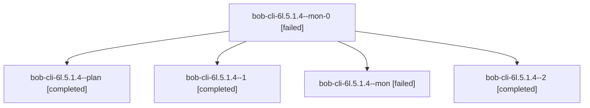

# Session: bob-cli-6l.5.1.4

[Agent Hoods](../README.md) / [bbugyi200](../users/bbugyi200/README.md) / [apollo](../users/bbugyi200/machines/apollo/README.md) / [bob-cli-6l](../users/bbugyi200/machines/apollo/hoods/bob-cli-6l/README.md) / bob-cli-6l.5.1.4

Owner: `bbugyi200.apollo` · Hood: `bob-cli-6l` · Members: 5 · Bead: [bob-cli-6l.5.1.4](https://github.com/bobs-org/bob-cli--beads/blob/main/pages/bob-cli-6l/bob-cli-6l.5.1.4.md)

## Lineage



The diagram is an optional enhancement; the ordered table below contains the same lineage in accessible text.

| Role | Agent | State | Model / provider | Timing | Commits | Prompt | Chat |
|---|---|---|---|---|---:|---|---|
| <a id="member-mon-0"></a>mon-0 | bob-cli-6l.5.1.4--mon-0 | failed | gpt-6-luna / codex | 2026-10-11T20:10:50.081332+00:00 → 2026-10-11T20:15:47.480399+00:00 | 0 | — | [Chat](../agents/bbugyi200.apollo.bob-cli-6l.5.1.4--mon-0/chat.md) |
| <a id="member-plan"></a>plan | bob-cli-6l.5.1.4--plan | completed | gpt-6-luna / codex | 2026-10-11T19:26:42.271557+00:00 → 2026-10-11T19:32:40.623072+00:00 | 0 | [Prompt](../agents/bbugyi200.apollo.bob-cli-6l.5.1.4--plan/prompt.md) | [Chat](../agents/bbugyi200.apollo.bob-cli-6l.5.1.4--plan/chat.md) |
| <a id="member-1"></a>1 | bob-cli-6l.5.1.4--1 | completed | gpt-6-luna / codex | 2026-10-11T19:34:12.467526+00:00 → 2026-10-11T20:11:51.753114+00:00 | 0 | [Prompt](../agents/bbugyi200.apollo.bob-cli-6l.5.1.4--1/prompt.md) | [Chat](../agents/bbugyi200.apollo.bob-cli-6l.5.1.4--1/chat.md) |
| <a id="member-mon"></a>mon | bob-cli-6l.5.1.4--mon | failed | gpt-6-luna / codex | 2026-10-11T19:31:34.457835+00:00 → 2026-10-11T19:34:11.282474+00:00 | 0 | — | [Chat](../agents/bbugyi200.apollo.bob-cli-6l.5.1.4--mon/chat.md) |
| <a id="member-2"></a>2 | bob-cli-6l.5.1.4--2 | completed | gpt-6-luna / codex | 2026-10-11T20:15:47.232587+00:00 → 2026-10-11T20:24:12.398583+00:00 | [1](../agents/bbugyi200.apollo.bob-cli-6l.5.1.4--2/README.md#commits) | [Prompt](../agents/bbugyi200.apollo.bob-cli-6l.5.1.4--2/prompt.md) | [Chat](../agents/bbugyi200.apollo.bob-cli-6l.5.1.4--2/chat.md) |

## Commits

| Role | Repo | Commit | Subject | Committed |
|---|---|---|---|---|
| 2 | bob-cli | [`efc5593`](https://github.com/bobs-org/bob-cli/commit/efc55932f7b055437d270d5fea37f7186ce5fd73) | docs(stats): document charts and preview workflow | 2026-10-11 16:21:19 EDT |

## Variables

| Role | Variable | Value |
|---|---|---|
| 1 | `artifacts` | \[{kind: image, label: Stats preview · 360 px · light, path: /home/bryan/.sase/artifacts/agents/gh\_bobs-org\_\_bob-cli/20261011153311/stats-360-light-47c47b16b3a1.png, ref: file:explicit:d43bb7378c605a2… |

#### artifacts

**Role:** `1`

```yaml
- kind: image
  label: Stats preview · 360 px · light
  path: /home/bryan/.sase/artifacts/agents/gh_bobs-org__bob-cli/20261011153311/stats-360-light-47c47b16b3a1.png
  ref: file:explicit:d43bb7378c605a2e0347762e
  source_path: /tmp/bob-stats-preview/stats-360-light.png
- kind: image
  label: Stats preview · 360 px · dark
  path: /home/bryan/.sase/artifacts/agents/gh_bobs-org__bob-cli/20261011153311/stats-360-dark-58e651659fc7.png
  ref: file:explicit:0f212e5aa948daabad875383
  source_path: /tmp/bob-stats-preview/stats-360-dark.png
- kind: image
  label: Stats preview · 1000 px · light
  path: /home/bryan/.sase/artifacts/agents/gh_bobs-org__bob-cli/20261011153311/stats-1000-light-85c14c374a5c.png
  ref: file:explicit:74113e3c03000eeea3adebc7
  source_path: /tmp/bob-stats-preview/stats-1000-light.png
- kind: image
  label: Stats preview · 1000 px · dark
  path: /home/bryan/.sase/artifacts/agents/gh_bobs-org__bob-cli/20261011153311/stats-1000-dark-b264c35b3803.png
  ref: file:explicit:34c79cdfd7216caeac586b8e
  source_path: /tmp/bob-stats-preview/stats-1000-dark.png
- kind: markdown
  label: Stats preview checked matrix report
  path: /home/bryan/.sase/artifacts/agents/gh_bobs-org__bob-cli/20261011153311/matrix-report-aa5d30a9bd32.md
  ref: file:explicit:43fb3347b5c0ebfef240a8f7
  source_path: /tmp/bob-stats-preview/matrix-report.md
```

Values are truncated for display; see each member's agent meta.json for the full values.

## Neighbors

| Agent | Relation | State |
|---|---|---|
| [bob-cli-6l.5](bbugyi200.apollo.bob-cli-6l.5.md) (session · 3) | ancestor | failed 3 |
| [bob-cli-6l.5.1.1](../agents/bbugyi200.apollo.bob-cli-6l.5.1.1/README.md) | bob-cli-6l.5.1 hood | completed |
| [bob-cli-6l.5.1.2](../agents/bbugyi200.apollo.bob-cli-6l.5.1.2/README.md) | bob-cli-6l.5.1 hood | completed |
| [bob-cli-6l.5.1.3](../agents/bbugyi200.apollo.bob-cli-6l.5.1.3/README.md) | bob-cli-6l.5.1 hood | completed |
| [bob-cli-6l.5.1.land](../agents/bbugyi200.apollo.bob-cli-6l.5.1.land/README.md) | bob-cli-6l.5.1 hood | completed |
| [bob-cli-6l.1](../agents/bbugyi200.apollo.bob-cli-6l.1/README.md) | bob-cli-6l hood | completed |
| [bob-cli-6l.2](bbugyi200.apollo.bob-cli-6l.2.md) (session · 3) | bob-cli-6l hood | failed 3 |
| [bob-cli-6l.2](../agents/bbugyi200.apollo.bob-cli-6l.2/README.md) | bob-cli-6l hood | waiting |
| [bob-cli-6l.2.1.1](../agents/bbugyi200.apollo.bob-cli-6l.2.1.1/README.md) | bob-cli-6l hood | completed |
| [bob-cli-6l.2.1.2](bbugyi200.apollo.bob-cli-6l.2.1.2.md) (session · 3) | bob-cli-6l hood | completed 2, failed 1 |
| [bob-cli-6l.2.1.3](../agents/bbugyi200.apollo.bob-cli-6l.2.1.3/README.md) | bob-cli-6l hood | completed |
| [bob-cli-6l.2.1.4](bbugyi200.apollo.bob-cli-6l.2.1.4.md) (session · 3) | bob-cli-6l hood | completed 2, failed 1 |
| [bob-cli-6l.2.1.4](../agents/bbugyi200.apollo.bob-cli-6l.2.1.4/README.md) | bob-cli-6l hood | active |
| [bob-cli-6l.2.1.5](../agents/bbugyi200.apollo.bob-cli-6l.2.1.5/README.md) | bob-cli-6l hood | completed |
| [bob-cli-6l.2.1.6](../agents/bbugyi200.apollo.bob-cli-6l.2.1.6/README.md) | bob-cli-6l hood | completed |
| [bob-cli-6l.2.1.land](bbugyi200.apollo.bob-cli-6l.2.1.land.md) (session · 3) | bob-cli-6l hood | completed 2, failed 1 |
| [bob-cli-6l.3](../agents/bbugyi200.apollo.bob-cli-6l.3/README.md) | bob-cli-6l hood | completed |
| [bob-cli-6l.4](../agents/bbugyi200.apollo.bob-cli-6l.4/README.md) | bob-cli-6l hood | completed |
| [bob-cli-6l.6](bbugyi200.apollo.bob-cli-6l.6.md) (session · 3) | bob-cli-6l hood | active 1, completed 1, failed 1 |
| [bob-cli-6l.land](../agents/bbugyi200.apollo.bob-cli-6l.land/README.md) | bob-cli-6l hood | waiting |
