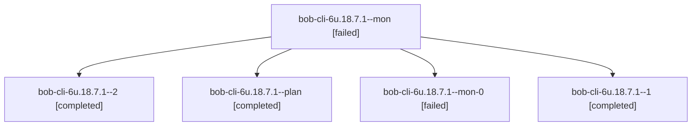

# Session: bob-cli-6u.18.7.1

[Agent Hoods](../README.md) / [bbugyi200](../users/bbugyi200/README.md) / [apollo](../users/bbugyi200/machines/apollo/README.md) / [bob-cli-6u](../users/bbugyi200/machines/apollo/hoods/bob-cli-6u/README.md) / bob-cli-6u.18.7.1

Owner: `bbugyi200.apollo` · Hood: `bob-cli-6u` · Members: 5 · Bead: [bob-cli-6u.18.7.1](https://github.com/bobs-org/bob-cli--beads/blob/main/pages/bob-cli-6u/bob-cli-6u.18.7.1.md)

## Lineage

The diagram is an optional enhancement; the ordered table below contains the same lineage in accessible text.

| Role | Agent | State | Model / provider | Timing | Commits | Prompt | Chat |
|---|---|---|---|---|---:|---|---|
| mon | bob-cli-6u.18.7.1--mon | failed | gpt-6-luna / codex | 2026-10-13T00:55:53.707123+00:00 → 2026-10-13T01:02:21.646030+00:00 | 0 | — | [Chat](../agents/bbugyi200.apollo.bob-cli-6u.18.7.1--mon/chat.md) |
| 2 | bob-cli-6u.18.7.1--2 | completed | gpt-6-luna / codex | 2026-10-13T01:11:33.583056+00:00 → 2026-10-13T01:20:03.670290+00:00 | [1](../agents/bbugyi200.apollo.bob-cli-6u.18.7.1--2/README.md#commits) | [Prompt](../agents/bbugyi200.apollo.bob-cli-6u.18.7.1--2/prompt.md) | [Chat](../agents/bbugyi200.apollo.bob-cli-6u.18.7.1--2/chat.md) |
| plan | bob-cli-6u.18.7.1--plan | completed | gpt-6-luna / codex | 2026-10-13T00:33:41.750851+00:00 → 2026-10-13T00:56:55.336111+00:00 | 0 | [Prompt](../agents/bbugyi200.apollo.bob-cli-6u.18.7.1--plan/prompt.md) | [Chat](../agents/bbugyi200.apollo.bob-cli-6u.18.7.1--plan/chat.md) |
| mon-0 | bob-cli-6u.18.7.1--mon-0 | failed | gpt-6-luna / codex | 2026-10-13T01:05:50.823729+00:00 → 2026-10-13T01:11:33.806460+00:00 | 0 | — | [Chat](../agents/bbugyi200.apollo.bob-cli-6u.18.7.1--mon-0/chat.md) |
| 1 | bob-cli-6u.18.7.1--1 | completed | gpt-6-luna / codex | 2026-10-13T01:02:21.179968+00:00 → 2026-10-13T01:06:47.054486+00:00 | 0 | [Prompt](../agents/bbugyi200.apollo.bob-cli-6u.18.7.1--1/prompt.md) | [Chat](../agents/bbugyi200.apollo.bob-cli-6u.18.7.1--1/chat.md) |

## Commits

| Role | Repo | Commit | Subject | Committed |
|---|---|---|---|---|
| 2 | bob-cli | [`d2836e0`](https://github.com/bobs-org/bob-cli/commit/d2836e0ed1a24be033ffb29772a6d4053390283f) | fix(projects): correct ^prj reconcile and sync behavior | 2026-10-12 21:18:03 EDT |

## Neighbors

| Agent | Relation | State |
|---|---|---|
| [bob-cli-6u.18.7.2](bbugyi200.apollo.bob-cli-6u.18.7.2.md) (session · 3) | bob-cli-6u.18.7 hood | completed 2, failed 1 |
| [bob-cli-6u.18.7.3](../agents/bbugyi200.apollo.bob-cli-6u.18.7.3/README.md) | bob-cli-6u.18.7 hood | completed |
| [bob-cli-6u.18.7.4](../agents/bbugyi200.apollo.bob-cli-6u.18.7.4/README.md) | bob-cli-6u.18.7 hood | completed |
| [bob-cli-6u.18.7.5](../agents/bbugyi200.apollo.bob-cli-6u.18.7.5/README.md) | bob-cli-6u.18.7 hood | completed |
| [bob-cli-6u.18.7.6.1](../agents/bbugyi200.apollo.bob-cli-6u.18.7.6.1/README.md) | bob-cli-6u.18.7 hood | completed |
| [bob-cli-6u.18.7.6.2](../agents/bbugyi200.apollo.bob-cli-6u.18.7.6.2/README.md) | bob-cli-6u.18.7 hood | completed |
| [bob-cli-6u.18.7.6.3](../agents/bbugyi200.apollo.bob-cli-6u.18.7.6.3/README.md) | bob-cli-6u.18.7 hood | completed |
| [bob-cli-6u.18.7.6.4](../agents/bbugyi200.apollo.bob-cli-6u.18.7.6.4/README.md) | bob-cli-6u.18.7 hood | completed |
| [bob-cli-6u.18.7.6.land](bbugyi200.apollo.bob-cli-6u.18.7.6.land.md) (session · 3) | bob-cli-6u.18.7 hood | active 2, failed 1 |
| [bob-cli-6u.18.7.land](bbugyi200.apollo.bob-cli-6u.18.7.land.md) (session · 3) | bob-cli-6u.18.7 hood | failed 3 |
| [bob-cli-6u.18.1](../agents/bbugyi200.apollo.bob-cli-6u.18.1/README.md) | bob-cli-6u.18 hood | completed |
| [bob-cli-6u.18.2](../agents/bbugyi200.apollo.bob-cli-6u.18.2/README.md) | bob-cli-6u.18 hood | completed |
| [bob-cli-6u.18.3](../agents/bbugyi200.apollo.bob-cli-6u.18.3/README.md) | bob-cli-6u.18 hood | completed |
| [bob-cli-6u.18.4](../agents/bbugyi200.apollo.bob-cli-6u.18.4/README.md) | bob-cli-6u.18 hood | completed |
| [bob-cli-6u.18.5](../agents/bbugyi200.apollo.bob-cli-6u.18.5/README.md) | bob-cli-6u.18 hood | completed |
| [bob-cli-6u.18.6](../agents/bbugyi200.apollo.bob-cli-6u.18.6/README.md) | bob-cli-6u.18 hood | completed |
| [bob-cli-6u.18.land](bbugyi200.apollo.bob-cli-6u.18.land.md) (session · 3) | bob-cli-6u.18 hood | failed 3 |
| [bob-cli-6u.1](../agents/bbugyi200.apollo.bob-cli-6u.1/README.md) | bob-cli-6u hood | completed |
| [bob-cli-6u.10](../agents/bbugyi200.apollo.bob-cli-6u.10/README.md) | bob-cli-6u hood | completed |
| [bob-cli-6u.11](../agents/bbugyi200.apollo.bob-cli-6u.11/README.md) | bob-cli-6u hood | completed |
| [bob-cli-6u.12](../agents/bbugyi200.apollo.bob-cli-6u.12/README.md) | bob-cli-6u hood | completed |
| [bob-cli-6u.13](../agents/bbugyi200.apollo.bob-cli-6u.13/README.md) | bob-cli-6u hood | completed |
| [bob-cli-6u.14](../agents/bbugyi200.apollo.bob-cli-6u.14/README.md) | bob-cli-6u hood | completed |
| [bob-cli-6u.15](../agents/bbugyi200.apollo.bob-cli-6u.15/README.md) | bob-cli-6u hood | completed |
| [bob-cli-6u.16](bbugyi200.apollo.bob-cli-6u.16.md) (session · 3) | bob-cli-6u hood | completed 2, failed 1 |
| [bob-cli-6u.17](bbugyi200.apollo.bob-cli-6u.17.md) (session · 3) | bob-cli-6u hood | completed 2, failed 1 |
| [bob-cli-6u.2](bbugyi200.apollo.bob-cli-6u.2.md) (session · 5) | bob-cli-6u hood | completed 3, failed 2 |
| [bob-cli-6u.3](../agents/bbugyi200.apollo.bob-cli-6u.3/README.md) | bob-cli-6u hood | completed |
| [bob-cli-6u.4](../agents/bbugyi200.apollo.bob-cli-6u.4/README.md) | bob-cli-6u hood | completed |
| [bob-cli-6u.5](bbugyi200.apollo.bob-cli-6u.5.md) (session · 3) | bob-cli-6u hood | completed 2, failed 1 |
| [bob-cli-6u.6](../agents/bbugyi200.apollo.bob-cli-6u.6/README.md) | bob-cli-6u hood | completed |
| [bob-cli-6u.7](../agents/bbugyi200.apollo.bob-cli-6u.7/README.md) | bob-cli-6u hood | completed |
| [bob-cli-6u.8](../agents/bbugyi200.apollo.bob-cli-6u.8/README.md) | bob-cli-6u hood | completed |
| [bob-cli-6u.9](bbugyi200.apollo.bob-cli-6u.9.md) (session · 6) | bob-cli-6u hood | completed 3, failed 3 |
| [bob-cli-6u.9](../agents/bbugyi200.apollo.bob-cli-6u.9/README.md) | bob-cli-6u hood | completed |
| [bob-cli-6u.land](bbugyi200.apollo.bob-cli-6u.land.md) (session · 3) | bob-cli-6u hood | failed 3 |
