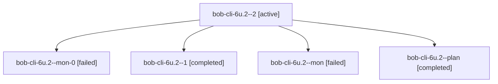

# Session: bob-cli-6u.2

[Agent Hoods](../README.md) / [bbugyi200](../users/bbugyi200/README.md) / [apollo](../users/bbugyi200/machines/apollo/README.md) / [bob-cli-6u](../users/bbugyi200/machines/apollo/hoods/bob-cli-6u/README.md) / bob-cli-6u.2

Owner: `bbugyi200.apollo` · Hood: `bob-cli-6u` · Members: 5 · Bead: [bob-cli-6u.2](https://github.com/bobs-org/bob-cli--beads/blob/main/pages/bob-cli-6u/bob-cli-6u.2.md)

## Lineage

The diagram is an optional enhancement; the ordered table below contains the same lineage in accessible text.

| Role | Agent | State | Model / provider | Timing | Commits | Prompt | Chat |
|---|---|---|---|---|---:|---|---|
| 2 | bob-cli-6u.2--2 | active | gpt-6-luna / codex | 2026-10-12T15:20:33.061581+00:00 | [1](../agents/bbugyi200.apollo.bob-cli-6u.2--2/README.md#commits) | [Prompt](../agents/bbugyi200.apollo.bob-cli-6u.2--2/prompt.md) | — |
| mon-0 | bob-cli-6u.2--mon-0 | failed | gpt-6-luna / codex | 2026-10-12T15:14:52.382090+00:00 → 2026-10-12T15:20:33.544377+00:00 | 0 | — | [Chat](../agents/bbugyi200.apollo.bob-cli-6u.2--mon-0/chat.md) |
| 1 | bob-cli-6u.2--1 | completed | gpt-6-luna / codex | 2026-10-12T15:07:20.348673+00:00 → 2026-10-12T15:15:43.200401+00:00 | 0 | [Prompt](../agents/bbugyi200.apollo.bob-cli-6u.2--1/prompt.md) | [Chat](../agents/bbugyi200.apollo.bob-cli-6u.2--1/chat.md) |
| mon | bob-cli-6u.2--mon | failed | gpt-6-luna / codex | 2026-10-12T15:00:58.215657+00:00 → 2026-10-12T15:07:20.507298+00:00 | 0 | — | [Chat](../agents/bbugyi200.apollo.bob-cli-6u.2--mon/chat.md) |
| plan | bob-cli-6u.2--plan | completed | gpt-6-luna / codex | 2026-10-12T14:54:17.643944+00:00 → 2026-10-12T15:01:50.437154+00:00 | 0 | [Prompt](../agents/bbugyi200.apollo.bob-cli-6u.2--plan/prompt.md) | [Chat](../agents/bbugyi200.apollo.bob-cli-6u.2--plan/chat.md) |

## Commits

| Role | Repo | Commit | Subject | Committed |
|---|---|---|---|---|
| 2 | bob-cli | [`f6fbd7d`](https://github.com/bobs-org/bob-cli/commit/f6fbd7ddf35e050d635f5c473ff38827458ec462) | refactor(projects): derive blocking from ^prj task line | 2026-10-12 11:22:48 EDT |

## Neighbors

| Agent | Relation | State |
|---|---|---|
| [bob-cli-6u.1](../agents/bbugyi200.apollo.bob-cli-6u.1/README.md) | bob-cli-6u hood | completed |
| [bob-cli-6u.10](../agents/bbugyi200.apollo.bob-cli-6u.10/README.md) | bob-cli-6u hood | waiting |
| [bob-cli-6u.11](../agents/bbugyi200.apollo.bob-cli-6u.11/README.md) | bob-cli-6u hood | waiting |
| [bob-cli-6u.12](../agents/bbugyi200.apollo.bob-cli-6u.12/README.md) | bob-cli-6u hood | waiting |
| [bob-cli-6u.13](../agents/bbugyi200.apollo.bob-cli-6u.13/README.md) | bob-cli-6u hood | waiting |
| [bob-cli-6u.14](../agents/bbugyi200.apollo.bob-cli-6u.14/README.md) | bob-cli-6u hood | waiting |
| [bob-cli-6u.15](../agents/bbugyi200.apollo.bob-cli-6u.15/README.md) | bob-cli-6u hood | waiting |
| [bob-cli-6u.16](../agents/bbugyi200.apollo.bob-cli-6u.16/README.md) | bob-cli-6u hood | waiting |
| [bob-cli-6u.17](../agents/bbugyi200.apollo.bob-cli-6u.17/README.md) | bob-cli-6u hood | waiting |
| [bob-cli-6u.3](../agents/bbugyi200.apollo.bob-cli-6u.3/README.md) | bob-cli-6u hood | active |
| [bob-cli-6u.4](../agents/bbugyi200.apollo.bob-cli-6u.4/README.md) | bob-cli-6u hood | waiting |
| [bob-cli-6u.5](../agents/bbugyi200.apollo.bob-cli-6u.5/README.md) | bob-cli-6u hood | waiting |
| [bob-cli-6u.6](../agents/bbugyi200.apollo.bob-cli-6u.6/README.md) | bob-cli-6u hood | waiting |
| [bob-cli-6u.7](../agents/bbugyi200.apollo.bob-cli-6u.7/README.md) | bob-cli-6u hood | waiting |
| [bob-cli-6u.8](../agents/bbugyi200.apollo.bob-cli-6u.8/README.md) | bob-cli-6u hood | waiting |
| [bob-cli-6u.9](../agents/bbugyi200.apollo.bob-cli-6u.9/README.md) | bob-cli-6u hood | waiting |
| [bob-cli-6u.land](../agents/bbugyi200.apollo.bob-cli-6u.land/README.md) | bob-cli-6u hood | waiting |
