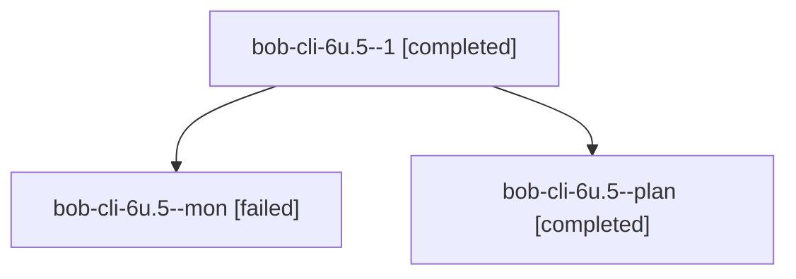

# Session: bob-cli-6u.5

[Agent Hoods](../README.md) / [bbugyi200](../users/bbugyi200/README.md) / [apollo](../users/bbugyi200/machines/apollo/README.md) / [bob-cli-6u](../users/bbugyi200/machines/apollo/hoods/bob-cli-6u/README.md) / bob-cli-6u.5

Owner: `bbugyi200.apollo` · Hood: `bob-cli-6u` · Members: 3 · Bead: [bob-cli-6u.5](https://github.com/bobs-org/bob-cli--beads/blob/main/pages/bob-cli-6u/bob-cli-6u.5.md)

## Lineage

The diagram is an optional enhancement; the ordered table below contains the same lineage in accessible text.

| Role | Agent | State | Model / provider | Timing | Commits | Prompt | Chat |
|---|---|---|---|---|---:|---|---|
| 1 | bob-cli-6u.5--1 | completed | muse-spark-1.3-contributor / muse | 2026-10-12T15:55:38.084234+00:00 → 2026-10-12T16:05:11.618542+00:00 | [1](../agents/bbugyi200.apollo.bob-cli-6u.5--1/README.md#commits) | [Prompt](../agents/bbugyi200.apollo.bob-cli-6u.5--1/prompt.md) | [Chat](../agents/bbugyi200.apollo.bob-cli-6u.5--1/chat.md) |
| mon | bob-cli-6u.5--mon | failed | muse-spark-1.3-contributor / muse | 2026-10-12T15:53:18.468957+00:00 → 2026-10-12T15:55:33.198522+00:00 | 0 | — | [Chat](../agents/bbugyi200.apollo.bob-cli-6u.5--mon/chat.md) |
| plan | bob-cli-6u.5--plan | completed | muse-spark-1.3-contributor / muse | 2026-10-12T15:25:13.227946+00:00 → 2026-10-12T15:54:15.940769+00:00 | 0 | [Prompt](../agents/bbugyi200.apollo.bob-cli-6u.5--plan/prompt.md) | [Chat](../agents/bbugyi200.apollo.bob-cli-6u.5--plan/chat.md) |

## Commits

| Role | Repo | Commit | Subject | Committed |
|---|---|---|---|---|
| 1 | bob-cli | [`34d4ab6`](https://github.com/bobs-org/bob-cli/commit/34d4ab6e8e28d20406cef9bb26668c486a740ccd) | feat(task-status): reconcile derives project blocking, maintains tag, writes \[unblocked::\] | 2026-10-12 12:03:12 EDT |

## Neighbors

| Agent | Relation | State |
|---|---|---|
| [bob-cli-6u.1](../agents/bbugyi200.apollo.bob-cli-6u.1/README.md) | bob-cli-6u hood | completed |
| [bob-cli-6u.10](../agents/bbugyi200.apollo.bob-cli-6u.10/README.md) | bob-cli-6u hood | completed |
| [bob-cli-6u.11](../agents/bbugyi200.apollo.bob-cli-6u.11/README.md) | bob-cli-6u hood | completed |
| [bob-cli-6u.12](../agents/bbugyi200.apollo.bob-cli-6u.12/README.md) | bob-cli-6u hood | completed |
| [bob-cli-6u.13](../agents/bbugyi200.apollo.bob-cli-6u.13/README.md) | bob-cli-6u hood | completed |
| [bob-cli-6u.14](../agents/bbugyi200.apollo.bob-cli-6u.14/README.md) | bob-cli-6u hood | active |
| [bob-cli-6u.15](../agents/bbugyi200.apollo.bob-cli-6u.15/README.md) | bob-cli-6u hood | completed |
| [bob-cli-6u.16](../agents/bbugyi200.apollo.bob-cli-6u.16/README.md) | bob-cli-6u hood | waiting |
| [bob-cli-6u.17](../agents/bbugyi200.apollo.bob-cli-6u.17/README.md) | bob-cli-6u hood | waiting |
| [bob-cli-6u.2](bbugyi200.apollo.bob-cli-6u.2.md) (session · 5) | bob-cli-6u hood | completed 3, failed 2 |
| [bob-cli-6u.3](../agents/bbugyi200.apollo.bob-cli-6u.3/README.md) | bob-cli-6u hood | completed |
| [bob-cli-6u.4](../agents/bbugyi200.apollo.bob-cli-6u.4/README.md) | bob-cli-6u hood | completed |
| [bob-cli-6u.6](../agents/bbugyi200.apollo.bob-cli-6u.6/README.md) | bob-cli-6u hood | completed |
| [bob-cli-6u.7](../agents/bbugyi200.apollo.bob-cli-6u.7/README.md) | bob-cli-6u hood | completed |
| [bob-cli-6u.8](../agents/bbugyi200.apollo.bob-cli-6u.8/README.md) | bob-cli-6u hood | completed |
| [bob-cli-6u.9](bbugyi200.apollo.bob-cli-6u.9.md) (session · 6) | bob-cli-6u hood | completed 3, failed 3 |
| [bob-cli-6u.9](../agents/bbugyi200.apollo.bob-cli-6u.9/README.md) | bob-cli-6u hood | active |
| [bob-cli-6u.land](../agents/bbugyi200.apollo.bob-cli-6u.land/README.md) | bob-cli-6u hood | waiting |
