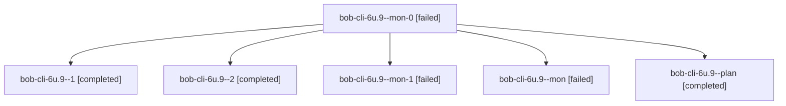

# Session: bob-cli-6u.9

[Agent Hoods](../README.md) / [bbugyi200](../users/bbugyi200/README.md) / [apollo](../users/bbugyi200/machines/apollo/README.md) / [bob-cli-6u](../users/bbugyi200/machines/apollo/hoods/bob-cli-6u/README.md) / bob-cli-6u.9

Owner: `bbugyi200.apollo` · Hood: `bob-cli-6u` · Members: 6 · Bead: [bob-cli-6u.9](https://github.com/bobs-org/bob-cli--beads/blob/main/pages/bob-cli-6u/bob-cli-6u.9.md)

## Lineage

The diagram is an optional enhancement; the ordered table below contains the same lineage in accessible text.

| Role | Agent | State | Model / provider | Timing | Commits | Prompt | Chat |
|---|---|---|---|---|---:|---|---|
| mon-0 | bob-cli-6u.9--mon-0 | failed | gpt-6-luna / codex | 2026-10-12T16:55:13.375011+00:00 → 2026-10-12T17:02:34.321090+00:00 | 0 | — | [Chat](../agents/bbugyi200.apollo.bob-cli-6u.9--mon-0/chat.md) |
| 1 | bob-cli-6u.9--1 | completed | gpt-6-luna / codex | 2026-10-12T16:51:19.607330+00:00 → 2026-10-12T16:56:11.665295+00:00 | 0 | [Prompt](../agents/bbugyi200.apollo.bob-cli-6u.9--1/prompt.md) | [Chat](../agents/bbugyi200.apollo.bob-cli-6u.9--1/chat.md) |
| 2 | bob-cli-6u.9--2 | completed | gpt-6-luna / codex | 2026-10-12T17:02:33.921087+00:00 → 2026-10-12T17:06:04.132076+00:00 | 0 | [Prompt](../agents/bbugyi200.apollo.bob-cli-6u.9--2/prompt.md) | [Chat](../agents/bbugyi200.apollo.bob-cli-6u.9--2/chat.md) |
| mon-1 | bob-cli-6u.9--mon-1 | failed | gpt-6-luna / codex | 2026-10-12T17:05:05.101686+00:00 → 2026-10-12T17:11:29.713053+00:00 | 0 | — | [Chat](../agents/bbugyi200.apollo.bob-cli-6u.9--mon-1/chat.md) |
| mon | bob-cli-6u.9--mon | failed | gpt-6-luna / codex | 2026-10-12T16:45:50.064436+00:00 → 2026-10-12T16:51:18.622608+00:00 | 0 | — | [Chat](../agents/bbugyi200.apollo.bob-cli-6u.9--mon/chat.md) |
| plan | bob-cli-6u.9--plan | completed | gpt-6-luna / codex | 2026-10-12T16:18:16.398954+00:00 → 2026-10-12T16:46:40.289087+00:00 | 0 | [Prompt](../agents/bbugyi200.apollo.bob-cli-6u.9--plan/prompt.md) | [Chat](../agents/bbugyi200.apollo.bob-cli-6u.9--plan/chat.md) |

## Neighbors

| Agent | Relation | State |
|---|---|---|
| [bob-cli-6u.1](../agents/bbugyi200.apollo.bob-cli-6u.1/README.md) | bob-cli-6u hood | completed |
| [bob-cli-6u.10](../agents/bbugyi200.apollo.bob-cli-6u.10/README.md) | bob-cli-6u hood | completed |
| [bob-cli-6u.11](../agents/bbugyi200.apollo.bob-cli-6u.11/README.md) | bob-cli-6u hood | completed |
| [bob-cli-6u.12](../agents/bbugyi200.apollo.bob-cli-6u.12/README.md) | bob-cli-6u hood | completed |
| [bob-cli-6u.13](../agents/bbugyi200.apollo.bob-cli-6u.13/README.md) | bob-cli-6u hood | completed |
| [bob-cli-6u.14](../agents/bbugyi200.apollo.bob-cli-6u.14/README.md) | bob-cli-6u hood | active |
| [bob-cli-6u.15](../agents/bbugyi200.apollo.bob-cli-6u.15/README.md) | bob-cli-6u hood | completed |
| [bob-cli-6u.16](../agents/bbugyi200.apollo.bob-cli-6u.16/README.md) | bob-cli-6u hood | waiting |
| [bob-cli-6u.17](../agents/bbugyi200.apollo.bob-cli-6u.17/README.md) | bob-cli-6u hood | waiting |
| [bob-cli-6u.2](bbugyi200.apollo.bob-cli-6u.2.md) (session · 5) | bob-cli-6u hood | completed 3, failed 2 |
| [bob-cli-6u.3](../agents/bbugyi200.apollo.bob-cli-6u.3/README.md) | bob-cli-6u hood | completed |
| [bob-cli-6u.4](../agents/bbugyi200.apollo.bob-cli-6u.4/README.md) | bob-cli-6u hood | completed |
| [bob-cli-6u.5](bbugyi200.apollo.bob-cli-6u.5.md) (session · 3) | bob-cli-6u hood | completed 2, failed 1 |
| [bob-cli-6u.6](../agents/bbugyi200.apollo.bob-cli-6u.6/README.md) | bob-cli-6u hood | completed |
| [bob-cli-6u.7](../agents/bbugyi200.apollo.bob-cli-6u.7/README.md) | bob-cli-6u hood | completed |
| [bob-cli-6u.8](../agents/bbugyi200.apollo.bob-cli-6u.8/README.md) | bob-cli-6u hood | completed |
| [bob-cli-6u.land](../agents/bbugyi200.apollo.bob-cli-6u.land/README.md) | bob-cli-6u hood | waiting |
