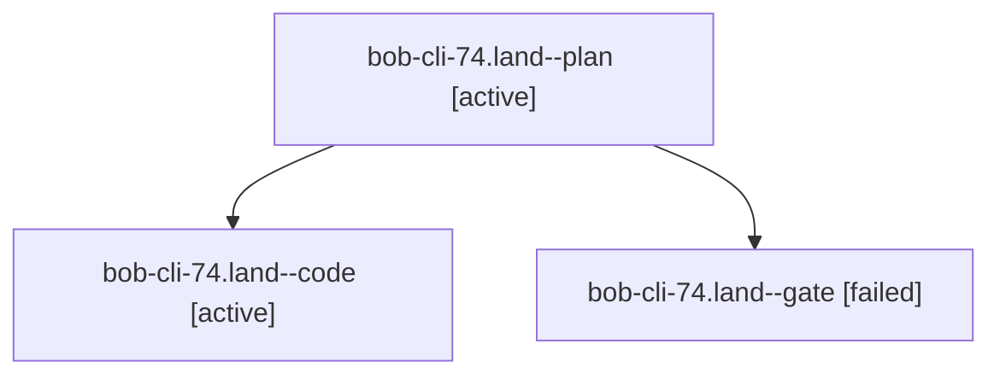

# Session: bob-cli-74.land

[Agent Hoods](../README.md) / [bbugyi200](../users/bbugyi200/README.md) / [apollo](../users/bbugyi200/machines/apollo/README.md) / [bob-cli-74](../users/bbugyi200/machines/apollo/hoods/bob-cli-74/README.md) / bob-cli-74.land

Owner: `bbugyi200.apollo` · Hood: `bob-cli-74` · Members: 3 · Bead: [bob-cli-74](https://github.com/bobs-org/bob-cli--beads/blob/main/pages/bob-cli-74/README.md)

## Lineage

The diagram is an optional enhancement; the ordered table below contains the same lineage in accessible text.

| Role | Agent | State | Model / provider | Timing | Commits | Prompt | Chat |
|---|---|---|---|---|---:|---|---|
| plan | bob-cli-74.land--plan | active | opus / claude | 2026-10-13T05:53:09.217029+00:00 | 0 | [Prompt](../agents/bbugyi200.apollo.bob-cli-74.land--plan/prompt.md) | [Chat](../agents/bbugyi200.apollo.bob-cli-74.land--plan/chat.md) |
| code | bob-cli-74.land--code | active | muse-spark-1.3-contributor / muse | 2026-10-13T06:19:34.444177+00:00 | [1](../agents/bbugyi200.apollo.bob-cli-74.land--code/README.md#commits) | — | — |
| gate | bob-cli-74.land--gate | failed | opus / claude | 2026-10-13T06:19:05.769091+00:00 → 2026-10-13T06:19:17.311090+00:00 | 0 | — | [Chat](../agents/bbugyi200.apollo.bob-cli-74.land--gate/chat.md) |

## Commits

| Role | Repo | Commit | Subject | Committed |
|---|---|---|---|---|
| code | bob-cli | [`db03ce6`](https://github.com/bobs-org/bob-cli/commit/db03ce6d2f008a85b9bd72d899792e99a0be5ffd) | fix(pull-in): land project pull-in repairs R1-R4 with tests | 2026-10-13 02:48:13 EDT |

## Neighbors

| Agent | Relation | State |
|---|---|---|
| [bob-cli-74.1](../agents/bbugyi200.apollo.bob-cli-74.1/README.md) | bob-cli-74 hood | completed |
| [bob-cli-74.2](../agents/bbugyi200.apollo.bob-cli-74.2/README.md) | bob-cli-74 hood | completed |
| [bob-cli-74.3](../agents/bbugyi200.apollo.bob-cli-74.3/README.md) | bob-cli-74 hood | completed |
| [bob-cli-74.4](../agents/bbugyi200.apollo.bob-cli-74.4/README.md) | bob-cli-74 hood | completed |
| [bob-cli-74.5](../agents/bbugyi200.apollo.bob-cli-74.5/README.md) | bob-cli-74 hood | completed |
| [bob-cli-74.6](../agents/bbugyi200.apollo.bob-cli-74.6/README.md) | bob-cli-74 hood | completed |
