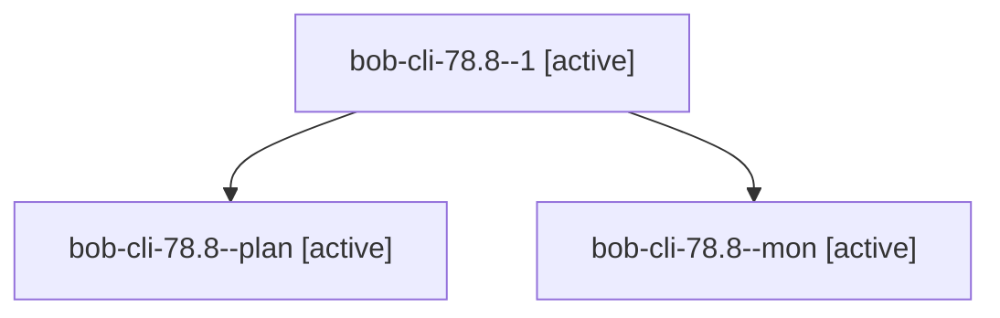

# Session: bob-cli-78.8

[Agent Hoods](../README.md) / [bbugyi200](../users/bbugyi200/README.md) / [apollo](../users/bbugyi200/machines/apollo/README.md) / [bob-cli-78](../users/bbugyi200/machines/apollo/hoods/bob-cli-78/README.md) / bob-cli-78.8

Owner: `bbugyi200.apollo` · Hood: `bob-cli-78` · Members: 3 · Bead: [bob-cli-78.8](https://github.com/bobs-org/bob-cli--beads/blob/main/pages/bob-cli-78/bob-cli-78.8.md)

## Lineage

The diagram is an optional enhancement; the ordered table below contains the same lineage in accessible text.

| Role | Agent | State | Model / provider | Timing | Commits | Prompt | Chat |
|---|---|---|---|---|---:|---|---|
| 1 | bob-cli-78.8--1 | active | gpt-6-luna / codex | 2026-10-13T10:08:30.670547+00:00 | 0 | [Prompt](../agents/bbugyi200.apollo.bob-cli-78.8--1/prompt.md) | [Chat](../agents/bbugyi200.apollo.bob-cli-78.8--1/chat.md) |
| plan | bob-cli-78.8--plan | active | gpt-6-luna / codex | 2026-10-13T09:57:44.418538+00:00 | 0 | [Prompt](../agents/bbugyi200.apollo.bob-cli-78.8--plan/prompt.md) | [Chat](../agents/bbugyi200.apollo.bob-cli-78.8--plan/chat.md) |
| mon | bob-cli-78.8--mon | active | gpt-6-luna / codex | 2026-10-13T10:06:43.310741+00:00 | 0 | — | [Chat](../agents/bbugyi200.apollo.bob-cli-78.8--mon/chat.md) |

## Neighbors

| Agent | Relation | State |
|---|---|---|
| [bob-cli-78.1](../agents/bbugyi200.apollo.bob-cli-78.1/README.md) | bob-cli-78 hood | active |
| [bob-cli-78.2](bbugyi200.apollo.bob-cli-78.2.md) (session · 3) | bob-cli-78 hood | active 3 |
| [bob-cli-78.3](../agents/bbugyi200.apollo.bob-cli-78.3/README.md) | bob-cli-78 hood | active |
| [bob-cli-78.4](../agents/bbugyi200.apollo.bob-cli-78.4/README.md) | bob-cli-78 hood | active |
| [bob-cli-78.5](../agents/bbugyi200.apollo.bob-cli-78.5/README.md) | bob-cli-78 hood | active |
| [bob-cli-78.6](../agents/bbugyi200.apollo.bob-cli-78.6/README.md) | bob-cli-78 hood | active |
| [bob-cli-78.7](../agents/bbugyi200.apollo.bob-cli-78.7/README.md) | bob-cli-78 hood | active |
| [bob-cli-78.land](bbugyi200.apollo.bob-cli-78.land.md) (session · 7) | bob-cli-78 hood | active 5, completed 1, failed 1 |
| [bob-cli-78.land](../agents/bbugyi200.apollo.bob-cli-78.land/README.md) | bob-cli-78 hood | waiting |
