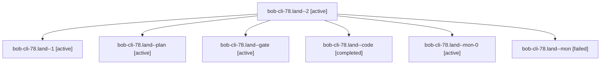

# Session: bob-cli-78.land

[Agent Hoods](../README.md) / [bbugyi200](../users/bbugyi200/README.md) / [apollo](../users/bbugyi200/machines/apollo/README.md) / [bob-cli-78](../users/bbugyi200/machines/apollo/hoods/bob-cli-78/README.md) / bob-cli-78.land

Owner: `bbugyi200.apollo` · Hood: `bob-cli-78` · Members: 7 · Bead: [bob-cli-78](https://github.com/bobs-org/bob-cli--beads/blob/main/pages/bob-cli-78/README.md)

## Lineage

The diagram is an optional enhancement; the ordered table below contains the same lineage in accessible text.

| Role | Agent | State | Model / provider | Timing | Commits | Prompt | Chat |
|---|---|---|---|---|---:|---|---|
| 2 | bob-cli-78.land--2 | active | gpt-6-luna / codex | 2026-10-13T11:01:49.685084+00:00 | 0 | [Prompt](../agents/bbugyi200.apollo.bob-cli-78.land--2/prompt.md) | — |
| 1 | bob-cli-78.land--1 | active | gpt-6-luna / codex | 2026-10-13T10:54:26.104576+00:00 | 0 | [Prompt](../agents/bbugyi200.apollo.bob-cli-78.land--1/prompt.md) | [Chat](../agents/bbugyi200.apollo.bob-cli-78.land--1/chat.md) |
| plan | bob-cli-78.land--plan | active | opus / claude | 2026-10-13T10:12:02.041157+00:00 | 0 | [Prompt](../agents/bbugyi200.apollo.bob-cli-78.land--plan/prompt.md) | [Chat](../agents/bbugyi200.apollo.bob-cli-78.land--plan/chat.md) |
| gate | bob-cli-78.land--gate | active | opus / claude | 2026-10-13T10:42:07.197557+00:00 | 0 | — | [Chat](../agents/bbugyi200.apollo.bob-cli-78.land--gate/chat.md) |
| code | bob-cli-78.land--code | completed | gpt-6-luna / codex | 2026-10-13T10:42:40.988914+00:00 → 2026-10-13T10:53:22.605988+00:00 | 0 | — | [Chat](../agents/bbugyi200.apollo.bob-cli-78.land--code/chat.md) |
| mon-0 | bob-cli-78.land--mon-0 | active | gpt-6-luna / codex | 2026-10-13T11:00:01.845477+00:00 | 0 | — | [Chat](../agents/bbugyi200.apollo.bob-cli-78.land--mon-0/chat.md) |
| mon | bob-cli-78.land--mon | failed | gpt-6-luna / codex | 2026-10-13T10:52:04.992014+00:00 → 2026-10-13T10:54:26.444706+00:00 | 0 | — | [Chat](../agents/bbugyi200.apollo.bob-cli-78.land--mon/chat.md) |

## Neighbors

| Agent | Relation | State |
|---|---|---|
| [bob-cli-78.1](../agents/bbugyi200.apollo.bob-cli-78.1/README.md) | bob-cli-78 hood | active |
| [bob-cli-78.2](bbugyi200.apollo.bob-cli-78.2.md) (session · 3) | bob-cli-78 hood | active 3 |
| [bob-cli-78.3](../agents/bbugyi200.apollo.bob-cli-78.3/README.md) | bob-cli-78 hood | active |
| [bob-cli-78.4](../agents/bbugyi200.apollo.bob-cli-78.4/README.md) | bob-cli-78 hood | active |
| [bob-cli-78.5](../agents/bbugyi200.apollo.bob-cli-78.5/README.md) | bob-cli-78 hood | active |
| [bob-cli-78.6](../agents/bbugyi200.apollo.bob-cli-78.6/README.md) | bob-cli-78 hood | active |
| [bob-cli-78.7](../agents/bbugyi200.apollo.bob-cli-78.7/README.md) | bob-cli-78 hood | active |
| [bob-cli-78.8](bbugyi200.apollo.bob-cli-78.8.md) (session · 3) | bob-cli-78 hood | active 3 |
