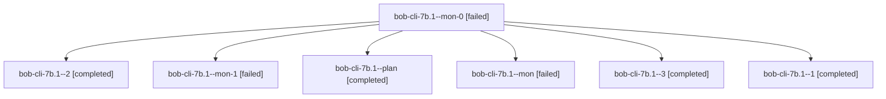

# Session: bob-cli-7b.1

[Agent Hoods](../README.md) / [bbugyi200](../users/bbugyi200/README.md) / [apollo](../users/bbugyi200/machines/apollo/README.md) / [bob-cli-7b](../users/bbugyi200/machines/apollo/hoods/bob-cli-7b/README.md) / bob-cli-7b.1

Owner: `bbugyi200.apollo` · Hood: `bob-cli-7b` · Members: 7 · Bead: [bob-cli-7b.1](https://github.com/bobs-org/bob-cli--beads/blob/main/pages/bob-cli-7b/bob-cli-7b.1.md)

## Lineage

The diagram is an optional enhancement; the ordered table below contains the same lineage in accessible text.

| Role | Agent | State | Model / provider | Timing | Commits | Prompt | Chat |
|---|---|---|---|---|---:|---|---|
| mon-0 | bob-cli-7b.1--mon-0 | failed | gpt-6-luna / codex | 2026-10-13T13:02:43.132497+00:00 → 2026-10-13T13:10:44.930885+00:00 | 0 | — | [Chat](../agents/bbugyi200.apollo.bob-cli-7b.1--mon-0/chat.md) |
| 2 | bob-cli-7b.1--2 | completed | gpt-6-luna / codex | 2026-10-13T13:10:51.706404+00:00 → 2026-10-13T13:15:17.398610+00:00 | 0 | [Prompt](../agents/bbugyi200.apollo.bob-cli-7b.1--2/prompt.md) | [Chat](../agents/bbugyi200.apollo.bob-cli-7b.1--2/chat.md) |
| mon-1 | bob-cli-7b.1--mon-1 | failed | gpt-6-luna / codex | 2026-10-13T13:14:09.241889+00:00 → 2026-10-13T13:21:10.852899+00:00 | 0 | — | [Chat](../agents/bbugyi200.apollo.bob-cli-7b.1--mon-1/chat.md) |
| plan | bob-cli-7b.1--plan | completed | gpt-6-luna / codex | 2026-10-13T12:13:25.638621+00:00 → 2026-10-13T12:47:12.313523+00:00 | 0 | [Prompt](../agents/bbugyi200.apollo.bob-cli-7b.1--plan/prompt.md) | [Chat](../agents/bbugyi200.apollo.bob-cli-7b.1--plan/chat.md) |
| mon | bob-cli-7b.1--mon | failed | gpt-6-luna / codex | 2026-10-13T12:46:10.508645+00:00 → 2026-10-13T12:52:11.646720+00:00 | 0 | — | [Chat](../agents/bbugyi200.apollo.bob-cli-7b.1--mon/chat.md) |
| 3 | bob-cli-7b.1--3 | completed | gpt-6-luna / codex | 2026-10-13T13:21:21.614856+00:00 → 2026-10-13T13:27:12.696699+00:00 | [1](../agents/bbugyi200.apollo.bob-cli-7b.1--3/README.md#commits) | [Prompt](../agents/bbugyi200.apollo.bob-cli-7b.1--3/prompt.md) | [Chat](../agents/bbugyi200.apollo.bob-cli-7b.1--3/chat.md) |
| 1 | bob-cli-7b.1--1 | completed | gpt-6-luna / codex | 2026-10-13T12:52:12.884663+00:00 → 2026-10-13T13:03:54.516566+00:00 | 0 | [Prompt](../agents/bbugyi200.apollo.bob-cli-7b.1--1/prompt.md) | [Chat](../agents/bbugyi200.apollo.bob-cli-7b.1--1/chat.md) |

## Commits

| Role | Repo | Commit | Subject | Committed |
|---|---|---|---|---|
| 3 | bob-cli | [`92515f1`](https://github.com/bobs-org/bob-cli/commit/92515f1bb8565fa7d6116e4581911b9f45e880bb) | feat(capture): support dependency-drop link gestures | 2026-10-13 09:24:19 EDT |

## Neighbors

| Agent | Relation | State |
|---|---|---|
| [bob-cli-7b.2](../agents/bbugyi200.apollo.bob-cli-7b.2/README.md) | bob-cli-7b hood | active |
| [bob-cli-7b.3](../agents/bbugyi200.apollo.bob-cli-7b.3/README.md) | bob-cli-7b hood | active |
| [bob-cli-7b.4](../agents/bbugyi200.apollo.bob-cli-7b.4/README.md) | bob-cli-7b hood | waiting |
| [bob-cli-7b.land](../agents/bbugyi200.apollo.bob-cli-7b.land/README.md) | bob-cli-7b hood | waiting |
