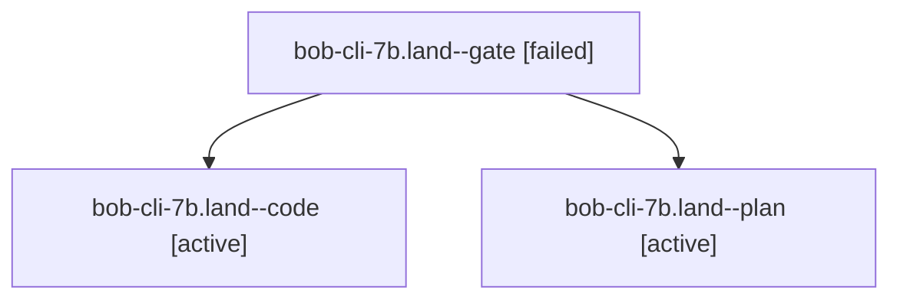

# Session: bob-cli-7b.land

[Agent Hoods](../README.md) / [bbugyi200](../users/bbugyi200/README.md) / [apollo](../users/bbugyi200/machines/apollo/README.md) / [bob-cli-7b](../users/bbugyi200/machines/apollo/hoods/bob-cli-7b/README.md) / bob-cli-7b.land

Owner: `bbugyi200.apollo` · Hood: `bob-cli-7b` · Members: 3 · Bead: [bob-cli-7b](https://github.com/bobs-org/bob-cli--beads/blob/main/pages/bob-cli-7b/README.md)

## Lineage

The diagram is an optional enhancement; the ordered table below contains the same lineage in accessible text.

| Role | Agent | State | Model / provider | Timing | Commits | Prompt | Chat |
|---|---|---|---|---|---:|---|---|
| gate | bob-cli-7b.land--gate | failed | grok-4.7 / grok | 2026-10-13T14:59:27.823574+00:00 → 2026-10-13T14:59:40.152967+00:00 | 0 | — | [Chat](../agents/bbugyi200.apollo.bob-cli-7b.land--gate/chat.md) |
| code | bob-cli-7b.land--code | active | grok-4.6 / grok | 2026-10-13T14:59:58.234249+00:00 | 0 | — | — |
| plan | bob-cli-7b.land--plan | active | grok-4.7 / grok | 2026-10-13T14:49:22.006965+00:00 | 0 | [Prompt](../agents/bbugyi200.apollo.bob-cli-7b.land--plan/prompt.md) | [Chat](../agents/bbugyi200.apollo.bob-cli-7b.land--plan/chat.md) |

## Neighbors

| Agent | Relation | State |
|---|---|---|
| [bob-cli-7b.1](bbugyi200.apollo.bob-cli-7b.1.md) (session · 7) | bob-cli-7b hood | completed 4, failed 3 |
| [bob-cli-7b.2](../agents/bbugyi200.apollo.bob-cli-7b.2/README.md) | bob-cli-7b hood | completed |
| [bob-cli-7b.3](../agents/bbugyi200.apollo.bob-cli-7b.3/README.md) | bob-cli-7b hood | completed |
| [bob-cli-7b.4](../agents/bbugyi200.apollo.bob-cli-7b.4/README.md) | bob-cli-7b hood | completed |
