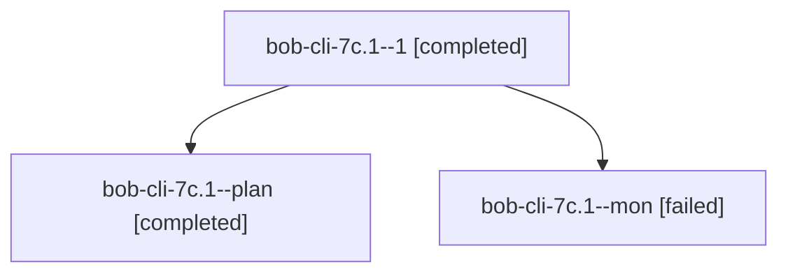

# Session: bob-cli-7c.1

[Agent Hoods](../README.md) / [bbugyi200](../users/bbugyi200/README.md) / [apollo](../users/bbugyi200/machines/apollo/README.md) / [bob-cli-7c](../users/bbugyi200/machines/apollo/hoods/bob-cli-7c/README.md) / bob-cli-7c.1

Owner: `bbugyi200.apollo` · Hood: `bob-cli-7c` · Members: 3 · Bead: [bob-cli-7c.1](https://github.com/bobs-org/bob-cli--beads/blob/main/pages/bob-cli-7c/bob-cli-7c.1.md)

## Lineage

The diagram is an optional enhancement; the ordered table below contains the same lineage in accessible text.

| Role | Agent | State | Model / provider | Timing | Commits | Prompt | Chat |
|---|---|---|---|---|---:|---|---|
| 1 | bob-cli-7c.1--1 | completed | grok-4.6 / grok | 2026-10-13T14:25:06.258917+00:00 → 2026-10-13T14:37:55.153514+00:00 | [1](../agents/bbugyi200.apollo.bob-cli-7c.1--1/README.md#commits) | [Prompt](../agents/bbugyi200.apollo.bob-cli-7c.1--1/prompt.md) | [Chat](../agents/bbugyi200.apollo.bob-cli-7c.1--1/chat.md) |
| plan | bob-cli-7c.1--plan | completed | grok-4.6 / grok | 2026-10-13T13:55:24.262297+00:00 → 2026-10-13T14:18:18.296401+00:00 | 0 | [Prompt](../agents/bbugyi200.apollo.bob-cli-7c.1--plan/prompt.md) | [Chat](../agents/bbugyi200.apollo.bob-cli-7c.1--plan/chat.md) |
| mon | bob-cli-7c.1--mon | failed | grok-4.6 / grok | 2026-10-13T14:16:03.191247+00:00 → 2026-10-13T14:24:49.606661+00:00 | 0 | — | [Chat](../agents/bbugyi200.apollo.bob-cli-7c.1--mon/chat.md) |

## Commits

| Role | Repo | Commit | Subject | Committed |
|---|---|---|---|---|
| 1 | bob-cli | [`2d1adfa`](https://github.com/bobs-org/bob-cli/commit/2d1adfa7d7c794929e8e198a013379f059e7f8fb) | docs(tasks): rewrite successor links as Successor Offers | 2026-10-13 10:35:14 EDT |

## Neighbors

| Agent | Relation | State |
|---|---|---|
| [bob-cli-7c.2](bbugyi200.apollo.bob-cli-7c.2.md) (session · 3) | bob-cli-7c hood | active 2, failed 1 |
| [bob-cli-7c.3](../agents/bbugyi200.apollo.bob-cli-7c.3/README.md) | bob-cli-7c hood | waiting |
| [bob-cli-7c.4](bbugyi200.apollo.bob-cli-7c.4.md) (session · 3) | bob-cli-7c hood | active 2, failed 1 |
| [bob-cli-7c.5](bbugyi200.apollo.bob-cli-7c.5.md) (session · 5) | bob-cli-7c hood | active 1, completed 2, failed 2 |
| [bob-cli-7c.6](../agents/bbugyi200.apollo.bob-cli-7c.6/README.md) | bob-cli-7c hood | waiting |
| [bob-cli-7c.7](../agents/bbugyi200.apollo.bob-cli-7c.7/README.md) | bob-cli-7c hood | waiting |
| [bob-cli-7c.8](../agents/bbugyi200.apollo.bob-cli-7c.8/README.md) | bob-cli-7c hood | waiting |
| [bob-cli-7c.land](../agents/bbugyi200.apollo.bob-cli-7c.land/README.md) | bob-cli-7c hood | waiting |
