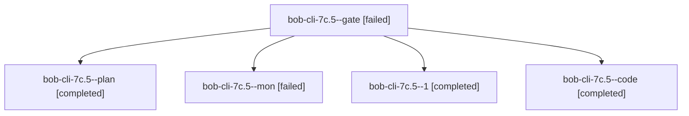

# Session: bob-cli-7c.5

[Agent Hoods](../README.md) / [bbugyi200](../users/bbugyi200/README.md) / [apollo](../users/bbugyi200/machines/apollo/README.md) / [bob-cli-7c](../users/bbugyi200/machines/apollo/hoods/bob-cli-7c/README.md) / bob-cli-7c.5

Owner: `bbugyi200.apollo` · Hood: `bob-cli-7c` · Members: 5 · Bead: [bob-cli-7c.5](https://github.com/bobs-org/bob-cli--beads/blob/main/pages/bob-cli-7c/bob-cli-7c.5.md)

## Lineage

The diagram is an optional enhancement; the ordered table below contains the same lineage in accessible text.

| Role | Agent | State | Model / provider | Timing | Commits | Prompt | Chat |
|---|---|---|---|---|---:|---|---|
| gate | bob-cli-7c.5--gate | failed | gpt-6.1-sol / codex | 2026-10-13T14:48:47.252135+00:00 → 2026-10-13T14:49:00.219064+00:00 | 0 | — | [Chat](../agents/bbugyi200.apollo.bob-cli-7c.5--gate/chat.md) |
| plan | bob-cli-7c.5--plan | completed | gpt-6.1-sol / codex | 2026-10-13T14:39:44.839797+00:00 → 2026-10-13T15:20:41.249441+00:00 | 0 | [Prompt](../agents/bbugyi200.apollo.bob-cli-7c.5--plan/prompt.md) | [Chat](../agents/bbugyi200.apollo.bob-cli-7c.5--plan/chat.md) |
| mon | bob-cli-7c.5--mon | failed | gpt-6-luna / codex | 2026-10-13T15:19:50.433380+00:00 → 2026-10-13T15:21:49.200929+00:00 | 0 | — | [Chat](../agents/bbugyi200.apollo.bob-cli-7c.5--mon/chat.md) |
| 1 | bob-cli-7c.5--1 | completed | muse-spark-1.3-contributor / muse | 2026-10-13T15:21:48.718371+00:00 → 2026-10-13T15:35:14.804777+00:00 | 0 | [Prompt](../agents/bbugyi200.apollo.bob-cli-7c.5--1/prompt.md) | [Chat](../agents/bbugyi200.apollo.bob-cli-7c.5--1/chat.md) |
| code | bob-cli-7c.5--code | completed | gpt-6-luna / codex | 2026-10-13T14:49:18.842480+00:00 → 2026-10-13T15:20:41.249441+00:00 | 0 | — | [Chat](../agents/bbugyi200.apollo.bob-cli-7c.5--code/chat.md) |

## Neighbors

| Agent | Relation | State |
|---|---|---|
| [bob-cli-7c.1](bbugyi200.apollo.bob-cli-7c.1.md) (session · 3) | bob-cli-7c hood | completed 2, failed 1 |
| [bob-cli-7c.2](bbugyi200.apollo.bob-cli-7c.2.md) (session · 7) | bob-cli-7c hood | active 1, completed 3, failed 3 |
| [bob-cli-7c.3](../agents/bbugyi200.apollo.bob-cli-7c.3/README.md) | bob-cli-7c hood | waiting |
| [bob-cli-7c.4](bbugyi200.apollo.bob-cli-7c.4.md) (session · 3) | bob-cli-7c hood | completed 2, failed 1 |
| [bob-cli-7c.6](../agents/bbugyi200.apollo.bob-cli-7c.6/README.md) | bob-cli-7c hood | completed |
| [bob-cli-7c.7](../agents/bbugyi200.apollo.bob-cli-7c.7/README.md) | bob-cli-7c hood | waiting |
| [bob-cli-7c.8](../agents/bbugyi200.apollo.bob-cli-7c.8/README.md) | bob-cli-7c hood | waiting |
| [bob-cli-7c.land](../agents/bbugyi200.apollo.bob-cli-7c.land/README.md) | bob-cli-7c hood | waiting |
