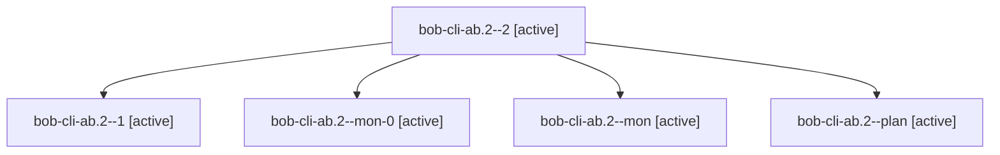

# Session: bob-cli-ab.2

[Agent Hoods](../README.md) / [bbugyi200](../users/bbugyi200/README.md) / [apollo](../users/bbugyi200/machines/apollo/README.md) / [bob-cli-ab](../users/bbugyi200/machines/apollo/hoods/bob-cli-ab/README.md) / bob-cli-ab.2

Owner: `bbugyi200.apollo` · Hood: `bob-cli-ab` · Members: 5 · Bead: [bob-cli-ab.2](https://github.com/bobs-org/bob-cli--beads/blob/main/pages/bob-cli-ab/bob-cli-ab.2.md)

## Lineage

The diagram is an optional enhancement; the ordered table below contains the same lineage in accessible text.

| Role | Agent | State | Model / provider | Timing | Commits | Prompt | Chat |
|---|---|---|---|---|---:|---|---|
| 2 | bob-cli-ab.2--2 | active | gpt-6-luna / codex | 2026-10-21T00:15:59.625708+00:00 | [1](../agents/bbugyi200.apollo.bob-cli-ab.2--2/README.md#commits) | [Prompt](../agents/bbugyi200.apollo.bob-cli-ab.2--2/prompt.md) | [Chat](../agents/bbugyi200.apollo.bob-cli-ab.2--2/chat.md) |
| 1 | bob-cli-ab.2--1 | active | gpt-6-luna / codex | 2026-10-20T23:52:41.883944+00:00 | 0 | [Prompt](../agents/bbugyi200.apollo.bob-cli-ab.2--1/prompt.md) | [Chat](../agents/bbugyi200.apollo.bob-cli-ab.2--1/chat.md) |
| mon-0 | bob-cli-ab.2--mon-0 | active | gpt-6-luna / codex | 2026-10-21T00:09:18.144333+00:00 | 0 | — | [Chat](../agents/bbugyi200.apollo.bob-cli-ab.2--mon-0/chat.md) |
| mon | bob-cli-ab.2--mon | active | gpt-6-luna / codex | 2026-10-20T23:47:57.477825+00:00 | 0 | — | [Chat](../agents/bbugyi200.apollo.bob-cli-ab.2--mon/chat.md) |
| plan | bob-cli-ab.2--plan | active | gpt-6-luna / codex | 2026-10-20T23:18:45.115176+00:00 | 0 | [Prompt](../agents/bbugyi200.apollo.bob-cli-ab.2--plan/prompt.md) | [Chat](../agents/bbugyi200.apollo.bob-cli-ab.2--plan/chat.md) |

## Commits

| Role | Repo | Commit | Subject | Committed |
|---|---|---|---|---|
| 2 | bob-cli | [`062fc3d`](https://github.com/bobs-org/bob-cli/commit/062fc3da24646166a752f264bd3acec0dd75b4c1) | feat(capture-related): add draft JSON contract | 2026-10-20 20:18:13 EDT |

## Neighbors

| Agent | Relation | State |
|---|---|---|
| [bob-cli-ab.1](../agents/bbugyi200.apollo.bob-cli-ab.1/README.md) | bob-cli-ab hood | active |
| [bob-cli-ab.3](bbugyi200.apollo.bob-cli-ab.3.md) (session · 6) | bob-cli-ab hood | active 3, completed 1, dismissed 1, failed 1 |
| [bob-cli-ab.4](bbugyi200.apollo.bob-cli-ab.4.md) (session · 3) | bob-cli-ab hood | active 3 |
| [bob-cli-ab.5](../agents/bbugyi200.apollo.bob-cli-ab.5/README.md) | bob-cli-ab hood | active |
| [bob-cli-ab.6](../agents/bbugyi200.apollo.bob-cli-ab.6/README.md) | bob-cli-ab hood | active |
| [bob-cli-ab.7](../agents/bbugyi200.apollo.bob-cli-ab.7/README.md) | bob-cli-ab hood | active |
| [bob-cli-ab.8](../agents/bbugyi200.apollo.bob-cli-ab.8/README.md) | bob-cli-ab hood | active |
| [bob-cli-ab.land](bbugyi200.apollo.bob-cli-ab.land.md) (session · 3) | bob-cli-ab hood | active 2, completed 1 |
