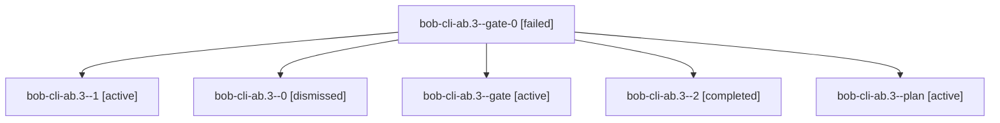

# Session: bob-cli-ab.3

[Agent Hoods](../README.md) / [bbugyi200](../users/bbugyi200/README.md) / [apollo](../users/bbugyi200/machines/apollo/README.md) / [bob-cli-ab](../users/bbugyi200/machines/apollo/hoods/bob-cli-ab/README.md) / bob-cli-ab.3

Owner: `bbugyi200.apollo` · Hood: `bob-cli-ab` · Members: 6 · Bead: [bob-cli-ab.3](https://github.com/bobs-org/bob-cli--beads/blob/main/pages/bob-cli-ab/bob-cli-ab.3.md)

## Lineage



The diagram is an optional enhancement; the ordered table below contains the same lineage in accessible text.

| Role | Agent | State | Model / provider | Timing | Commits | Prompt | Chat |
|---|---|---|---|---|---:|---|---|
| <a id="member-gate-0"></a>gate-0 | bob-cli-ab.3--gate-0 | failed | muse-spark-1.3-contributor / muse | 2026-10-21T00:53:14.223607+00:00 → 2026-10-21T00:53:23.673256+00:00 | 0 | — | [Chat](../agents/bbugyi200.apollo.bob-cli-ab.3--gate-0/chat.md) |
| <a id="member-1"></a>1 | bob-cli-ab.3--1 | active | muse-spark-1.3-contributor / muse | 2026-10-21T00:41:21.583515+00:00 | 0 | — | [Chat](../agents/bbugyi200.apollo.bob-cli-ab.3--1/chat.md) |
| <a id="member-0"></a>0 | bob-cli-ab.3--0 | dismissed | muse-spark-1.3-contributor / muse | 2026-10-20T20:20:39.704951 → 2026-10-20T20:59:28.330781 | 0 | [Prompt](../agents/bbugyi200.apollo.bob-cli-ab.3--0/prompt.md) | [Chat](../agents/bbugyi200.apollo.bob-cli-ab.3--0/chat.md) |
| <a id="member-gate"></a>gate | bob-cli-ab.3--gate | active | muse-spark-1.3-contributor / muse | 2026-10-21T00:41:00.495139+00:00 | 0 | — | [Chat](../agents/bbugyi200.apollo.bob-cli-ab.3--gate/chat.md) |
| <a id="member-2"></a>2 | bob-cli-ab.3--2 | completed | gpt-6-luna / codex | 2026-10-21T00:53:33.090994+00:00 → 2026-10-21T00:59:28.294791+00:00 | 0 | — | [Chat](../agents/bbugyi200.apollo.bob-cli-ab.3--2/chat.md) |
| <a id="member-plan"></a>plan | bob-cli-ab.3--plan | active | muse-spark-1.3-contributor / muse | 2026-10-21T00:20:39.704951+00:00 | 0 | [Prompt](../agents/bbugyi200.apollo.bob-cli-ab.3--plan/prompt.md) | [Chat](../agents/bbugyi200.apollo.bob-cli-ab.3--plan/chat.md) |

## Variables

| Role | Variable | Value |
|---|---|---|
| 0 | `artifacts` | \[{kind: markdown, label: Similar-tasks calibration report (provisional), path: /home/bryan/.sase/artifacts/agents/gh\_bobs-org\_\_bob-cli/20261020174453/calibration-d7eead99f8c6.md, ref: file:explicit:7… |
| 2 | `artifacts` | \[{bead: bob-cli-ab.3, kind: file, label: Similar-tasks calibration worksheet (100 pairs), path: /home/bryan/.sase/artifacts/agents/gh\_bobs-org\_\_bob-cli/20261020205333/calibration\_worksheet-5d04cea2ac… |
| plan | `artifacts` | \[{kind: markdown, label: Similar-tasks calibration report (provisional), path: /home/bryan/.sase/artifacts/agents/gh\_bobs-org\_\_bob-cli/20261020174453/calibration-d7eead99f8c6.md, ref: file:explicit:7… |

#### artifacts

**Role:** `0`

```yaml
- kind: markdown
  label: Similar-tasks calibration report (provisional)
  path: /home/bryan/.sase/artifacts/agents/gh_bobs-org__bob-cli/20261020174453/calibration-d7eead99f8c6.md
  ref: file:explicit:7c689c33d9c1d963d3dcd8f7
  source_path: /home/bryan/.local/state/sase/workspaces/bobs-org/bob-cli/bob-cli_14/sase/repos/research/202610/capture_similar_tasks_band/calibration.md
- kind: file
  label: Similar-tasks calibration worksheet (100 pairs)
  path: /home/bryan/.sase/artifacts/agents/gh_bobs-org__bob-cli/20261020174453/calibration_worksheet-5d04cea2acec.csv
  ref: file:explicit:c2537d2742efa6baa53ade03
  source_path: /home/bryan/.local/state/sase/workspaces/bobs-org/bob-cli/bob-cli_14/sase/repos/research/202610/capture_similar_tasks_band/calibration_worksheet.csv
```

#### artifacts

**Role:** `2`

```yaml
- bead: bob-cli-ab.3
  kind: file
  label: Similar-tasks calibration worksheet (100 pairs)
  path: /home/bryan/.sase/artifacts/agents/gh_bobs-org__bob-cli/20261020205333/calibration_worksheet-5d04cea2acec.csv
  ref: file:explicit:f1a9611f4190a723473baade
  source_path: /home/bryan/.local/state/sase/workspaces/bobs-org/bob-cli/bob-cli_14/sase/repos/research/202610/capture_similar_tasks_band/calibration_worksheet.csv
```

#### artifacts

**Role:** `plan`

```yaml
- kind: markdown
  label: Similar-tasks calibration report (provisional)
  path: /home/bryan/.sase/artifacts/agents/gh_bobs-org__bob-cli/20261020174453/calibration-d7eead99f8c6.md
  ref: file:explicit:7c689c33d9c1d963d3dcd8f7
  source_path: /home/bryan/.local/state/sase/workspaces/bobs-org/bob-cli/bob-cli_14/sase/repos/research/202610/capture_similar_tasks_band/calibration.md
- kind: file
  label: Similar-tasks calibration worksheet (100 pairs)
  path: /home/bryan/.sase/artifacts/agents/gh_bobs-org__bob-cli/20261020174453/calibration_worksheet-5d04cea2acec.csv
  ref: file:explicit:c2537d2742efa6baa53ade03
  source_path: /home/bryan/.local/state/sase/workspaces/bobs-org/bob-cli/bob-cli_14/sase/repos/research/202610/capture_similar_tasks_band/calibration_worksheet.csv
```

Values are truncated for display; see each member's agent meta.json for the full values.

## Neighbors

| Agent | Relation | State |
|---|---|---|
| [bob-cli-ab.1](../agents/bbugyi200.apollo.bob-cli-ab.1/README.md) | bob-cli-ab hood | active |
| [bob-cli-ab.2](bbugyi200.apollo.bob-cli-ab.2.md) (session · 5) | bob-cli-ab hood | active 5 |
| [bob-cli-ab.4](bbugyi200.apollo.bob-cli-ab.4.md) (session · 3) | bob-cli-ab hood | active 3 |
| [bob-cli-ab.5](../agents/bbugyi200.apollo.bob-cli-ab.5/README.md) | bob-cli-ab hood | active |
| [bob-cli-ab.6](../agents/bbugyi200.apollo.bob-cli-ab.6/README.md) | bob-cli-ab hood | active |
| [bob-cli-ab.7](../agents/bbugyi200.apollo.bob-cli-ab.7/README.md) | bob-cli-ab hood | active |
| [bob-cli-ab.8](../agents/bbugyi200.apollo.bob-cli-ab.8/README.md) | bob-cli-ab hood | active |
| [bob-cli-ab.land](bbugyi200.apollo.bob-cli-ab.land.md) (session · 3) | bob-cli-ab hood | active 2, completed 1 |
