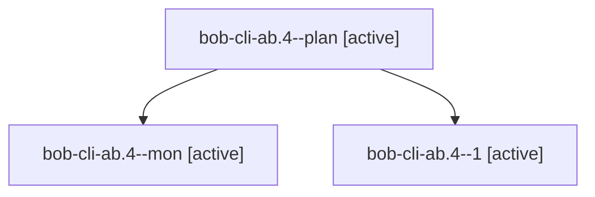

# Session: bob-cli-ab.4

[Agent Hoods](../README.md) / [bbugyi200](../users/bbugyi200/README.md) / [apollo](../users/bbugyi200/machines/apollo/README.md) / [bob-cli-ab](../users/bbugyi200/machines/apollo/hoods/bob-cli-ab/README.md) / bob-cli-ab.4

Owner: `bbugyi200.apollo` · Hood: `bob-cli-ab` · Members: 3 · Bead: [bob-cli-ab.4](https://github.com/bobs-org/bob-cli--beads/blob/main/pages/bob-cli-ab/bob-cli-ab.4.md)

## Lineage

The diagram is an optional enhancement; the ordered table below contains the same lineage in accessible text.

| Role | Agent | State | Model / provider | Timing | Commits | Prompt | Chat |
|---|---|---|---|---|---:|---|---|
| plan | bob-cli-ab.4--plan | active | gpt-6-luna / codex | 2026-10-21T00:20:47.583532+00:00 | 0 | [Prompt](../agents/bbugyi200.apollo.bob-cli-ab.4--plan/prompt.md) | [Chat](../agents/bbugyi200.apollo.bob-cli-ab.4--plan/chat.md) |
| mon | bob-cli-ab.4--mon | active | gpt-6-luna / codex | 2026-10-21T00:34:59.372277+00:00 | 0 | — | [Chat](../agents/bbugyi200.apollo.bob-cli-ab.4--mon/chat.md) |
| 1 | bob-cli-ab.4--1 | active | gpt-6-luna / codex | 2026-10-21T00:38:14.934404+00:00 | 0 | [Prompt](../agents/bbugyi200.apollo.bob-cli-ab.4--1/prompt.md) | [Chat](../agents/bbugyi200.apollo.bob-cli-ab.4--1/chat.md) |

## Neighbors

| Agent | Relation | State |
|---|---|---|
| [bob-cli-ab.1](../agents/bbugyi200.apollo.bob-cli-ab.1/README.md) | bob-cli-ab hood | active |
| [bob-cli-ab.2](bbugyi200.apollo.bob-cli-ab.2.md) (session · 5) | bob-cli-ab hood | active 5 |
| [bob-cli-ab.3](bbugyi200.apollo.bob-cli-ab.3.md) (session · 6) | bob-cli-ab hood | active 3, completed 1, dismissed 1, failed 1 |
| [bob-cli-ab.5](../agents/bbugyi200.apollo.bob-cli-ab.5/README.md) | bob-cli-ab hood | active |
| [bob-cli-ab.6](../agents/bbugyi200.apollo.bob-cli-ab.6/README.md) | bob-cli-ab hood | active |
| [bob-cli-ab.7](../agents/bbugyi200.apollo.bob-cli-ab.7/README.md) | bob-cli-ab hood | active |
| [bob-cli-ab.8](../agents/bbugyi200.apollo.bob-cli-ab.8/README.md) | bob-cli-ab hood | active |
| [bob-cli-ab.land](bbugyi200.apollo.bob-cli-ab.land.md) (session · 3) | bob-cli-ab hood | active 2, completed 1 |
