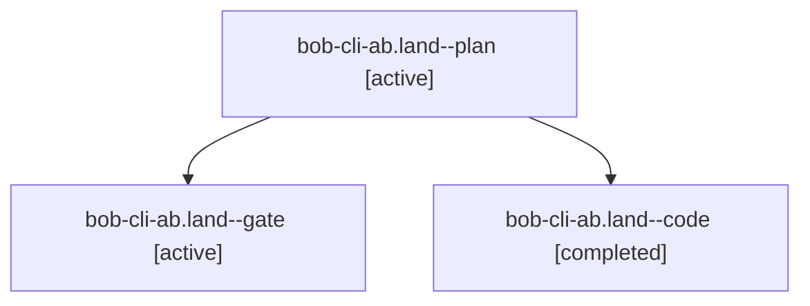

# Session: bob-cli-ab.land

[Agent Hoods](../README.md) / [bbugyi200](../users/bbugyi200/README.md) / [apollo](../users/bbugyi200/machines/apollo/README.md) / [bob-cli-ab](../users/bbugyi200/machines/apollo/hoods/bob-cli-ab/README.md) / bob-cli-ab.land

Owner: `bbugyi200.apollo` · Hood: `bob-cli-ab` · Members: 3 · Bead: [bob-cli-ab](https://github.com/bobs-org/bob-cli--beads/blob/main/pages/bob-cli-ab/README.md)

## Lineage

The diagram is an optional enhancement; the ordered table below contains the same lineage in accessible text.

| Role | Agent | State | Model / provider | Timing | Commits | Prompt | Chat |
|---|---|---|---|---|---:|---|---|
| plan | bob-cli-ab.land--plan | active | opus / claude | 2026-10-21T17:57:06.872783+00:00 | 0 | [Prompt](../agents/bbugyi200.apollo.bob-cli-ab.land--plan/prompt.md) | [Chat](../agents/bbugyi200.apollo.bob-cli-ab.land--plan/chat.md) |
| gate | bob-cli-ab.land--gate | active | opus / claude | 2026-10-21T18:20:20.060685+00:00 | 0 | — | [Chat](../agents/bbugyi200.apollo.bob-cli-ab.land--gate/chat.md) |
| code | bob-cli-ab.land--code | completed | muse-spark-1.3-contributor / muse | 2026-10-21T18:20:51.278168+00:00 → 2026-10-21T18:53:54.913919+00:00 | [1](../agents/bbugyi200.apollo.bob-cli-ab.land--code/README.md#commits) | — | [Chat](../agents/bbugyi200.apollo.bob-cli-ab.land--code/chat.md) |

## Commits

| Role | Repo | Commit | Subject | Committed |
|---|---|---|---|---|
| code | bob-cli | [`a065472`](https://github.com/bobs-org/bob-cli/commit/a0654724452cbb4b14a15d1fd2413fd8f155c2f0) | feat(capture-related): restore --exclude calibration pieces and regen docs | 2026-10-21 14:50:55 EDT |

## Neighbors

| Agent | Relation | State |
|---|---|---|
| [bob-cli-ab.1](../agents/bbugyi200.apollo.bob-cli-ab.1/README.md) | bob-cli-ab hood | active |
| [bob-cli-ab.2](bbugyi200.apollo.bob-cli-ab.2.md) (session · 5) | bob-cli-ab hood | active 5 |
| [bob-cli-ab.3](bbugyi200.apollo.bob-cli-ab.3.md) (session · 6) | bob-cli-ab hood | active 3, completed 1, dismissed 1, failed 1 |
| [bob-cli-ab.4](bbugyi200.apollo.bob-cli-ab.4.md) (session · 3) | bob-cli-ab hood | active 3 |
| [bob-cli-ab.5](../agents/bbugyi200.apollo.bob-cli-ab.5/README.md) | bob-cli-ab hood | active |
| [bob-cli-ab.6](../agents/bbugyi200.apollo.bob-cli-ab.6/README.md) | bob-cli-ab hood | active |
| [bob-cli-ab.7](../agents/bbugyi200.apollo.bob-cli-ab.7/README.md) | bob-cli-ab hood | active |
| [bob-cli-ab.8](../agents/bbugyi200.apollo.bob-cli-ab.8/README.md) | bob-cli-ab hood | active |
