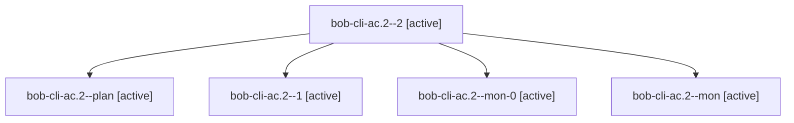

# Session: bob-cli-ac.2

[Agent Hoods](../README.md) / [bbugyi200](../users/bbugyi200/README.md) / [apollo](../users/bbugyi200/machines/apollo/README.md) / [bob-cli-ac](../users/bbugyi200/machines/apollo/hoods/bob-cli-ac/README.md) / bob-cli-ac.2

Owner: `bbugyi200.apollo` · Hood: `bob-cli-ac` · Members: 5 · Bead: [bob-cli-ac.2](https://github.com/bobs-org/bob-cli--beads/blob/main/pages/bob-cli-ac/bob-cli-ac.2.md)

## Lineage

The diagram is an optional enhancement; the ordered table below contains the same lineage in accessible text.

| Role | Agent | State | Model / provider | Timing | Commits | Prompt | Chat |
|---|---|---|---|---|---:|---|---|
| 2 | bob-cli-ac.2--2 | active | gpt-6-luna / codex | 2026-10-20T23:20:54.501119+00:00 | [1](../agents/bbugyi200.apollo.bob-cli-ac.2--2/README.md#commits) | [Prompt](../agents/bbugyi200.apollo.bob-cli-ac.2--2/prompt.md) | [Chat](../agents/bbugyi200.apollo.bob-cli-ac.2--2/chat.md) |
| plan | bob-cli-ac.2--plan | active | gpt-6-luna / codex | 2026-10-20T22:38:02.605539+00:00 | 0 | [Prompt](../agents/bbugyi200.apollo.bob-cli-ac.2--plan/prompt.md) | [Chat](../agents/bbugyi200.apollo.bob-cli-ac.2--plan/chat.md) |
| 1 | bob-cli-ac.2--1 | active | gpt-6-luna / codex | 2026-10-20T22:55:57.710405+00:00 | 0 | [Prompt](../agents/bbugyi200.apollo.bob-cli-ac.2--1/prompt.md) | [Chat](../agents/bbugyi200.apollo.bob-cli-ac.2--1/chat.md) |
| mon-0 | bob-cli-ac.2--mon-0 | active | gpt-6-luna / codex | 2026-10-20T22:59:06.749979+00:00 | 0 | — | [Chat](../agents/bbugyi200.apollo.bob-cli-ac.2--mon-0/chat.md) |
| mon | bob-cli-ac.2--mon | active | gpt-6-luna / codex | 2026-10-20T22:45:40.008383+00:00 | 0 | — | [Chat](../agents/bbugyi200.apollo.bob-cli-ac.2--mon/chat.md) |

## Commits

| Role | Repo | Commit | Subject | Committed |
|---|---|---|---|---|
| 2 | bob-cli | [`eabd291`](https://github.com/bobs-org/bob-cli/commit/eabd291506814b5b8591c7dd211201b455e73ef5) | feat(package): prepare bob-obsidian 0.2.0 release package | 2026-10-20 19:23:49 EDT |

## Neighbors

| Agent | Relation | State |
|---|---|---|
| [bob-cli-ac.1](../agents/bbugyi200.apollo.bob-cli-ac.1/README.md) | bob-cli-ac hood | active |
| [bob-cli-ac.3](bbugyi200.apollo.bob-cli-ac.3.md) (session · 13) | bob-cli-ac hood | active 13 |
| [bob-cli-ac.4](../agents/bbugyi200.apollo.bob-cli-ac.4/README.md) | bob-cli-ac hood | active |
| [bob-cli-ac.5](../agents/bbugyi200.apollo.bob-cli-ac.5/README.md) | bob-cli-ac hood | active |
| [bob-cli-ac.6](../agents/bbugyi200.apollo.bob-cli-ac.6/README.md) | bob-cli-ac hood | active |
| [bob-cli-ac.7](../agents/bbugyi200.apollo.bob-cli-ac.7/README.md) | bob-cli-ac hood | active |
| [bob-cli-ac.8](bbugyi200.apollo.bob-cli-ac.8.md) (session · 3) | bob-cli-ac hood | active 3 |
| [bob-cli-ac.land](bbugyi200.apollo.bob-cli-ac.land.md) (session · 3) | bob-cli-ac hood | active 2, completed 1 |
