# Session: bob-cli-ac.3

[Agent Hoods](../README.md) / [bbugyi200](../users/bbugyi200/README.md) / [apollo](../users/bbugyi200/machines/apollo/README.md) / [bob-cli-ac](../users/bbugyi200/machines/apollo/hoods/bob-cli-ac/README.md) / bob-cli-ac.3

Owner: `bbugyi200.apollo` · Hood: `bob-cli-ac` · Members: 13 · Bead: [bob-cli-ac.3](https://github.com/bobs-org/bob-cli--beads/blob/main/pages/bob-cli-ac/bob-cli-ac.3.md)

## Lineage

```mermaid
flowchart TD
  n0["bob-cli-ac.3--mon-2 [active]"]
  n1["bob-cli-ac.3--mon-1 [active]"]
  n0 --> n1
  n2["bob-cli-ac.3--mon-4 [active]"]
  n0 --> n2
  n3["bob-cli-ac.3--plan [active]"]
  n0 --> n3
  n4["bob-cli-ac.3--mon-0 [active]"]
  n0 --> n4
  n5["bob-cli-ac.3--1 [active]"]
  n0 --> n5
  n6["bob-cli-ac.3--mon-3 [active]"]
  n0 --> n6
  n7["bob-cli-ac.3--5 [active]"]
  n0 --> n7
  n8["bob-cli-ac.3--2 [active]"]
  n0 --> n8
  n9["bob-cli-ac.3--4 [active]"]
  n0 --> n9
  n10["bob-cli-ac.3--3 [active]"]
  n0 --> n10
  n11["bob-cli-ac.3--6 [active]"]
  n0 --> n11
  n12["bob-cli-ac.3--mon [active]"]
  n0 --> n12
```

The diagram is an optional enhancement; the ordered table below contains the same lineage in accessible text.

| Role | Agent | State | Model / provider | Timing | Commits | Prompt | Chat |
|---|---|---|---|---|---:|---|---|
| mon-2 | bob-cli-ac.3--mon-2 | active | grok-4.6 / grok | 2026-10-21T01:30:13.252604+00:00 | 0 | — | [Chat](../agents/bbugyi200.apollo.bob-cli-ac.3--mon-2/chat.md) |
| mon-1 | bob-cli-ac.3--mon-1 | active | grok-4.6 / grok | 2026-10-21T00:56:18.125421+00:00 | 0 | — | [Chat](../agents/bbugyi200.apollo.bob-cli-ac.3--mon-1/chat.md) |
| mon-4 | bob-cli-ac.3--mon-4 | active | grok-4.6 / grok | 2026-10-21T02:05:02.753442+00:00 | 0 | — | [Chat](../agents/bbugyi200.apollo.bob-cli-ac.3--mon-4/chat.md) |
| plan | bob-cli-ac.3--plan | active | grok-4.6 / grok | 2026-10-20T23:26:33.488361+00:00 | 0 | [Prompt](../agents/bbugyi200.apollo.bob-cli-ac.3--plan/prompt.md) | [Chat](../agents/bbugyi200.apollo.bob-cli-ac.3--plan/chat.md) |
| mon-0 | bob-cli-ac.3--mon-0 | active | grok-4.6 / grok | 2026-10-20T23:49:47.692660+00:00 | 0 | — | [Chat](../agents/bbugyi200.apollo.bob-cli-ac.3--mon-0/chat.md) |
| 1 | bob-cli-ac.3--1 | active | grok-4.6 / grok | 2026-10-20T23:43:58.320784+00:00 | 0 | [Prompt](../agents/bbugyi200.apollo.bob-cli-ac.3--1/prompt.md) | [Chat](../agents/bbugyi200.apollo.bob-cli-ac.3--1/chat.md) |
| mon-3 | bob-cli-ac.3--mon-3 | active | grok-4.6 / grok | 2026-10-21T01:53:35.307502+00:00 | 0 | — | [Chat](../agents/bbugyi200.apollo.bob-cli-ac.3--mon-3/chat.md) |
| 5 | bob-cli-ac.3--5 | active | grok-4.6 / grok | 2026-10-21T02:01:00.190519+00:00 | 0 | [Prompt](../agents/bbugyi200.apollo.bob-cli-ac.3--5/prompt.md) | [Chat](../agents/bbugyi200.apollo.bob-cli-ac.3--5/chat.md) |
| 2 | bob-cli-ac.3--2 | active | grok-4.6 / grok | 2026-10-21T00:35:23.418710+00:00 | 0 | [Prompt](../agents/bbugyi200.apollo.bob-cli-ac.3--2/prompt.md) | [Chat](../agents/bbugyi200.apollo.bob-cli-ac.3--2/chat.md) |
| 4 | bob-cli-ac.3--4 | active | grok-4.6 / grok | 2026-10-21T01:39:50.819806+00:00 | 0 | [Prompt](../agents/bbugyi200.apollo.bob-cli-ac.3--4/prompt.md) | [Chat](../agents/bbugyi200.apollo.bob-cli-ac.3--4/chat.md) |
| 3 | bob-cli-ac.3--3 | active | grok-4.6 / grok | 2026-10-21T01:09:36.491005+00:00 | 0 | [Prompt](../agents/bbugyi200.apollo.bob-cli-ac.3--3/prompt.md) | [Chat](../agents/bbugyi200.apollo.bob-cli-ac.3--3/chat.md) |
| 6 | bob-cli-ac.3--6 | active | grok-4.6 / grok | 2026-10-21T02:15:59.448650+00:00 | [1](../agents/bbugyi200.apollo.bob-cli-ac.3--6/README.md#commits) | [Prompt](../agents/bbugyi200.apollo.bob-cli-ac.3--6/prompt.md) | [Chat](../agents/bbugyi200.apollo.bob-cli-ac.3--6/chat.md) |
| mon | bob-cli-ac.3--mon | active | grok-4.6 / grok | 2026-10-20T23:39:20.198989+00:00 | 0 | — | [Chat](../agents/bbugyi200.apollo.bob-cli-ac.3--mon/chat.md) |

## Commits

| Role | Repo | Commit | Subject | Committed |
|---|---|---|---|---|
| 6 | bob-cli | [`1d1b8fe`](https://github.com/bobs-org/bob-cli/commit/1d1b8fec66676da163cee0180f58985f83cb99eb) | ci: add GitHub Actions workflow and fix macOS test portability | 2026-10-20 22:28:14 EDT |

## Neighbors

| Agent | Relation | State |
|---|---|---|
| [bob-cli-ac.1](../agents/bbugyi200.apollo.bob-cli-ac.1/README.md) | bob-cli-ac hood | active |
| [bob-cli-ac.2](bbugyi200.apollo.bob-cli-ac.2.md) (session · 5) | bob-cli-ac hood | active 5 |
| [bob-cli-ac.4](../agents/bbugyi200.apollo.bob-cli-ac.4/README.md) | bob-cli-ac hood | active |
| [bob-cli-ac.5](../agents/bbugyi200.apollo.bob-cli-ac.5/README.md) | bob-cli-ac hood | active |
| [bob-cli-ac.6](../agents/bbugyi200.apollo.bob-cli-ac.6/README.md) | bob-cli-ac hood | active |
| [bob-cli-ac.7](../agents/bbugyi200.apollo.bob-cli-ac.7/README.md) | bob-cli-ac hood | active |
| [bob-cli-ac.8](bbugyi200.apollo.bob-cli-ac.8.md) (session · 3) | bob-cli-ac hood | active 3 |
| [bob-cli-ac.land](bbugyi200.apollo.bob-cli-ac.land.md) (session · 3) | bob-cli-ac hood | active 2, completed 1 |
