# Session: bob-cli-ac.3

[Agent Hoods](../README.md) / [bbugyi200](../users/bbugyi200/README.md) / [apollo](../users/bbugyi200/machines/apollo/README.md) / [bob-cli-ac](../users/bbugyi200/machines/apollo/hoods/bob-cli-ac/README.md) / bob-cli-ac.3

Owner: `bbugyi200.apollo` · Hood: `bob-cli-ac` · Members: 13 · Bead: [bob-cli-ac.3](https://github.com/bobs-org/bob-cli--beads/blob/main/pages/bob-cli-ac/bob-cli-ac.3.md)

## Lineage

```mermaid
flowchart TD
  n0["bob-cli-ac.3--mon-2 [dismissed]"]
  n1["bob-cli-ac.3--mon-1 [dismissed]"]
  n0 --> n1
  n2["bob-cli-ac.3--mon-4 [dismissed]"]
  n0 --> n2
  n3["bob-cli-ac.3--plan [dismissed]"]
  n0 --> n3
  n4["bob-cli-ac.3--mon-0 [dismissed]"]
  n0 --> n4
  n5["bob-cli-ac.3--1 [dismissed]"]
  n0 --> n5
  n6["bob-cli-ac.3--mon-3 [dismissed]"]
  n0 --> n6
  n7["bob-cli-ac.3--5 [dismissed]"]
  n0 --> n7
  n8["bob-cli-ac.3--2 [dismissed]"]
  n0 --> n8
  n9["bob-cli-ac.3--4 [dismissed]"]
  n0 --> n9
  n10["bob-cli-ac.3--3 [dismissed]"]
  n0 --> n10
  n11["bob-cli-ac.3--6 [dismissed]"]
  n0 --> n11
  n12["bob-cli-ac.3--mon [dismissed]"]
  n0 --> n12
```

The diagram is an optional enhancement; the ordered table below contains the same lineage in accessible text.

| Role | Agent | State | Model / provider | Timing | Commits | Prompt | Chat |
|---|---|---|---|---|---:|---|---|
| mon-2 | bob-cli-ac.3--mon-2 | dismissed | grok-4.6 / grok | 2026-10-20T21:30:13.252604 → 2026-10-20T21:38:42.129768 | 0 | — | [Chat](../agents/bbugyi200.apollo.bob-cli-ac.3--mon-2/chat.md) |
| mon-1 | bob-cli-ac.3--mon-1 | dismissed | grok-4.6 / grok | 2026-10-20T20:56:18.125421 → 2026-10-20T21:08:27.135112 | 0 | — | [Chat](../agents/bbugyi200.apollo.bob-cli-ac.3--mon-1/chat.md) |
| mon-4 | bob-cli-ac.3--mon-4 | dismissed | grok-4.6 / grok | 2026-10-20T22:05:02.753442 → 2026-10-20T22:14:44.733709 | 0 | — | [Chat](../agents/bbugyi200.apollo.bob-cli-ac.3--mon-4/chat.md) |
| plan | bob-cli-ac.3--plan | dismissed | grok-4.6 / grok | 2026-10-20T19:26:33.488361 → 2026-10-20T19:40:28.444554 | 0 | [Prompt](../agents/bbugyi200.apollo.bob-cli-ac.3--plan/prompt.md) | [Chat](../agents/bbugyi200.apollo.bob-cli-ac.3--plan/chat.md) |
| mon-0 | bob-cli-ac.3--mon-0 | dismissed | grok-4.6 / grok | 2026-10-20T19:49:47.692660 → 2026-10-20T20:34:12.139071 | 0 | — | [Chat](../agents/bbugyi200.apollo.bob-cli-ac.3--mon-0/chat.md) |
| 1 | bob-cli-ac.3--1 | dismissed | grok-4.6 / grok | 2026-10-20T19:43:58.320784 → 2026-10-20T19:50:54.599746 | 0 | [Prompt](../agents/bbugyi200.apollo.bob-cli-ac.3--1/prompt.md) | [Chat](../agents/bbugyi200.apollo.bob-cli-ac.3--1/chat.md) |
| mon-3 | bob-cli-ac.3--mon-3 | dismissed | grok-4.6 / grok | 2026-10-20T21:53:35.307502 → 2026-10-20T21:59:44.409844 | 0 | — | [Chat](../agents/bbugyi200.apollo.bob-cli-ac.3--mon-3/chat.md) |
| 5 | bob-cli-ac.3--5 | dismissed | grok-4.6 / grok | 2026-10-20T22:01:00.190519 → 2026-10-20T22:06:05.710851 | 0 | [Prompt](../agents/bbugyi200.apollo.bob-cli-ac.3--5/prompt.md) | [Chat](../agents/bbugyi200.apollo.bob-cli-ac.3--5/chat.md) |
| 2 | bob-cli-ac.3--2 | dismissed | grok-4.6 / grok | 2026-10-20T20:35:23.418710 → 2026-10-20T20:57:20.765542 | 0 | [Prompt](../agents/bbugyi200.apollo.bob-cli-ac.3--2/prompt.md) | [Chat](../agents/bbugyi200.apollo.bob-cli-ac.3--2/chat.md) |
| 4 | bob-cli-ac.3--4 | dismissed | grok-4.6 / grok | 2026-10-20T21:39:50.819806 → 2026-10-20T21:54:38.478173 | 0 | [Prompt](../agents/bbugyi200.apollo.bob-cli-ac.3--4/prompt.md) | [Chat](../agents/bbugyi200.apollo.bob-cli-ac.3--4/chat.md) |
| 3 | bob-cli-ac.3--3 | dismissed | grok-4.6 / grok | 2026-10-20T21:09:36.491005 → 2026-10-20T21:31:16.320533 | 0 | [Prompt](../agents/bbugyi200.apollo.bob-cli-ac.3--3/prompt.md) | [Chat](../agents/bbugyi200.apollo.bob-cli-ac.3--3/chat.md) |
| 6 | bob-cli-ac.3--6 | dismissed | grok-4.6 / grok | 2026-10-20T22:15:59.448650 → 2026-10-20T22:30:14.207700 | [1](../agents/bbugyi200.apollo.bob-cli-ac.3--6/README.md#commits) | [Prompt](../agents/bbugyi200.apollo.bob-cli-ac.3--6/prompt.md) | [Chat](../agents/bbugyi200.apollo.bob-cli-ac.3--6/chat.md) |
| mon | bob-cli-ac.3--mon | dismissed | grok-4.6 / grok | 2026-10-20T19:39:20.198989 → 2026-10-20T19:42:49.276917 | 0 | — | [Chat](../agents/bbugyi200.apollo.bob-cli-ac.3--mon/chat.md) |

## Commits

| Role | Repo | Commit | Subject | Committed |
|---|---|---|---|---|
| 6 | — | `1d1b8fe` | ci: add GitHub Actions workflow and fix macOS test portability | 2026-10-20 22:28:14 EDT |

## Neighbors

| Agent | Relation | State |
|---|---|---|
| [bob-cli-ac.1](../agents/bbugyi200.apollo.bob-cli-ac.1/README.md) | bob-cli-ac hood | dismissed |
| [bob-cli-ac.2](bbugyi200.apollo.bob-cli-ac.2.md) (session · 5) | bob-cli-ac hood | dismissed 5 |
| [bob-cli-ac.4](../agents/bbugyi200.apollo.bob-cli-ac.4/README.md) | bob-cli-ac hood | dismissed |
| [bob-cli-ac.5](../agents/bbugyi200.apollo.bob-cli-ac.5/README.md) | bob-cli-ac hood | dismissed |
| [bob-cli-ac.6](../agents/bbugyi200.apollo.bob-cli-ac.6/README.md) | bob-cli-ac hood | dismissed |
| [bob-cli-ac.7](../agents/bbugyi200.apollo.bob-cli-ac.7/README.md) | bob-cli-ac hood | dismissed |
| [bob-cli-ac.8](bbugyi200.apollo.bob-cli-ac.8.md) (session · 3) | bob-cli-ac hood | dismissed 3 |
| [bob-cli-ac.land](bbugyi200.apollo.bob-cli-ac.land.md) (session · 3) | bob-cli-ac hood | completed 1, dismissed 2 |
