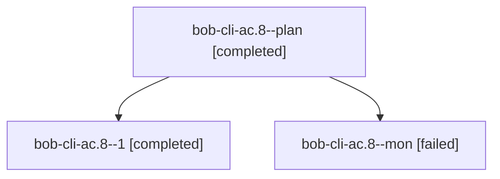

# Session: bob-cli-ac.8

[Agent Hoods](../README.md) / [bbugyi200](../users/bbugyi200/README.md) / [apollo](../users/bbugyi200/machines/apollo/README.md) / [bob-cli-ac](../users/bbugyi200/machines/apollo/hoods/bob-cli-ac/README.md) / bob-cli-ac.8

Owner: `bbugyi200.apollo` · Hood: `bob-cli-ac` · Members: 3 · Bead: [bob-cli-ac.8](https://github.com/bobs-org/bob-cli--beads/blob/main/pages/bob-cli-ac/bob-cli-ac.8.md)

## Lineage



The diagram is an optional enhancement; the ordered table below contains the same lineage in accessible text.

| Role | Agent | State | Model / provider | Timing | Commits | Prompt | Chat |
|---|---|---|---|---|---:|---|---|
| <a id="member-plan"></a>plan | bob-cli-ac.8--plan | completed | muse-spark-1.3-contributor / muse | 2026-10-21T03:45:48.665921+00:00 → 2026-10-21T03:52:02.829259+00:00 | 0 | [Prompt](../agents/bbugyi200.apollo.bob-cli-ac.8--plan/prompt.md) | [Chat](../agents/bbugyi200.apollo.bob-cli-ac.8--plan/chat.md) |
| <a id="member-1"></a>1 | bob-cli-ac.8--1 | completed | muse-spark-1.3-contributor / muse | 2026-10-21T04:03:11.813838+00:00 → 2026-10-21T04:20:42.067785+00:00 | [1](../agents/bbugyi200.apollo.bob-cli-ac.8--1/README.md#commits) | [Prompt](../agents/bbugyi200.apollo.bob-cli-ac.8--1/prompt.md) | [Chat](../agents/bbugyi200.apollo.bob-cli-ac.8--1/chat.md) |
| <a id="member-mon"></a>mon | bob-cli-ac.8--mon | failed | muse-spark-1.3-contributor / muse | 2026-10-21T03:51:02.033940+00:00 → 2026-10-21T04:03:12.316635+00:00 | 0 | — | [Chat](../agents/bbugyi200.apollo.bob-cli-ac.8--mon/chat.md) |

## Commits

| Role | Repo | Commit | Subject | Committed |
|---|---|---|---|---|
| 1 | — | `1257c2e` | ci(release): upload binaries via ref instead of unsupported tag input | 2026-10-21 00:18:44 EDT |

## Variables

| Role | Variable | Value |
|---|---|---|
| 1 | `artifacts` | \[{bead: bob-cli-ac.8, kind: markdown, label: crates-io-release-train-handoff, path: /home/bryan/.sase/artifacts/agents/gh\_bobs-org\_\_bob-cli/20261021000216/crates\_io\_release\_train\_handoff-0cb4fd793e5f… |

#### artifacts

**Role:** `1`

```yaml
- bead: bob-cli-ac.8
  kind: markdown
  label: crates-io-release-train-handoff
  path: /home/bryan/.sase/artifacts/agents/gh_bobs-org__bob-cli/20261021000216/crates_io_release_train_handoff-0cb4fd793e5f.md
  ref: file:explicit:69aedc409000fc76103efc6e
  source_path: /tmp/crates_io_release_train_handoff.md
```

Values are truncated for display; see each member's agent meta.json for the full values.

## Neighbors

| Agent | Relation | State |
|---|---|---|
| [bob-cli-ac.1](../agents/bbugyi200.apollo.bob-cli-ac.1/README.md) | bob-cli-ac hood | completed |
| [bob-cli-ac.2](bbugyi200.apollo.bob-cli-ac.2.md) (session · 5) | bob-cli-ac hood | completed 3, failed 2 |
| [bob-cli-ac.3](bbugyi200.apollo.bob-cli-ac.3.md) (session · 13) | bob-cli-ac hood | completed 7, failed 6 |
| [bob-cli-ac.4](../agents/bbugyi200.apollo.bob-cli-ac.4/README.md) | bob-cli-ac hood | completed |
| [bob-cli-ac.5](../agents/bbugyi200.apollo.bob-cli-ac.5/README.md) | bob-cli-ac hood | completed |
| [bob-cli-ac.6](../agents/bbugyi200.apollo.bob-cli-ac.6/README.md) | bob-cli-ac hood | completed |
| [bob-cli-ac.7](../agents/bbugyi200.apollo.bob-cli-ac.7/README.md) | bob-cli-ac hood | completed |
| [bob-cli-ac.land](bbugyi200.apollo.bob-cli-ac.land.md) (session · 3) | bob-cli-ac hood | completed 2, failed 1 |
