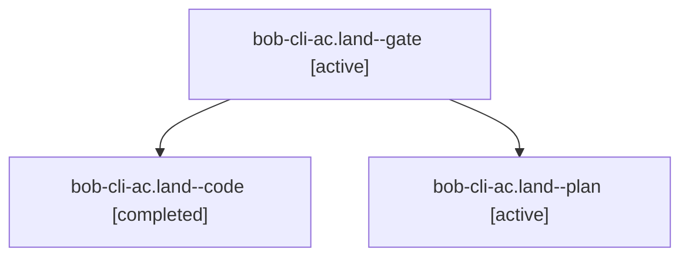

# Session: bob-cli-ac.land

[Agent Hoods](../README.md) / [bbugyi200](../users/bbugyi200/README.md) / [apollo](../users/bbugyi200/machines/apollo/README.md) / [bob-cli-ac](../users/bbugyi200/machines/apollo/hoods/bob-cli-ac/README.md) / bob-cli-ac.land

Owner: `bbugyi200.apollo` · Hood: `bob-cli-ac` · Members: 3 · Bead: [bob-cli-ac](https://github.com/bobs-org/bob-cli--beads/blob/main/pages/bob-cli-ac/README.md)

## Lineage



The diagram is an optional enhancement; the ordered table below contains the same lineage in accessible text.

| Role | Agent | State | Model / provider | Timing | Commits | Prompt | Chat |
|---|---|---|---|---|---:|---|---|
| <a id="member-gate"></a>gate | bob-cli-ac.land--gate | active | opus / claude | 2026-10-21T04:37:58.157726+00:00 | 0 | — | [Chat](../agents/bbugyi200.apollo.bob-cli-ac.land--gate/chat.md) |
| <a id="member-code"></a>code | bob-cli-ac.land--code | completed | grok-4.6 / grok | 2026-10-21T04:38:27.191342+00:00 → 2026-10-21T05:25:36.523234+00:00 | [1](../agents/bbugyi200.apollo.bob-cli-ac.land--code/README.md#commits) | — | [Chat](../agents/bbugyi200.apollo.bob-cli-ac.land--code/chat.md) |
| <a id="member-plan"></a>plan | bob-cli-ac.land--plan | active | opus / claude | 2026-10-21T04:20:51.495561+00:00 | 0 | [Prompt](../agents/bbugyi200.apollo.bob-cli-ac.land--plan/prompt.md) | [Chat](../agents/bbugyi200.apollo.bob-cli-ac.land--plan/chat.md) |

## Commits

| Role | Repo | Commit | Subject | Committed |
|---|---|---|---|---|
| code | bob-cli | [`5d212ef`](https://github.com/bobs-org/bob-cli/commit/5d212ef964b862fb9675dbe76dbd9281b87bf77d) | ci(release): fix archive names and recover v0.2.0 binaries | 2026-10-21 01:23:23 EDT |

## Variables

| Role | Variable | Value |
|---|---|---|
| code | `artifacts` | \[{bead: bob-cli-ac, kind: markdown, label: crates.io release-train handoff v2, path: /home/bryan/.sase/artifacts/agents/gh\_bobs-org\_\_bob-cli/20261021003827/crates\_io\_release\_train\_handoff\_v2-a440e026… |

#### artifacts

**Role:** `code`

```yaml
- bead: bob-cli-ac
  kind: markdown
  label: crates.io release-train handoff v2
  path: /home/bryan/.sase/artifacts/agents/gh_bobs-org__bob-cli/20261021003827/crates_io_release_train_handoff_v2-a440e0268c28.md
  ref: file:explicit:b9e52f0423806630d894e1d8
  source_path: /tmp/crates_io_release_train_handoff_v2.md
```

Values are truncated for display; see each member's agent meta.json for the full values.

## Neighbors

| Agent | Relation | State |
|---|---|---|
| [bob-cli-ac.1](../agents/bbugyi200.apollo.bob-cli-ac.1/README.md) | bob-cli-ac hood | active |
| [bob-cli-ac.2](bbugyi200.apollo.bob-cli-ac.2.md) (session · 5) | bob-cli-ac hood | active 5 |
| [bob-cli-ac.3](bbugyi200.apollo.bob-cli-ac.3.md) (session · 13) | bob-cli-ac hood | active 13 |
| [bob-cli-ac.4](../agents/bbugyi200.apollo.bob-cli-ac.4/README.md) | bob-cli-ac hood | active |
| [bob-cli-ac.5](../agents/bbugyi200.apollo.bob-cli-ac.5/README.md) | bob-cli-ac hood | active |
| [bob-cli-ac.6](../agents/bbugyi200.apollo.bob-cli-ac.6/README.md) | bob-cli-ac hood | active |
| [bob-cli-ac.7](../agents/bbugyi200.apollo.bob-cli-ac.7/README.md) | bob-cli-ac hood | active |
| [bob-cli-ac.8](bbugyi200.apollo.bob-cli-ac.8.md) (session · 3) | bob-cli-ac hood | active 3 |
