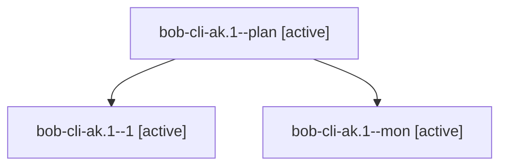

# Session: bob-cli-ak.1

[Agent Hoods](../README.md) / [bbugyi200](../users/bbugyi200/README.md) / [apollo](../users/bbugyi200/machines/apollo/README.md) / [bob-cli-ak](../users/bbugyi200/machines/apollo/hoods/bob-cli-ak/README.md) / bob-cli-ak.1

Owner: `bbugyi200.apollo` · Hood: `bob-cli-ak` · Members: 3 · Bead: [bob-cli-ak.1](https://github.com/bobs-org/bob-cli--beads/blob/main/pages/bob-cli-ak/bob-cli-ak.1.md)

## Lineage

The diagram is an optional enhancement; the ordered table below contains the same lineage in accessible text.

| Role | Agent | State | Model / provider | Timing | Commits | Prompt | Chat |
|---|---|---|---|---|---:|---|---|
| plan | bob-cli-ak.1--plan | active | gpt-6-luna / codex | 2026-10-21T12:51:14.254396+00:00 | 0 | [Prompt](../agents/bbugyi200.apollo.bob-cli-ak.1--plan/prompt.md) | [Chat](../agents/bbugyi200.apollo.bob-cli-ak.1--plan/chat.md) |
| 1 | bob-cli-ak.1--1 | active | gpt-6-luna / codex | 2026-10-21T13:07:46.955597+00:00 | [1](../agents/bbugyi200.apollo.bob-cli-ak.1--1/README.md#commits) | [Prompt](../agents/bbugyi200.apollo.bob-cli-ak.1--1/prompt.md) | [Chat](../agents/bbugyi200.apollo.bob-cli-ak.1--1/chat.md) |
| mon | bob-cli-ak.1--mon | active | gpt-6-luna / codex | 2026-10-21T13:05:23.124845+00:00 | 0 | — | — |

## Commits

| Role | Repo | Commit | Subject | Committed |
|---|---|---|---|---|
| 1 | bob-cli | [`8a4936f`](https://github.com/bobs-org/bob-cli/commit/8a4936f4879a326034aae934c392c6e332d3c067) | docs(task-tag-marks): specify PRE and POST glyph behavior | 2026-10-21 09:20:29 EDT |

## Neighbors

| Agent | Relation | State |
|---|---|---|
| [bob-cli-ak.2](../agents/bbugyi200.apollo.bob-cli-ak.2/README.md) | bob-cli-ak hood | active |
| [bob-cli-ak.3](bbugyi200.apollo.bob-cli-ak.3.md) (session · 3) | bob-cli-ak hood | active 3 |
| [bob-cli-ak.land](bbugyi200.apollo.bob-cli-ak.land.md) (session · 3) | bob-cli-ak hood | active 2, completed 1 |
