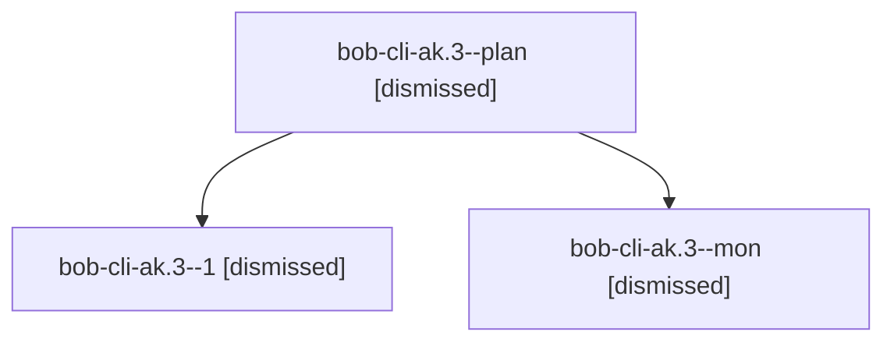

# Session: bob-cli-ak.3

[Agent Hoods](../README.md) / [bbugyi200](../users/bbugyi200/README.md) / [apollo](../users/bbugyi200/machines/apollo/README.md) / [bob-cli-ak](../users/bbugyi200/machines/apollo/hoods/bob-cli-ak/README.md) / bob-cli-ak.3

Owner: `bbugyi200.apollo` · Hood: `bob-cli-ak` · Members: 3 · Bead: [bob-cli-ak.3](https://github.com/bobs-org/bob-cli--beads/blob/main/pages/bob-cli-ak/bob-cli-ak.3.md)

## Lineage

The diagram is an optional enhancement; the ordered table below contains the same lineage in accessible text.

| Role | Agent | State | Model / provider | Timing | Commits | Prompt | Chat |
|---|---|---|---|---|---:|---|---|
| plan | bob-cli-ak.3--plan | dismissed | gpt-6-luna / codex | 2026-10-21T09:53:15.070704 → 2026-10-21T10:10:23.052030 | 0 | [Prompt](../agents/bbugyi200.apollo.bob-cli-ak.3--plan/prompt.md) | [Chat](../agents/bbugyi200.apollo.bob-cli-ak.3--plan/chat.md) |
| 1 | bob-cli-ak.3--1 | dismissed | muse-spark-1.3-contributor / muse | 2026-10-21T10:11:30.464918 → 2026-10-21T10:25:58.792225 | [1](../agents/bbugyi200.apollo.bob-cli-ak.3--1/README.md#commits) | [Prompt](../agents/bbugyi200.apollo.bob-cli-ak.3--1/prompt.md) | [Chat](../agents/bbugyi200.apollo.bob-cli-ak.3--1/chat.md) |
| mon | bob-cli-ak.3--mon | dismissed | gpt-6-luna / codex | 2026-10-21T10:09:12.244794 → 2026-10-21T10:09:42.722750 | 0 | — | — |

## Commits

| Role | Repo | Commit | Subject | Committed |
|---|---|---|---|---|
| 1 | — | `8e81f3c` | docs(date-marks): specify Tasks recurrence-mark host, guard, and RT vectors | 2026-10-21 10:23:14 EDT |

## Neighbors

| Agent | Relation | State |
|---|---|---|
| [bob-cli-ak.1](bbugyi200.apollo.bob-cli-ak.1.md) (session · 3) | bob-cli-ak hood | dismissed 3 |
| [bob-cli-ak.2](../agents/bbugyi200.apollo.bob-cli-ak.2/README.md) | bob-cli-ak hood | dismissed |
| [bob-cli-ak.land](bbugyi200.apollo.bob-cli-ak.land.md) (session · 3) | bob-cli-ak hood | completed 1, dismissed 2 |
