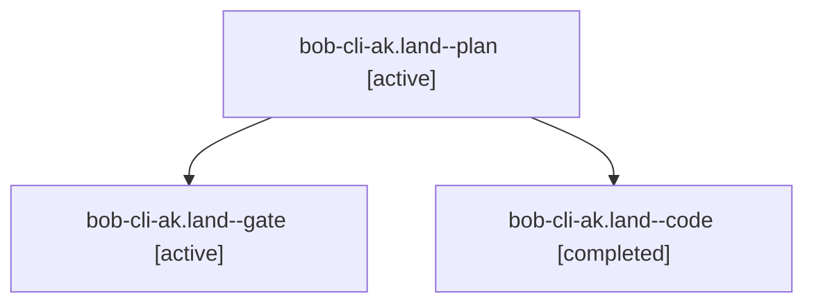

# Session: bob-cli-ak.land

[Agent Hoods](../README.md) / [bbugyi200](../users/bbugyi200/README.md) / [apollo](../users/bbugyi200/machines/apollo/README.md) / [bob-cli-ak](../users/bbugyi200/machines/apollo/hoods/bob-cli-ak/README.md) / bob-cli-ak.land

Owner: `bbugyi200.apollo` · Hood: `bob-cli-ak` · Members: 3 · Bead: [bob-cli-ak](https://github.com/bobs-org/bob-cli--beads/blob/main/pages/bob-cli-ak/README.md)

## Lineage



The diagram is an optional enhancement; the ordered table below contains the same lineage in accessible text.

| Role | Agent | State | Model / provider | Timing | Commits | Prompt | Chat |
|---|---|---|---|---|---:|---|---|
| <a id="member-plan"></a>plan | bob-cli-ak.land--plan | active | gpt-6-astra / codex | 2026-10-21T14:26:32.759767+00:00 | 0 | [Prompt](../agents/bbugyi200.apollo.bob-cli-ak.land--plan/prompt.md) | [Chat](../agents/bbugyi200.apollo.bob-cli-ak.land--plan/chat.md) |
| <a id="member-gate"></a>gate | bob-cli-ak.land--gate | active | gpt-6-astra / codex | 2026-10-21T14:38:47.960606+00:00 | 0 | — | [Chat](../agents/bbugyi200.apollo.bob-cli-ak.land--gate/chat.md) |
| <a id="member-code"></a>code | bob-cli-ak.land--code | completed | gpt-6-luna / codex | 2026-10-21T14:39:19.552043+00:00 → 2026-10-21T14:58:02.712742+00:00 | [1](../agents/bbugyi200.apollo.bob-cli-ak.land--code/README.md#commits) | — | [Chat](../agents/bbugyi200.apollo.bob-cli-ak.land--code/chat.md) |

## Commits

| Role | Repo | Commit | Subject | Committed |
|---|---|---|---|---|
| code | bob-cli | [`55470e6`](https://github.com/bobs-org/bob-cli/commit/55470e65cd25db0880253ebdffc1238c1a19959a) | docs(date-marks): clarify recurrence validation vectors | 2026-10-21 10:54:58 EDT |

## Variables

| Role | Variable | Value |
|---|---|---|
| plan | `artifacts` | \[{bead: bob-cli-ak, kind: file, label: ak recurrence landing defect reproductions, path: /home/bryan/.sase/artifacts/agents/gh\_bobs-org\_\_bob-cli/20261021085040/bob-cli-ak-repro-a1677654de24.log, ref:… |

#### artifacts

**Role:** `plan`

```yaml
- bead: bob-cli-ak
  kind: file
  label: ak recurrence landing defect reproductions
  path: /home/bryan/.sase/artifacts/agents/gh_bobs-org__bob-cli/20261021085040/bob-cli-ak-repro-a1677654de24.log
  ref: file:explicit:17290fc9a7bd57a9561ab5c3
  source_path: /tmp/bob-cli-ak-repro.log
- bead: bob-cli-ak
  kind: file
  label: ak focused mark regression baseline
  path: /home/bryan/.sase/artifacts/agents/gh_bobs-org__bob-cli/20261021085040/bob-cli-ak-focused-427bb13bc458.log
  ref: file:explicit:ae784b01fc84d2cbb42ff449
  source_path: /tmp/bob-cli-ak-focused.log
- bead: bob-cli-ak
  kind: file
  label: ak full plugin suite baseline
  path: /home/bryan/.sase/artifacts/agents/gh_bobs-org__bob-cli/20261021085040/bob-cli-ak-npm-9257d0852741.log
  ref: file:explicit:d5d1a0b22b67564637f53139
  source_path: /tmp/bob-cli-ak-npm.log
```

Values are truncated for display; see each member's agent meta.json for the full values.

## Neighbors

| Agent | Relation | State |
|---|---|---|
| [bob-cli-ak.1](bbugyi200.apollo.bob-cli-ak.1.md) (session · 3) | bob-cli-ak hood | active 3 |
| [bob-cli-ak.2](../agents/bbugyi200.apollo.bob-cli-ak.2/README.md) | bob-cli-ak hood | active |
| [bob-cli-ak.3](bbugyi200.apollo.bob-cli-ak.3.md) (session · 3) | bob-cli-ak hood | active 3 |
