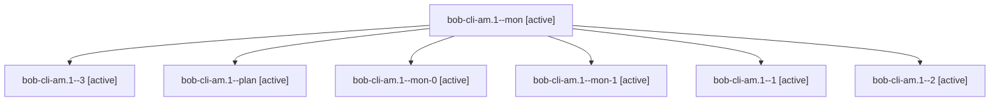

# Session: bob-cli-am.1

[Agent Hoods](../README.md) / [bbugyi200](../users/bbugyi200/README.md) / [apollo](../users/bbugyi200/machines/apollo/README.md) / [bob-cli-am](../users/bbugyi200/machines/apollo/hoods/bob-cli-am/README.md) / bob-cli-am.1

Owner: `bbugyi200.apollo` · Hood: `bob-cli-am` · Members: 7 · Bead: [bob-cli-am.1](https://github.com/bobs-org/bob-cli--beads/blob/main/pages/bob-cli-am/bob-cli-am.1.md)

## Lineage

The diagram is an optional enhancement; the ordered table below contains the same lineage in accessible text.

| Role | Agent | State | Model / provider | Timing | Commits | Prompt | Chat |
|---|---|---|---|---|---:|---|---|
| mon | bob-cli-am.1--mon | active | gpt-6-luna / codex | 2026-10-21T14:25:10.907874+00:00 | 0 | — | [Chat](../agents/bbugyi200.apollo.bob-cli-am.1--mon/chat.md) |
| 3 | bob-cli-am.1--3 | active | gpt-6-luna / codex | 2026-10-21T14:53:31.706800+00:00 | [1](../agents/bbugyi200.apollo.bob-cli-am.1--3/README.md#commits) | [Prompt](../agents/bbugyi200.apollo.bob-cli-am.1--3/prompt.md) | [Chat](../agents/bbugyi200.apollo.bob-cli-am.1--3/chat.md) |
| plan | bob-cli-am.1--plan | active | gpt-6-luna / codex | 2026-10-21T14:10:06.754231+00:00 | 0 | [Prompt](../agents/bbugyi200.apollo.bob-cli-am.1--plan/prompt.md) | [Chat](../agents/bbugyi200.apollo.bob-cli-am.1--plan/chat.md) |
| mon-0 | bob-cli-am.1--mon-0 | active | gpt-6-luna / codex | 2026-10-21T14:33:38.795881+00:00 | 0 | — | [Chat](../agents/bbugyi200.apollo.bob-cli-am.1--mon-0/chat.md) |
| mon-1 | bob-cli-am.1--mon-1 | active | gpt-6-luna / codex | 2026-10-21T14:44:48.626762+00:00 | 0 | — | [Chat](../agents/bbugyi200.apollo.bob-cli-am.1--mon-1/chat.md) |
| 1 | bob-cli-am.1--1 | active | gpt-6-luna / codex | 2026-10-21T14:28:11.788752+00:00 | 0 | [Prompt](../agents/bbugyi200.apollo.bob-cli-am.1--1/prompt.md) | [Chat](../agents/bbugyi200.apollo.bob-cli-am.1--1/chat.md) |
| 2 | bob-cli-am.1--2 | active | gpt-6-luna / codex | 2026-10-21T14:42:05.899268+00:00 | 0 | [Prompt](../agents/bbugyi200.apollo.bob-cli-am.1--2/prompt.md) | [Chat](../agents/bbugyi200.apollo.bob-cli-am.1--2/chat.md) |

## Commits

| Role | Repo | Commit | Subject | Committed |
|---|---|---|---|---|
| 3 | bob-cli | [`39e1d48`](https://github.com/bobs-org/bob-cli/commit/39e1d48aa312ce14cc6016abebb83be48a525034) | docs(relations): define pair contract and glossary | 2026-10-21 10:55:36 EDT |

## Neighbors

| Agent | Relation | State |
|---|---|---|
| [bob-cli-am.2](../agents/bbugyi200.apollo.bob-cli-am.2/README.md) | bob-cli-am hood | active |
| [bob-cli-am.3](../agents/bbugyi200.apollo.bob-cli-am.3/README.md) | bob-cli-am hood | active |
| [bob-cli-am.4](../agents/bbugyi200.apollo.bob-cli-am.4/README.md) | bob-cli-am hood | active |
| [bob-cli-am.5](../agents/bbugyi200.apollo.bob-cli-am.5/README.md) | bob-cli-am hood | active |
| [bob-cli-am.6](../agents/bbugyi200.apollo.bob-cli-am.6/README.md) | bob-cli-am hood | active |
| [bob-cli-am.7](../agents/bbugyi200.apollo.bob-cli-am.7/README.md) | bob-cli-am hood | active |
| [bob-cli-am.8](../agents/bbugyi200.apollo.bob-cli-am.8/README.md) | bob-cli-am hood | active |
| [bob-cli-am.land](../agents/bbugyi200.apollo.bob-cli-am.land/README.md) | bob-cli-am hood | active |
