# Session: bob-cli-bc.5

[Agent Hoods](../README.md) / [bbugyi200](../users/bbugyi200/README.md) / [apollo](../users/bbugyi200/machines/apollo/README.md) / [bob-cli-bc](../users/bbugyi200/machines/apollo/hoods/bob-cli-bc/README.md) / bob-cli-bc.5

Owner: `bbugyi200.apollo` · Hood: `bob-cli-bc` · Members: 13 · Bead: [bob-cli-bc.5](https://github.com/bobs-org/bob-cli--beads/blob/main/pages/bob-cli-bc/bob-cli-bc.5.md)

## Lineage

```mermaid
flowchart TD
  n0["bob-cli-bc.5--plan [active]"]
  n1["bob-cli-bc.5--mon [active]"]
  n0 --> n1
  n2["bob-cli-bc.5--5 [active]"]
  n0 --> n2
  n3["bob-cli-bc.5--mon-3 [active]"]
  n0 --> n3
  n4["bob-cli-bc.5--4 [active]"]
  n0 --> n4
  n5["bob-cli-bc.5--1 [active]"]
  n0 --> n5
  n6["bob-cli-bc.5--3 [active]"]
  n0 --> n6
  n7["bob-cli-bc.5--mon-2 [active]"]
  n0 --> n7
  n8["bob-cli-bc.5--mon-0 [active]"]
  n0 --> n8
  n9["bob-cli-bc.5--2 [active]"]
  n0 --> n9
  n10["bob-cli-bc.5--mon-4 [active]"]
  n0 --> n10
  n11["bob-cli-bc.5--6 [active]"]
  n0 --> n11
  n12["bob-cli-bc.5--mon-1 [active]"]
  n0 --> n12
```

The diagram is an optional enhancement; the ordered table below contains the same lineage in accessible text.

| Role | Agent | State | Model / provider | Timing | Commits | Prompt | Chat |
|---|---|---|---|---|---:|---|---|
| plan | bob-cli-bc.5--plan | active | gpt-6-luna / codex | 2026-10-24T13:41:21.260121+00:00 | 0 | [Prompt](../agents/bbugyi200.apollo.bob-cli-bc.5--plan/prompt.md) | [Chat](../agents/bbugyi200.apollo.bob-cli-bc.5--plan/chat.md) |
| mon | bob-cli-bc.5--mon | active | gpt-6-luna / codex | 2026-10-24T14:03:04.875768+00:00 | 0 | — | [Chat](../agents/bbugyi200.apollo.bob-cli-bc.5--mon/chat.md) |
| 5 | bob-cli-bc.5--5 | active | gpt-6-luna / codex | 2026-10-24T15:19:06.966203+00:00 | 0 | [Prompt](../agents/bbugyi200.apollo.bob-cli-bc.5--5/prompt.md) | [Chat](../agents/bbugyi200.apollo.bob-cli-bc.5--5/chat.md) |
| mon-3 | bob-cli-bc.5--mon-3 | active | gpt-6-luna / codex | 2026-10-24T15:12:35.903765+00:00 | 0 | — | [Chat](../agents/bbugyi200.apollo.bob-cli-bc.5--mon-3/chat.md) |
| 4 | bob-cli-bc.5--4 | active | gpt-6-luna / codex | 2026-10-24T15:03:05.603691+00:00 | 0 | [Prompt](../agents/bbugyi200.apollo.bob-cli-bc.5--4/prompt.md) | [Chat](../agents/bbugyi200.apollo.bob-cli-bc.5--4/chat.md) |
| 1 | bob-cli-bc.5--1 | active | gpt-6-luna / codex | 2026-10-24T14:08:37.566736+00:00 | 0 | [Prompt](../agents/bbugyi200.apollo.bob-cli-bc.5--1/prompt.md) | [Chat](../agents/bbugyi200.apollo.bob-cli-bc.5--1/chat.md) |
| 3 | bob-cli-bc.5--3 | active | gpt-6-luna / codex | 2026-10-24T14:51:24.344878+00:00 | 0 | [Prompt](../agents/bbugyi200.apollo.bob-cli-bc.5--3/prompt.md) | [Chat](../agents/bbugyi200.apollo.bob-cli-bc.5--3/chat.md) |
| mon-2 | bob-cli-bc.5--mon-2 | active | gpt-6-luna / codex | 2026-10-24T14:57:58.882114+00:00 | 0 | — | [Chat](../agents/bbugyi200.apollo.bob-cli-bc.5--mon-2/chat.md) |
| mon-0 | bob-cli-bc.5--mon-0 | active | gpt-6-luna / codex | 2026-10-24T14:17:07.129157+00:00 | 0 | — | [Chat](../agents/bbugyi200.apollo.bob-cli-bc.5--mon-0/chat.md) |
| 2 | bob-cli-bc.5--2 | active | gpt-6-luna / codex | 2026-10-24T14:20:41.387419+00:00 | 0 | [Prompt](../agents/bbugyi200.apollo.bob-cli-bc.5--2/prompt.md) | [Chat](../agents/bbugyi200.apollo.bob-cli-bc.5--2/chat.md) |
| mon-4 | bob-cli-bc.5--mon-4 | active | gpt-6-luna / codex | 2026-10-24T15:21:00.556149+00:00 | 0 | — | [Chat](../agents/bbugyi200.apollo.bob-cli-bc.5--mon-4/chat.md) |
| 6 | bob-cli-bc.5--6 | active | muse-spark-1.3-contributor / muse | 2026-10-24T15:28:57.383164+00:00 | [1](../agents/bbugyi200.apollo.bob-cli-bc.5--6/README.md#commits) | [Prompt](../agents/bbugyi200.apollo.bob-cli-bc.5--6/prompt.md) | [Chat](../agents/bbugyi200.apollo.bob-cli-bc.5--6/chat.md) |
| mon-1 | bob-cli-bc.5--mon-1 | active | gpt-6-luna / codex | 2026-10-24T14:43:43.972468+00:00 | 0 | — | [Chat](../agents/bbugyi200.apollo.bob-cli-bc.5--mon-1/chat.md) |

## Commits

| Role | Repo | Commit | Subject | Committed |
|---|---|---|---|---|
| 6 | bob-cli | [`8628ce2`](https://github.com/bobs-org/bob-cli/commit/8628ce2f7acdf9a27f4d8ba1c6117638afe34371) | feat(themes): add theme refs to capture-parse spans, agenda, plan, stats and capture output plus CLI and tmux swatches | 2026-10-24 11:56:30 EDT |

## Neighbors

| Agent | Relation | State |
|---|---|---|
| [bob-cli-bc.1](../agents/bbugyi200.apollo.bob-cli-bc.1/README.md) | bob-cli-bc hood | active |
| [bob-cli-bc.10](../agents/bbugyi200.apollo.bob-cli-bc.10/README.md) | bob-cli-bc hood | active |
| [bob-cli-bc.11](../agents/bbugyi200.apollo.bob-cli-bc.11/README.md) | bob-cli-bc hood | active |
| [bob-cli-bc.12](../agents/bbugyi200.apollo.bob-cli-bc.12/README.md) | bob-cli-bc hood | active |
| [bob-cli-bc.13](../agents/bbugyi200.apollo.bob-cli-bc.13/README.md) | bob-cli-bc hood | active |
| [bob-cli-bc.2](../agents/bbugyi200.apollo.bob-cli-bc.2/README.md) | bob-cli-bc hood | active |
| [bob-cli-bc.3](../agents/bbugyi200.apollo.bob-cli-bc.3/README.md) | bob-cli-bc hood | active |
| [bob-cli-bc.4](../agents/bbugyi200.apollo.bob-cli-bc.4/README.md) | bob-cli-bc hood | active |
| [bob-cli-bc.6](../agents/bbugyi200.apollo.bob-cli-bc.6/README.md) | bob-cli-bc hood | active |
| [bob-cli-bc.7](bbugyi200.apollo.bob-cli-bc.7.md) (session · 3) | bob-cli-bc hood | active 3 |
| [bob-cli-bc.8](../agents/bbugyi200.apollo.bob-cli-bc.8/README.md) | bob-cli-bc hood | active |
| [bob-cli-bc.9](../agents/bbugyi200.apollo.bob-cli-bc.9/README.md) | bob-cli-bc hood | active |
| [bob-cli-bc.land](bbugyi200.apollo.bob-cli-bc.land.md) (session · 7) | bob-cli-bc hood | active 5, completed 1, failed 1 |
