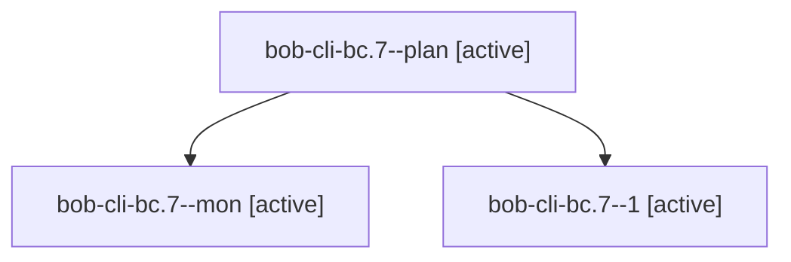

# Session: bob-cli-bc.7

[Agent Hoods](../README.md) / [bbugyi200](../users/bbugyi200/README.md) / [apollo](../users/bbugyi200/machines/apollo/README.md) / [bob-cli-bc](../users/bbugyi200/machines/apollo/hoods/bob-cli-bc/README.md) / bob-cli-bc.7

Owner: `bbugyi200.apollo` · Hood: `bob-cli-bc` · Members: 3 · Bead: [bob-cli-bc.7](https://github.com/bobs-org/bob-cli--beads/blob/main/pages/bob-cli-bc/bob-cli-bc.7.md)

## Lineage

The diagram is an optional enhancement; the ordered table below contains the same lineage in accessible text.

| Role | Agent | State | Model / provider | Timing | Commits | Prompt | Chat |
|---|---|---|---|---|---:|---|---|
| plan | bob-cli-bc.7--plan | active | gpt-6-luna / codex | 2026-10-24T17:19:44.003909+00:00 | 0 | [Prompt](../agents/bbugyi200.apollo.bob-cli-bc.7--plan/prompt.md) | [Chat](../agents/bbugyi200.apollo.bob-cli-bc.7--plan/chat.md) |
| mon | bob-cli-bc.7--mon | active | gpt-6-luna / codex | 2026-10-24T17:35:10.313213+00:00 | 0 | — | [Chat](../agents/bbugyi200.apollo.bob-cli-bc.7--mon/chat.md) |
| 1 | bob-cli-bc.7--1 | active | gpt-6-luna / codex | 2026-10-24T17:38:01.324373+00:00 | 0 | [Prompt](../agents/bbugyi200.apollo.bob-cli-bc.7--1/prompt.md) | [Chat](../agents/bbugyi200.apollo.bob-cli-bc.7--1/chat.md) |

## Neighbors

| Agent | Relation | State |
|---|---|---|
| [bob-cli-bc.1](../agents/bbugyi200.apollo.bob-cli-bc.1/README.md) | bob-cli-bc hood | active |
| [bob-cli-bc.10](../agents/bbugyi200.apollo.bob-cli-bc.10/README.md) | bob-cli-bc hood | active |
| [bob-cli-bc.11](../agents/bbugyi200.apollo.bob-cli-bc.11/README.md) | bob-cli-bc hood | active |
| [bob-cli-bc.12](../agents/bbugyi200.apollo.bob-cli-bc.12/README.md) | bob-cli-bc hood | active |
| [bob-cli-bc.13](../agents/bbugyi200.apollo.bob-cli-bc.13/README.md) | bob-cli-bc hood | active |
| [bob-cli-bc.2](../agents/bbugyi200.apollo.bob-cli-bc.2/README.md) | bob-cli-bc hood | active |
| [bob-cli-bc.3](../agents/bbugyi200.apollo.bob-cli-bc.3/README.md) | bob-cli-bc hood | active |
| [bob-cli-bc.4](../agents/bbugyi200.apollo.bob-cli-bc.4/README.md) | bob-cli-bc hood | active |
| [bob-cli-bc.5](bbugyi200.apollo.bob-cli-bc.5.md) (session · 13) | bob-cli-bc hood | active 13 |
| [bob-cli-bc.6](../agents/bbugyi200.apollo.bob-cli-bc.6/README.md) | bob-cli-bc hood | active |
| [bob-cli-bc.8](../agents/bbugyi200.apollo.bob-cli-bc.8/README.md) | bob-cli-bc hood | active |
| [bob-cli-bc.9](../agents/bbugyi200.apollo.bob-cli-bc.9/README.md) | bob-cli-bc hood | active |
| [bob-cli-bc.land](bbugyi200.apollo.bob-cli-bc.land.md) (session · 7) | bob-cli-bc hood | active 5, completed 1, failed 1 |
