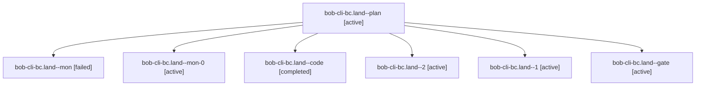

# Session: bob-cli-bc.land

[Agent Hoods](../README.md) / [bbugyi200](../users/bbugyi200/README.md) / [apollo](../users/bbugyi200/machines/apollo/README.md) / [bob-cli-bc](../users/bbugyi200/machines/apollo/hoods/bob-cli-bc/README.md) / bob-cli-bc.land

Owner: `bbugyi200.apollo` · Hood: `bob-cli-bc` · Members: 7 · Bead: [bob-cli-bc](https://github.com/bobs-org/bob-cli--beads/blob/main/pages/bob-cli-bc/README.md)

## Lineage

The diagram is an optional enhancement; the ordered table below contains the same lineage in accessible text.

| Role | Agent | State | Model / provider | Timing | Commits | Prompt | Chat |
|---|---|---|---|---|---:|---|---|
| plan | bob-cli-bc.land--plan | active | opus / claude | 2026-10-24T19:44:40.603294+00:00 | 0 | [Prompt](../agents/bbugyi200.apollo.bob-cli-bc.land--plan/prompt.md) | [Chat](../agents/bbugyi200.apollo.bob-cli-bc.land--plan/chat.md) |
| mon | bob-cli-bc.land--mon | failed | gpt-6-luna / codex | 2026-10-24T20:29:20.342786+00:00 → 2026-10-24T20:34:56.375493+00:00 | 0 | — | [Chat](../agents/bbugyi200.apollo.bob-cli-bc.land--mon/chat.md) |
| mon-0 | bob-cli-bc.land--mon-0 | active | gpt-6-luna / codex | 2026-10-24T20:40:40.821320+00:00 | 0 | — | [Chat](../agents/bbugyi200.apollo.bob-cli-bc.land--mon-0/chat.md) |
| code | bob-cli-bc.land--code | completed | gpt-6-luna / codex | 2026-10-24T20:14:37.888768+00:00 → 2026-10-24T20:31:22.896292+00:00 | 0 | — | [Chat](../agents/bbugyi200.apollo.bob-cli-bc.land--code/chat.md) |
| 2 | bob-cli-bc.land--2 | active | gpt-6-luna / codex | 2026-10-24T20:54:30.817931+00:00 | [1](../agents/bbugyi200.apollo.bob-cli-bc.land--2/README.md#commits) | [Prompt](../agents/bbugyi200.apollo.bob-cli-bc.land--2/prompt.md) | [Chat](../agents/bbugyi200.apollo.bob-cli-bc.land--2/chat.md) |
| 1 | bob-cli-bc.land--1 | active | gpt-6-luna / codex | 2026-10-24T20:34:56.364342+00:00 | 0 | [Prompt](../agents/bbugyi200.apollo.bob-cli-bc.land--1/prompt.md) | [Chat](../agents/bbugyi200.apollo.bob-cli-bc.land--1/chat.md) |
| gate | bob-cli-bc.land--gate | active | opus / claude | 2026-10-24T20:13:45.856430+00:00 | 0 | — | [Chat](../agents/bbugyi200.apollo.bob-cli-bc.land--gate/chat.md) |

## Commits

| Role | Repo | Commit | Subject | Committed |
|---|---|---|---|---|
| 2 | bob-cli | [`09b2695`](https://github.com/bobs-org/bob-cli/commit/09b269571c34708a944bdfa7b86ecdb641df5d1b) | fix(pomodoro-themes): bound cache and restore completion contracts | 2026-10-24 16:57:51 EDT |

## Neighbors

| Agent | Relation | State |
|---|---|---|
| [bob-cli-bc.1](../agents/bbugyi200.apollo.bob-cli-bc.1/README.md) | bob-cli-bc hood | active |
| [bob-cli-bc.10](../agents/bbugyi200.apollo.bob-cli-bc.10/README.md) | bob-cli-bc hood | active |
| [bob-cli-bc.11](../agents/bbugyi200.apollo.bob-cli-bc.11/README.md) | bob-cli-bc hood | active |
| [bob-cli-bc.12](../agents/bbugyi200.apollo.bob-cli-bc.12/README.md) | bob-cli-bc hood | active |
| [bob-cli-bc.13](../agents/bbugyi200.apollo.bob-cli-bc.13/README.md) | bob-cli-bc hood | active |
| [bob-cli-bc.2](../agents/bbugyi200.apollo.bob-cli-bc.2/README.md) | bob-cli-bc hood | active |
| [bob-cli-bc.3](../agents/bbugyi200.apollo.bob-cli-bc.3/README.md) | bob-cli-bc hood | active |
| [bob-cli-bc.4](../agents/bbugyi200.apollo.bob-cli-bc.4/README.md) | bob-cli-bc hood | active |
| [bob-cli-bc.5](bbugyi200.apollo.bob-cli-bc.5.md) (session · 13) | bob-cli-bc hood | active 13 |
| [bob-cli-bc.6](../agents/bbugyi200.apollo.bob-cli-bc.6/README.md) | bob-cli-bc hood | active |
| [bob-cli-bc.7](bbugyi200.apollo.bob-cli-bc.7.md) (session · 3) | bob-cli-bc hood | active 3 |
| [bob-cli-bc.8](../agents/bbugyi200.apollo.bob-cli-bc.8/README.md) | bob-cli-bc hood | active |
| [bob-cli-bc.9](../agents/bbugyi200.apollo.bob-cli-bc.9/README.md) | bob-cli-bc hood | active |
