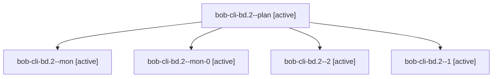

# Session: bob-cli-bd.2

[Agent Hoods](../README.md) / [bbugyi200](../users/bbugyi200/README.md) / [apollo](../users/bbugyi200/machines/apollo/README.md) / [bob-cli-bd](../users/bbugyi200/machines/apollo/hoods/bob-cli-bd/README.md) / bob-cli-bd.2

Owner: `bbugyi200.apollo` · Hood: `bob-cli-bd` · Members: 5 · Bead: [bob-cli-bd.2](https://github.com/bobs-org/bob-cli--beads/blob/main/pages/bob-cli-bd/bob-cli-bd.2.md)

## Lineage

The diagram is an optional enhancement; the ordered table below contains the same lineage in accessible text.

| Role | Agent | State | Model / provider | Timing | Commits | Prompt | Chat |
|---|---|---|---|---|---:|---|---|
| plan | bob-cli-bd.2--plan | active | gpt-6-luna / codex | 2026-10-24T12:53:48.002074+00:00 | 0 | [Prompt](../agents/bbugyi200.apollo.bob-cli-bd.2--plan/prompt.md) | [Chat](../agents/bbugyi200.apollo.bob-cli-bd.2--plan/chat.md) |
| mon | bob-cli-bd.2--mon | active | gpt-6-luna / codex | 2026-10-24T13:25:57.635117+00:00 | 0 | — | [Chat](../agents/bbugyi200.apollo.bob-cli-bd.2--mon/chat.md) |
| mon-0 | bob-cli-bd.2--mon-0 | active | gpt-6-luna / codex | 2026-10-24T13:41:00.828522+00:00 | 0 | — | [Chat](../agents/bbugyi200.apollo.bob-cli-bd.2--mon-0/chat.md) |
| 2 | bob-cli-bd.2--2 | active | gpt-6-luna / codex | 2026-10-24T13:47:42.062741+00:00 | [1](../agents/bbugyi200.apollo.bob-cli-bd.2--2/README.md#commits) | [Prompt](../agents/bbugyi200.apollo.bob-cli-bd.2--2/prompt.md) | [Chat](../agents/bbugyi200.apollo.bob-cli-bd.2--2/chat.md) |
| 1 | bob-cli-bd.2--1 | active | gpt-6-luna / codex | 2026-10-24T13:36:52.794634+00:00 | 0 | [Prompt](../agents/bbugyi200.apollo.bob-cli-bd.2--1/prompt.md) | [Chat](../agents/bbugyi200.apollo.bob-cli-bd.2--1/chat.md) |

## Commits

| Role | Repo | Commit | Subject | Committed |
|---|---|---|---|---|
| 2 | bob-cli | [`453b07e`](https://github.com/bobs-org/bob-cli/commit/453b07e74ea1aafce753b9a8de69db680079cfe9) | feat(highlights): parse reference sections | 2026-10-24 09:49:33 EDT |

## Neighbors

| Agent | Relation | State |
|---|---|---|
| [bob-cli-bd.1](../agents/bbugyi200.apollo.bob-cli-bd.1/README.md) | bob-cli-bd hood | active |
| [bob-cli-bd.3](../agents/bbugyi200.apollo.bob-cli-bd.3/README.md) | bob-cli-bd hood | active |
| [bob-cli-bd.4](bbugyi200.apollo.bob-cli-bd.4.md) (session · 3) | bob-cli-bd hood | active 2, completed 1 |
| [bob-cli-bd.5](../agents/bbugyi200.apollo.bob-cli-bd.5/README.md) | bob-cli-bd hood | active |
| [bob-cli-bd.6](../agents/bbugyi200.apollo.bob-cli-bd.6/README.md) | bob-cli-bd hood | active |
| [bob-cli-bd.7](bbugyi200.apollo.bob-cli-bd.7.md) (session · 7) | bob-cli-bd hood | active 7 |
| [bob-cli-bd.8](bbugyi200.apollo.bob-cli-bd.8.md) (session · 3) | bob-cli-bd hood | active 2, completed 1 |
| [bob-cli-bd.land](bbugyi200.apollo.bob-cli-bd.land.md) (session · 3) | bob-cli-bd hood | active 2, completed 1 |
