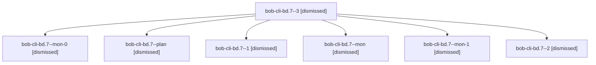

# Session: bob-cli-bd.7

[Agent Hoods](../README.md) / [bbugyi200](../users/bbugyi200/README.md) / [apollo](../users/bbugyi200/machines/apollo/README.md) / [bob-cli-bd](../users/bbugyi200/machines/apollo/hoods/bob-cli-bd/README.md) / bob-cli-bd.7

Owner: `bbugyi200.apollo` · Hood: `bob-cli-bd` · Members: 7 · Bead: [bob-cli-bd.7](https://github.com/bobs-org/bob-cli--beads/blob/main/pages/bob-cli-bd/bob-cli-bd.7.md)

## Lineage

The diagram is an optional enhancement; the ordered table below contains the same lineage in accessible text.

| Role | Agent | State | Model / provider | Timing | Commits | Prompt | Chat |
|---|---|---|---|---|---:|---|---|
| 3 | bob-cli-bd.7--3 | dismissed | gpt-6-luna / codex | 2026-10-24T12:29:23.849640 → 2026-10-24T12:37:39.408453 | [1](../agents/bbugyi200.apollo.bob-cli-bd.7--3/README.md#commits) | [Prompt](../agents/bbugyi200.apollo.bob-cli-bd.7--3/prompt.md) | [Chat](../agents/bbugyi200.apollo.bob-cli-bd.7--3/chat.md) |
| mon-0 | bob-cli-bd.7--mon-0 | dismissed | gpt-6-luna / codex | 2026-10-24T12:04:42.325687 → 2026-10-24T12:11:22.913168 | 0 | — | [Chat](../agents/bbugyi200.apollo.bob-cli-bd.7--mon-0/chat.md) |
| plan | bob-cli-bd.7--plan | dismissed | gpt-6-luna / codex | 2026-10-24T11:36:21.848030 → 2026-10-24T11:48:19.207914 | 0 | [Prompt](../agents/bbugyi200.apollo.bob-cli-bd.7--plan/prompt.md) | [Chat](../agents/bbugyi200.apollo.bob-cli-bd.7--plan/chat.md) |
| 1 | bob-cli-bd.7--1 | dismissed | gpt-6-luna / codex | 2026-10-24T11:55:36.637597 → 2026-10-24T12:05:26.109284 | 0 | [Prompt](../agents/bbugyi200.apollo.bob-cli-bd.7--1/prompt.md) | [Chat](../agents/bbugyi200.apollo.bob-cli-bd.7--1/chat.md) |
| mon | bob-cli-bd.7--mon | dismissed | gpt-6-luna / codex | 2026-10-24T11:47:20.490393 → 2026-10-24T11:54:26.870744 | 0 | — | [Chat](../agents/bbugyi200.apollo.bob-cli-bd.7--mon/chat.md) |
| mon-1 | bob-cli-bd.7--mon-1 | dismissed | gpt-6-luna / codex | 2026-10-24T12:18:09.722284 → 2026-10-24T12:28:03.386414 | 0 | — | [Chat](../agents/bbugyi200.apollo.bob-cli-bd.7--mon-1/chat.md) |
| 2 | bob-cli-bd.7--2 | dismissed | gpt-6-luna / codex | 2026-10-24T12:12:27.910920 → 2026-10-24T12:19:42.604399 | 0 | [Prompt](../agents/bbugyi200.apollo.bob-cli-bd.7--2/prompt.md) | [Chat](../agents/bbugyi200.apollo.bob-cli-bd.7--2/chat.md) |

## Commits

| Role | Repo | Commit | Subject | Committed |
|---|---|---|---|---|
| 3 | — | `2eb9812` | docs(highlights): document annotation sections and add cross-surface checks | 2026-10-24 12:35:52 EDT |

## Neighbors

| Agent | Relation | State |
|---|---|---|
| [bob-cli-bd.1](../agents/bbugyi200.apollo.bob-cli-bd.1/README.md) | bob-cli-bd hood | dismissed |
| [bob-cli-bd.2](bbugyi200.apollo.bob-cli-bd.2.md) (session · 5) | bob-cli-bd hood | dismissed 5 |
| [bob-cli-bd.3](../agents/bbugyi200.apollo.bob-cli-bd.3/README.md) | bob-cli-bd hood | dismissed |
| [bob-cli-bd.4](bbugyi200.apollo.bob-cli-bd.4.md) (session · 3) | bob-cli-bd hood | completed 1, dismissed 2 |
| [bob-cli-bd.5](../agents/bbugyi200.apollo.bob-cli-bd.5/README.md) | bob-cli-bd hood | dismissed |
| [bob-cli-bd.6](../agents/bbugyi200.apollo.bob-cli-bd.6/README.md) | bob-cli-bd hood | dismissed |
| [bob-cli-bd.8](bbugyi200.apollo.bob-cli-bd.8.md) (session · 3) | bob-cli-bd hood | completed 1, dismissed 2 |
| [bob-cli-bd.land](bbugyi200.apollo.bob-cli-bd.land.md) (session · 3) | bob-cli-bd hood | completed 1, dismissed 2 |
