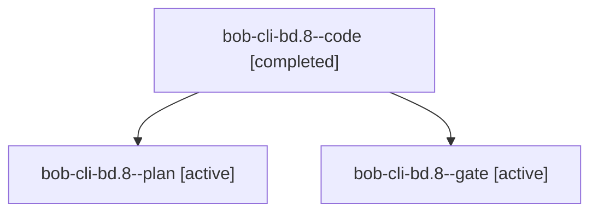

# Session: bob-cli-bd.8

[Agent Hoods](../README.md) / [bbugyi200](../users/bbugyi200/README.md) / [apollo](../users/bbugyi200/machines/apollo/README.md) / [bob-cli-bd](../users/bbugyi200/machines/apollo/hoods/bob-cli-bd/README.md) / bob-cli-bd.8

Owner: `bbugyi200.apollo` · Hood: `bob-cli-bd` · Members: 3 · Bead: [bob-cli-bd.8](https://github.com/bobs-org/bob-cli--beads/blob/main/pages/bob-cli-bd/bob-cli-bd.8.md)

## Lineage

The diagram is an optional enhancement; the ordered table below contains the same lineage in accessible text.

| Role | Agent | State | Model / provider | Timing | Commits | Prompt | Chat |
|---|---|---|---|---|---:|---|---|
| code | bob-cli-bd.8--code | completed | grok-4.6 / grok | 2026-10-24T13:10:03.356450+00:00 → 2026-10-24T13:50:20.420016+00:00 | 0 | — | [Chat](../agents/bbugyi200.apollo.bob-cli-bd.8--code/chat.md) |
| plan | bob-cli-bd.8--plan | active | gpt-6-astra / codex | 2026-10-24T13:01:21.175594+00:00 | 0 | [Prompt](../agents/bbugyi200.apollo.bob-cli-bd.8--plan/prompt.md) | [Chat](../agents/bbugyi200.apollo.bob-cli-bd.8--plan/chat.md) |
| gate | bob-cli-bd.8--gate | active | gpt-6-astra / codex | 2026-10-24T13:09:18.379123+00:00 | 0 | — | [Chat](../agents/bbugyi200.apollo.bob-cli-bd.8--gate/chat.md) |

## Neighbors

| Agent | Relation | State |
|---|---|---|
| [bob-cli-bd.1](../agents/bbugyi200.apollo.bob-cli-bd.1/README.md) | bob-cli-bd hood | active |
| [bob-cli-bd.2](bbugyi200.apollo.bob-cli-bd.2.md) (session · 5) | bob-cli-bd hood | active 5 |
| [bob-cli-bd.3](../agents/bbugyi200.apollo.bob-cli-bd.3/README.md) | bob-cli-bd hood | active |
| [bob-cli-bd.4](bbugyi200.apollo.bob-cli-bd.4.md) (session · 3) | bob-cli-bd hood | active 2, completed 1 |
| [bob-cli-bd.5](../agents/bbugyi200.apollo.bob-cli-bd.5/README.md) | bob-cli-bd hood | active |
| [bob-cli-bd.6](../agents/bbugyi200.apollo.bob-cli-bd.6/README.md) | bob-cli-bd hood | active |
| [bob-cli-bd.7](bbugyi200.apollo.bob-cli-bd.7.md) (session · 7) | bob-cli-bd hood | active 7 |
| [bob-cli-bd.land](bbugyi200.apollo.bob-cli-bd.land.md) (session · 3) | bob-cli-bd hood | active 2, completed 1 |
