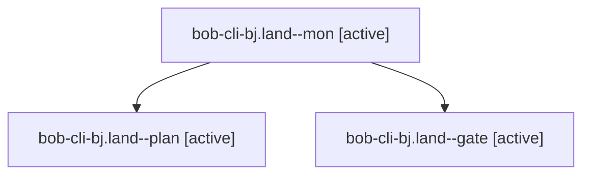

# Session: bob-cli-bj.land

[Agent Hoods](../README.md) / [bbugyi200](../users/bbugyi200/README.md) / [apollo](../users/bbugyi200/machines/apollo/README.md) / [bob-cli-bj](../users/bbugyi200/machines/apollo/hoods/bob-cli-bj/README.md) / bob-cli-bj.land

Owner: `bbugyi200.apollo` · Hood: `bob-cli-bj` · Members: 3 · Bead: [bob-cli-bj](https://github.com/bobs-org/bob-cli--beads/blob/main/pages/bob-cli-bj/README.md)

## Lineage

The diagram is an optional enhancement; the ordered table below contains the same lineage in accessible text.

| Role | Agent | State | Model / provider | Timing | Commits | Prompt | Chat |
|---|---|---|---|---|---:|---|---|
| mon | bob-cli-bj.land--mon | active | opus / claude | 2026-10-25T00:05:40.270942+00:00 | 0 | — | [Chat](../agents/bbugyi200.apollo.bob-cli-bj.land--mon/chat.md) |
| plan | bob-cli-bj.land--plan | active | opus / claude | 2026-10-24T23:37:02.310315+00:00 | 0 | [Prompt](../agents/bbugyi200.apollo.bob-cli-bj.land--plan/prompt.md) | [Chat](../agents/bbugyi200.apollo.bob-cli-bj.land--plan/chat.md) |
| gate | bob-cli-bj.land--gate | active | opus / claude | 2026-10-25T00:05:24.053077+00:00 | 0 | — | [Chat](../agents/bbugyi200.apollo.bob-cli-bj.land--gate/chat.md) |

## Neighbors

| Agent | Relation | State |
|---|---|---|
| [bob-cli-bj.1](bbugyi200.apollo.bob-cli-bj.1.md) (session · 3) | bob-cli-bj hood | active 3 |
| [bob-cli-bj.10](../agents/bbugyi200.apollo.bob-cli-bj.10/README.md) | bob-cli-bj hood | active |
| [bob-cli-bj.11](../agents/bbugyi200.apollo.bob-cli-bj.11/README.md) | bob-cli-bj hood | active |
| [bob-cli-bj.12.1](../agents/bbugyi200.apollo.bob-cli-bj.12.1/README.md) | bob-cli-bj hood | active |
| [bob-cli-bj.12.2](../agents/bbugyi200.apollo.bob-cli-bj.12.2/README.md) | bob-cli-bj hood | active |
| [bob-cli-bj.12.3](../agents/bbugyi200.apollo.bob-cli-bj.12.3/README.md) | bob-cli-bj hood | active |
| [bob-cli-bj.12.land](bbugyi200.apollo.bob-cli-bj.12.land.md) (session · 3) | bob-cli-bj hood | active 2, completed 1 |
| [bob-cli-bj.2](../agents/bbugyi200.apollo.bob-cli-bj.2/README.md) | bob-cli-bj hood | active |
| [bob-cli-bj.3](../agents/bbugyi200.apollo.bob-cli-bj.3/README.md) | bob-cli-bj hood | active |
| [bob-cli-bj.4](../agents/bbugyi200.apollo.bob-cli-bj.4/README.md) | bob-cli-bj hood | active |
| [bob-cli-bj.5](../agents/bbugyi200.apollo.bob-cli-bj.5/README.md) | bob-cli-bj hood | active |
| [bob-cli-bj.6](../agents/bbugyi200.apollo.bob-cli-bj.6/README.md) | bob-cli-bj hood | active |
| [bob-cli-bj.7](../agents/bbugyi200.apollo.bob-cli-bj.7/README.md) | bob-cli-bj hood | active |
| [bob-cli-bj.8](../agents/bbugyi200.apollo.bob-cli-bj.8/README.md) | bob-cli-bj hood | active |
| [bob-cli-bj.9](../agents/bbugyi200.apollo.bob-cli-bj.9/README.md) | bob-cli-bj hood | active |
