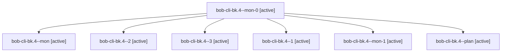

# Session: bob-cli-bk.4

[Agent Hoods](../README.md) / [bbugyi200](../users/bbugyi200/README.md) / [apollo](../users/bbugyi200/machines/apollo/README.md) / [bob-cli-bk](../users/bbugyi200/machines/apollo/hoods/bob-cli-bk/README.md) / bob-cli-bk.4

Owner: `bbugyi200.apollo` · Hood: `bob-cli-bk` · Members: 7 · Bead: [bob-cli-bk.4](https://github.com/bobs-org/bob-cli--beads/blob/main/pages/bob-cli-bk/bob-cli-bk.4.md)

## Lineage

The diagram is an optional enhancement; the ordered table below contains the same lineage in accessible text.

| Role | Agent | State | Model / provider | Timing | Commits | Prompt | Chat |
|---|---|---|---|---|---:|---|---|
| mon-0 | bob-cli-bk.4--mon-0 | active | gpt-6-luna / codex | 2026-10-24T21:48:16.707062+00:00 | 0 | — | [Chat](../agents/bbugyi200.apollo.bob-cli-bk.4--mon-0/chat.md) |
| mon | bob-cli-bk.4--mon | active | gpt-6-luna / codex | 2026-10-24T21:40:57.699797+00:00 | 0 | — | [Chat](../agents/bbugyi200.apollo.bob-cli-bk.4--mon/chat.md) |
| 2 | bob-cli-bk.4--2 | active | gpt-6-luna / codex | 2026-10-24T21:50:07.738983+00:00 | 0 | [Prompt](../agents/bbugyi200.apollo.bob-cli-bk.4--2/prompt.md) | [Chat](../agents/bbugyi200.apollo.bob-cli-bk.4--2/chat.md) |
| 3 | bob-cli-bk.4--3 | active | gpt-6-luna / codex | 2026-10-24T21:59:45.830648+00:00 | [1](../agents/bbugyi200.apollo.bob-cli-bk.4--3/README.md#commits) | [Prompt](../agents/bbugyi200.apollo.bob-cli-bk.4--3/prompt.md) | [Chat](../agents/bbugyi200.apollo.bob-cli-bk.4--3/chat.md) |
| 1 | bob-cli-bk.4--1 | active | gpt-6-luna / codex | 2026-10-24T21:44:59.831839+00:00 | 0 | [Prompt](../agents/bbugyi200.apollo.bob-cli-bk.4--1/prompt.md) | [Chat](../agents/bbugyi200.apollo.bob-cli-bk.4--1/chat.md) |
| mon-1 | bob-cli-bk.4--mon-1 | active | gpt-6-luna / codex | 2026-10-24T21:56:19.383574+00:00 | 0 | — | [Chat](../agents/bbugyi200.apollo.bob-cli-bk.4--mon-1/chat.md) |
| plan | bob-cli-bk.4--plan | active | gpt-6-luna / codex | 2026-10-24T21:18:30.253717+00:00 | 0 | [Prompt](../agents/bbugyi200.apollo.bob-cli-bk.4--plan/prompt.md) | [Chat](../agents/bbugyi200.apollo.bob-cli-bk.4--plan/chat.md) |

## Commits

| Role | Repo | Commit | Subject | Committed |
|---|---|---|---|---|
| 3 | bob-cli | [`e70f9ea`](https://github.com/bobs-org/bob-cli/commit/e70f9ea40a7be87ffc761b851eda2613d288e9c8) | docs(memory): explain capture inbox routing | 2026-10-24 18:10:17 EDT |

## Neighbors

| Agent | Relation | State |
|---|---|---|
| [bob-cli-bk.1](../agents/bbugyi200.apollo.bob-cli-bk.1/README.md) | bob-cli-bk hood | active |
| [bob-cli-bk.2](../agents/bbugyi200.apollo.bob-cli-bk.2/README.md) | bob-cli-bk hood | active |
| [bob-cli-bk.3](../agents/bbugyi200.apollo.bob-cli-bk.3/README.md) | bob-cli-bk hood | active |
| [bob-cli-bk.land](bbugyi200.apollo.bob-cli-bk.land.md) (session · 3) | bob-cli-bk hood | active 2, completed 1 |
