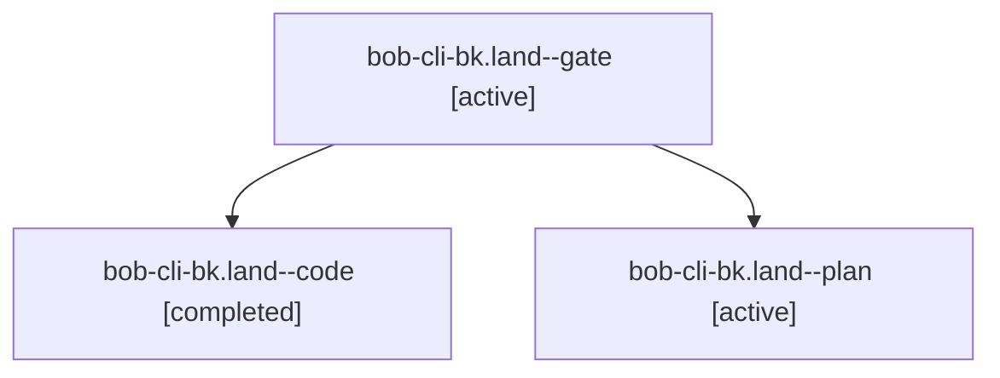

# Session: bob-cli-bk.land

[Agent Hoods](../README.md) / [bbugyi200](../users/bbugyi200/README.md) / [apollo](../users/bbugyi200/machines/apollo/README.md) / [bob-cli-bk](../users/bbugyi200/machines/apollo/hoods/bob-cli-bk/README.md) / bob-cli-bk.land

Owner: `bbugyi200.apollo` · Hood: `bob-cli-bk` · Members: 3 · Bead: [bob-cli-bk](https://github.com/bobs-org/bob-cli--beads/blob/main/pages/bob-cli-bk/README.md)

## Lineage

The diagram is an optional enhancement; the ordered table below contains the same lineage in accessible text.

| Role | Agent | State | Model / provider | Timing | Commits | Prompt | Chat |
|---|---|---|---|---|---:|---|---|
| gate | bob-cli-bk.land--gate | active | gpt-6-astra / codex | 2026-10-24T22:23:22.998787+00:00 | 0 | — | [Chat](../agents/bbugyi200.apollo.bob-cli-bk.land--gate/chat.md) |
| code | bob-cli-bk.land--code | completed | muse-spark-1.3-contributor / muse | 2026-10-24T22:23:51.555007+00:00 → 2026-10-24T23:07:21.754446+00:00 | [1](../agents/bbugyi200.apollo.bob-cli-bk.land--code/README.md#commits) | — | [Chat](../agents/bbugyi200.apollo.bob-cli-bk.land--code/chat.md) |
| plan | bob-cli-bk.land--plan | active | gpt-6-astra / codex | 2026-10-24T22:13:02.967133+00:00 | 0 | [Prompt](../agents/bbugyi200.apollo.bob-cli-bk.land--plan/prompt.md) | [Chat](../agents/bbugyi200.apollo.bob-cli-bk.land--plan/chat.md) |

## Commits

| Role | Repo | Commit | Subject | Committed |
|---|---|---|---|---|
| code | bob-cli | [`e5c7d0f`](https://github.com/bobs-org/bob-cli/commit/e5c7d0fcab0d256ae6a4ebe00e92092b73ffe179) | feat(capture): finish inbox routing with atomic snapshot and exact task identity | 2026-10-24 19:04:51 EDT |

## Neighbors

| Agent | Relation | State |
|---|---|---|
| [bob-cli-bk.1](../agents/bbugyi200.apollo.bob-cli-bk.1/README.md) | bob-cli-bk hood | active |
| [bob-cli-bk.2](../agents/bbugyi200.apollo.bob-cli-bk.2/README.md) | bob-cli-bk hood | active |
| [bob-cli-bk.3](../agents/bbugyi200.apollo.bob-cli-bk.3/README.md) | bob-cli-bk hood | active |
| [bob-cli-bk.4](bbugyi200.apollo.bob-cli-bk.4.md) (session · 7) | bob-cli-bk hood | active 7 |
