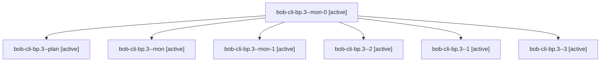

# Session: bob-cli-bp.3

[Agent Hoods](../README.md) / [bbugyi200](../users/bbugyi200/README.md) / [apollo](../users/bbugyi200/machines/apollo/README.md) / [bob-cli-bp](../users/bbugyi200/machines/apollo/hoods/bob-cli-bp/README.md) / bob-cli-bp.3

Owner: `bbugyi200.apollo` · Hood: `bob-cli-bp` · Members: 7 · Bead: [bob-cli-bp.3](https://github.com/bobs-org/bob-cli--beads/blob/main/pages/bob-cli-bp/bob-cli-bp.3.md)

## Lineage



The diagram is an optional enhancement; the ordered table below contains the same lineage in accessible text.

| Role | Agent | State | Model / provider | Timing | Commits | Prompt | Chat |
|---|---|---|---|---|---:|---|---|
| <a id="member-mon-0"></a>mon-0 | bob-cli-bp.3--mon-0 | active | gpt-6-luna / codex | 2026-10-24T21:20:19.568037+00:00 | 0 | — | — |
| <a id="member-plan"></a>plan | bob-cli-bp.3--plan | active | gpt-6-luna / codex | 2026-10-24T21:00:08.012699+00:00 | 0 | [Prompt](../agents/bbugyi200.apollo.bob-cli-bp.3--plan/prompt.md) | [Chat](../agents/bbugyi200.apollo.bob-cli-bp.3--plan/chat.md) |
| <a id="member-mon"></a>mon | bob-cli-bp.3--mon | active | gpt-6-luna / codex | 2026-10-24T21:15:45.383284+00:00 | 0 | — | — |
| <a id="member-mon-1"></a>mon-1 | bob-cli-bp.3--mon-1 | active | gpt-6-luna / codex | 2026-10-24T21:24:15.969159+00:00 | 0 | — | — |
| <a id="member-2"></a>2 | bob-cli-bp.3--2 | active | gpt-6-luna / codex | 2026-10-24T21:22:22.521866+00:00 | 0 | [Prompt](../agents/bbugyi200.apollo.bob-cli-bp.3--2/prompt.md) | [Chat](../agents/bbugyi200.apollo.bob-cli-bp.3--2/chat.md) |
| <a id="member-1"></a>1 | bob-cli-bp.3--1 | active | gpt-6-luna / codex | 2026-10-24T21:18:00.009364+00:00 | 0 | [Prompt](../agents/bbugyi200.apollo.bob-cli-bp.3--1/prompt.md) | [Chat](../agents/bbugyi200.apollo.bob-cli-bp.3--1/chat.md) |
| <a id="member-3"></a>3 | bob-cli-bp.3--3 | active | gpt-6-luna / codex | 2026-10-24T21:26:06.611726+00:00 | 0 | [Prompt](../agents/bbugyi200.apollo.bob-cli-bp.3--3/prompt.md) | [Chat](../agents/bbugyi200.apollo.bob-cli-bp.3--3/chat.md) |

## Variables

| Role | Variable | Value |
|---|---|---|
| 3 | `artifacts` | \[{bead: bob-cli-bp.3, kind: markdown, label: Day strip Chromium preview matrix report, path: /home/bryan/.sase/artifacts/agents/gh\_bobs-org\_\_bob-cli/20261024172514/matrix-report-e65029815bae.md, ref:… |
| plan | `artifacts` | \[{kind: image, label: Day strip matrix — 410 px — light, path: /home/bryan/.sase/artifacts/agents/gh\_bobs-org\_\_bob-cli/20261024163146/day-strip-410-light-19bd5629304f.png, ref: file:explicit:79cf7c22… |

#### artifacts

**Role:** `3`

```yaml
- bead: bob-cli-bp.3
  kind: markdown
  label: Day strip Chromium preview matrix report
  path: /home/bryan/.sase/artifacts/agents/gh_bobs-org__bob-cli/20261024172514/matrix-report-e65029815bae.md
  ref: file:explicit:b8bf48bc6fec94fe208996dc
  source_path: /home/bryan/.local/state/sase/workspaces/bobs-org/bob-cli/bob-cli_17/.tmp-day-strip-preview-matrix/matrix-report.md
- bead: bob-cli-bp.3
  kind: image
  label: Day strip preview — 410px light
  path: /home/bryan/.sase/artifacts/agents/gh_bobs-org__bob-cli/20261024172514/day-strip-410-light-19bd5629304f.png
  ref: file:explicit:308c92cde5e93634770ae126
  source_path: /home/bryan/.local/state/sase/workspaces/bobs-org/bob-cli/bob-cli_17/.tmp-day-strip-preview-matrix/day-strip-410-light.png
- bead: bob-cli-bp.3
  kind: image
  label: Day strip preview — 410px dark
  path: /home/bryan/.sase/artifacts/agents/gh_bobs-org__bob-cli/20261024172514/day-strip-410-dark-e0af7e7b6d77.png
  ref: file:explicit:d821cd4f91b6944d55bf6abc
  source_path: /home/bryan/.local/state/sase/workspaces/bobs-org/bob-cli/bob-cli_17/.tmp-day-strip-preview-matrix/day-strip-410-dark.png
- bead: bob-cli-bp.3
  kind: image
  label: Day strip preview — 540px light
  path: /home/bryan/.sase/artifacts/agents/gh_bobs-org__bob-cli/20261024172514/day-strip-540-light-07f2a34d72e5.png
  ref: file:explicit:2451c0c7958aeeb61875c014
  source_path: /home/bryan/.local/state/sase/workspaces/bobs-org/bob-cli/bob-cli_17/.tmp-day-strip-preview-matrix/day-strip-540-light.png
- bead: bob-cli-bp.3
  kind: image
  label: Day strip preview — 540px dark
  path: /home/bryan/.sase/artifacts/agents/gh_bobs-org__bob-cli/20261024172514/day-strip-540-dark-9e2b85ef68a0.png
  ref: file:explicit:074509956333e6a89093941f
  source_path: /home/bryan/.local/state/sase/workspaces/bobs-org/bob-cli/bob-cli_17/.tmp-day-strip-preview-matrix/day-strip-540-dark.png
- bead: bob-cli-bp.3
  kind: image
  label: Day strip preview — 700px light
  path: /home/bryan/.sase/artifacts/agents/gh_bobs-org__bob-cli/20261024172514/day-strip-700-light-e501ef91f762.png
  ref: file:explicit:0435bbc015cda3fd88a5cf26
  source_path: /home/bryan/.local/state/sase/workspaces/bobs-org/bob-cli/bob-cli_17/.tmp-day-strip-preview-matrix/day-strip-700-light.png
- bead: bob-cli-bp.3
  kind: image
  label: Day strip preview — 700px dark
  path: /home/bryan/.sase/artifacts/agents/gh_bobs-org__bob-cli/20261024172514/day-strip-700-dark-7d2b8f0a014a.png
  ref: file:explicit:1eed2b1b389e1cb6c56fd494
  source_path: /home/bryan/.local/state/sase/workspaces/bobs-org/bob-cli/bob-cli_17/.tmp-day-strip-preview-matrix/day-strip-700-dark.png
```

#### artifacts

**Role:** `plan`

```yaml
- kind: image
  label: Day strip matrix — 410 px — light
  path: /home/bryan/.sase/artifacts/agents/gh_bobs-org__bob-cli/20261024163146/day-strip-410-light-19bd5629304f.png
  ref: file:explicit:79cf7c22cd26c0e379634a54
  source_path: /tmp/bob-day-strip-preview/day-strip-410-light.png
- kind: image
  label: Day strip matrix — 410 px — dark
  path: /home/bryan/.sase/artifacts/agents/gh_bobs-org__bob-cli/20261024163146/day-strip-410-dark-e0af7e7b6d77.png
  ref: file:explicit:b90b9a7e68bc6c3c35f8e386
  source_path: /tmp/bob-day-strip-preview/day-strip-410-dark.png
- kind: image
  label: Day strip matrix — 540 px — light
  path: /home/bryan/.sase/artifacts/agents/gh_bobs-org__bob-cli/20261024163146/day-strip-540-light-07f2a34d72e5.png
  ref: file:explicit:f3d947542e7e7ca63a196a23
  source_path: /tmp/bob-day-strip-preview/day-strip-540-light.png
- kind: image
  label: Day strip matrix — 540 px — dark
  path: /home/bryan/.sase/artifacts/agents/gh_bobs-org__bob-cli/20261024163146/day-strip-540-dark-9e2b85ef68a0.png
  ref: file:explicit:e79b31059673279f96aa1260
  source_path: /tmp/bob-day-strip-preview/day-strip-540-dark.png
- kind: image
  label: Day strip matrix — 700 px — light
  path: /home/bryan/.sase/artifacts/agents/gh_bobs-org__bob-cli/20261024163146/day-strip-700-light-e501ef91f762.png
  ref: file:explicit:1f6928ae69004365bfecf8b5
  source_path: /tmp/bob-day-strip-preview/day-strip-700-light.png
- kind: image
  label: Day strip matrix — 700 px — dark
  path: /home/bryan/.sase/artifacts/agents/gh_bobs-org__bob-cli/20261024163146/day-strip-700-dark-7d2b8f0a014a.png
  ref: file:explicit:12efac3bab380eef488e2c19
  source_path: /tmp/bob-day-strip-preview/day-strip-700-dark.png
- kind: markdown
  label: Day strip preview matrix report
  path: /home/bryan/.sase/artifacts/agents/gh_bobs-org__bob-cli/20261024163146/matrix-report-e65029815bae.md
  ref: file:explicit:c10eb6c45efa236be7e88a2d
  source_path: /tmp/bob-day-strip-preview/matrix-report.md
```

Values are truncated for display; see each member's agent meta.json for the full values.

## Neighbors

| Agent | Relation | State |
|---|---|---|
| [bob-cli-bp.1](../agents/bbugyi200.apollo.bob-cli-bp.1/README.md) | bob-cli-bp hood | active |
| [bob-cli-bp.2](../agents/bbugyi200.apollo.bob-cli-bp.2/README.md) | bob-cli-bp hood | active |
| [bob-cli-bp.4](../agents/bbugyi200.apollo.bob-cli-bp.4/README.md) | bob-cli-bp hood | active |
| [bob-cli-bp.5](bbugyi200.apollo.bob-cli-bp.5.md) (session · 3) | bob-cli-bp hood | active 3 |
| [bob-cli-bp.6](../agents/bbugyi200.apollo.bob-cli-bp.6/README.md) | bob-cli-bp hood | active |
| [bob-cli-bp.land](../agents/bbugyi200.apollo.bob-cli-bp.land/README.md) | bob-cli-bp hood | active |
