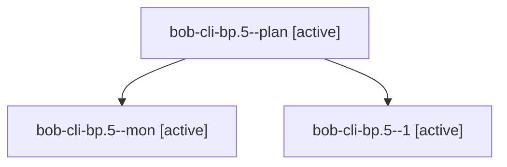

# Session: bob-cli-bp.5

[Agent Hoods](../README.md) / [bbugyi200](../users/bbugyi200/README.md) / [apollo](../users/bbugyi200/machines/apollo/README.md) / [bob-cli-bp](../users/bbugyi200/machines/apollo/hoods/bob-cli-bp/README.md) / bob-cli-bp.5

Owner: `bbugyi200.apollo` · Hood: `bob-cli-bp` · Members: 3 · Bead: [bob-cli-bp.5](https://github.com/bobs-org/bob-cli--beads/blob/main/pages/bob-cli-bp/bob-cli-bp.5.md)

## Lineage

The diagram is an optional enhancement; the ordered table below contains the same lineage in accessible text.

| Role | Agent | State | Model / provider | Timing | Commits | Prompt | Chat |
|---|---|---|---|---|---:|---|---|
| plan | bob-cli-bp.5--plan | active | gpt-6-luna / codex | 2026-10-24T21:59:57.349698+00:00 | 0 | [Prompt](../agents/bbugyi200.apollo.bob-cli-bp.5--plan/prompt.md) | [Chat](../agents/bbugyi200.apollo.bob-cli-bp.5--plan/chat.md) |
| mon | bob-cli-bp.5--mon | active | gpt-6-luna / codex | 2026-10-24T22:10:16.992613+00:00 | 0 | — | — |
| 1 | bob-cli-bp.5--1 | active | gpt-6-luna / codex | 2026-10-24T22:12:21.168943+00:00 | 0 | [Prompt](../agents/bbugyi200.apollo.bob-cli-bp.5--1/prompt.md) | [Chat](../agents/bbugyi200.apollo.bob-cli-bp.5--1/chat.md) |

## Neighbors

| Agent | Relation | State |
|---|---|---|
| [bob-cli-bp.1](../agents/bbugyi200.apollo.bob-cli-bp.1/README.md) | bob-cli-bp hood | active |
| [bob-cli-bp.2](../agents/bbugyi200.apollo.bob-cli-bp.2/README.md) | bob-cli-bp hood | active |
| [bob-cli-bp.3](bbugyi200.apollo.bob-cli-bp.3.md) (session · 7) | bob-cli-bp hood | active 7 |
| [bob-cli-bp.4](../agents/bbugyi200.apollo.bob-cli-bp.4/README.md) | bob-cli-bp hood | active |
| [bob-cli-bp.6](../agents/bbugyi200.apollo.bob-cli-bp.6/README.md) | bob-cli-bp hood | active |
| [bob-cli-bp.land](../agents/bbugyi200.apollo.bob-cli-bp.land/README.md) | bob-cli-bp hood | active |
