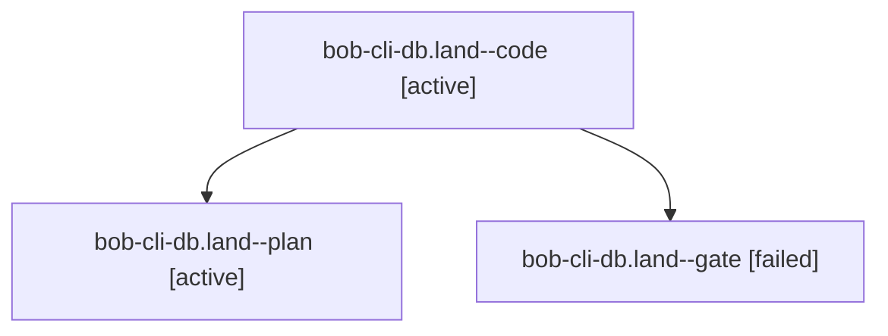

# Session: bob-cli-db.land

[Agent Hoods](../README.md) / [bbugyi200](../users/bbugyi200/README.md) / [apollo](../users/bbugyi200/machines/apollo/README.md) / [bob-cli-db](../users/bbugyi200/machines/apollo/hoods/bob-cli-db/README.md) / bob-cli-db.land

Owner: `bbugyi200.apollo` · Hood: `bob-cli-db` · Members: 3 · Bead: [bob-cli-db](https://github.com/bobs-org/bob-cli--beads/blob/main/pages/bob-cli-db/README.md)

## Lineage

The diagram is an optional enhancement; the ordered table below contains the same lineage in accessible text.

| Role | Agent | State | Model / provider | Timing | Commits | Prompt | Chat |
|---|---|---|---|---|---:|---|---|
| code | bob-cli-db.land--code | active | muse-spark-1.3-contributor / muse | 2026-10-27T22:15:17.234926+00:00 | [1](../agents/bbugyi200.apollo.bob-cli-db.land--code/README.md#commits) | — | — |
| plan | bob-cli-db.land--plan | active | gpt-6-astra / codex | 2026-10-27T22:02:56.233997+00:00 | 0 | [Prompt](../agents/bbugyi200.apollo.bob-cli-db.land--plan/prompt.md) | [Chat](../agents/bbugyi200.apollo.bob-cli-db.land--plan/chat.md) |
| gate | bob-cli-db.land--gate | failed | gpt-6-astra / codex | 2026-10-27T22:14:41.533251+00:00 → 2026-10-27T22:14:52.336704+00:00 | 0 | — | [Chat](../agents/bbugyi200.apollo.bob-cli-db.land--gate/chat.md) |

## Commits

| Role | Repo | Commit | Subject | Committed |
|---|---|---|---|---|
| code | bob-cli | [`0a896a4`](https://github.com/bobs-org/bob-cli/commit/0a896a45c6df23ab048c144a56a342e47276c45d) | fix(themes): preserve split bytes, complete completion, and order journal re-adoption | 2026-10-27 18:56:33 EDT |

## Neighbors

| Agent | Relation | State |
|---|---|---|
| [bob-cli-db.1](../agents/bbugyi200.apollo.bob-cli-db.1/README.md) | bob-cli-db hood | completed |
| [bob-cli-db.2](../agents/bbugyi200.apollo.bob-cli-db.2/README.md) | bob-cli-db hood | completed |
