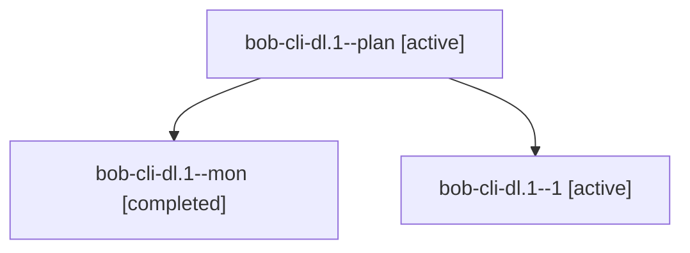

# Session: bob-cli-dl.1

[Agent Hoods](../README.md) / [bbugyi200](../users/bbugyi200/README.md) / [apollo](../users/bbugyi200/machines/apollo/README.md) / [bob-cli-dl](../users/bbugyi200/machines/apollo/hoods/bob-cli-dl/README.md) / bob-cli-dl.1

Owner: `bbugyi200.apollo` · Hood: `bob-cli-dl` · Members: 3 · Bead: [bob-cli-dl.1](https://github.com/bobs-org/bob-cli--beads/blob/main/pages/bob-cli-dl/bob-cli-dl.1.md)

## Lineage

The diagram is an optional enhancement; the ordered table below contains the same lineage in accessible text.

| Role | Agent | State | Model / provider | Timing | Commits | Prompt | Chat |
|---|---|---|---|---|---:|---|---|
| plan | bob-cli-dl.1--plan | active | grok-4.6 / grok | 2026-10-28T12:17:09.425969+00:00 | 0 | [Prompt](../agents/bbugyi200.apollo.bob-cli-dl.1--plan/prompt.md) | [Chat](../agents/bbugyi200.apollo.bob-cli-dl.1--plan/chat.md) |
| mon | bob-cli-dl.1--mon | completed | grok-4.6 / grok | 2026-10-28T12:37:00.754853+00:00 → 2026-10-28T12:44:54.630085+00:00 | 0 | — | [Chat](../agents/bbugyi200.apollo.bob-cli-dl.1--mon/chat.md) |
| 1 | bob-cli-dl.1--1 | active | grok-4.6 / grok | 2026-10-28T12:44:54.565338+00:00 | [1](../agents/bbugyi200.apollo.bob-cli-dl.1--1/README.md#commits) | [Prompt](../agents/bbugyi200.apollo.bob-cli-dl.1--1/prompt.md) | [Chat](../agents/bbugyi200.apollo.bob-cli-dl.1--1/chat.md) |

## Commits

| Role | Repo | Commit | Subject | Committed |
|---|---|---|---|---|
| 1 | bob-cli | [`52bff01`](https://github.com/bobs-org/bob-cli/commit/52bff0161befe3ce9656117547920caaf3129644) | feat(relations): add cancel-label contract, config docs, and shared vectors | 2026-10-28 09:03:56 EDT |

## Neighbors

| Agent | Relation | State |
|---|---|---|
| [bob-cli-dl.2](bbugyi200.apollo.bob-cli-dl.2.md) (session · 7) | bob-cli-dl hood | active 3, completed 3, failed 1 |
| [bob-cli-dl.3](../agents/bbugyi200.apollo.bob-cli-dl.3/README.md) | bob-cli-dl hood | active |
| [bob-cli-dl.4](../agents/bbugyi200.apollo.bob-cli-dl.4/README.md) | bob-cli-dl hood | active |
| [bob-cli-dl.5](bbugyi200.apollo.bob-cli-dl.5.md) (session · 3) | bob-cli-dl hood | active 1, completed 2 |
| [bob-cli-dl.6](bbugyi200.apollo.bob-cli-dl.6.md) (session · 3) | bob-cli-dl hood | active 2, completed 1 |
| [bob-cli-dl.7](../agents/bbugyi200.apollo.bob-cli-dl.7/README.md) | bob-cli-dl hood | active |
| [bob-cli-dl.8](../agents/bbugyi200.apollo.bob-cli-dl.8/README.md) | bob-cli-dl hood | active |
| [bob-cli-dl.land](bbugyi200.apollo.bob-cli-dl.land.md) (session · 3) | bob-cli-dl hood | active 1, completed 2 |
