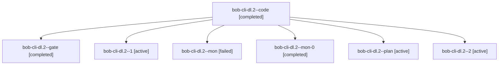

# Session: bob-cli-dl.2

[Agent Hoods](../README.md) / [bbugyi200](../users/bbugyi200/README.md) / [apollo](../users/bbugyi200/machines/apollo/README.md) / [bob-cli-dl](../users/bbugyi200/machines/apollo/hoods/bob-cli-dl/README.md) / bob-cli-dl.2

Owner: `bbugyi200.apollo` · Hood: `bob-cli-dl` · Members: 7 · Bead: [bob-cli-dl.2](https://github.com/bobs-org/bob-cli--beads/blob/main/pages/bob-cli-dl/bob-cli-dl.2.md)

## Lineage

The diagram is an optional enhancement; the ordered table below contains the same lineage in accessible text.

| Role | Agent | State | Model / provider | Timing | Commits | Prompt | Chat |
|---|---|---|---|---|---:|---|---|
| code | bob-cli-dl.2--code | completed | gpt-6-luna / codex | 2026-10-28T13:17:27.036934+00:00 → 2026-10-28T13:57:50.415982+00:00 | 0 | — | [Chat](../agents/bbugyi200.apollo.bob-cli-dl.2--code/chat.md) |
| gate | bob-cli-dl.2--gate | completed | gpt-6-astra / codex | 2026-10-28T13:17:05.321966+00:00 → 2026-10-28T13:17:15.382854+00:00 | 0 | — | [Chat](../agents/bbugyi200.apollo.bob-cli-dl.2--gate/chat.md) |
| 1 | bob-cli-dl.2--1 | active | gpt-6-luna / codex | 2026-10-28T13:59:50.007440+00:00 | 0 | [Prompt](../agents/bbugyi200.apollo.bob-cli-dl.2--1/prompt.md) | [Chat](../agents/bbugyi200.apollo.bob-cli-dl.2--1/chat.md) |
| mon | bob-cli-dl.2--mon | failed | gpt-6-luna / codex | 2026-10-28T13:56:07.050971+00:00 → 2026-10-28T13:59:50.032826+00:00 | 0 | — | [Chat](../agents/bbugyi200.apollo.bob-cli-dl.2--mon/chat.md) |
| mon-0 | bob-cli-dl.2--mon-0 | completed | gpt-6-luna / codex | 2026-10-28T14:02:42.584958+00:00 → 2026-10-28T14:13:43.796201+00:00 | 0 | — | [Chat](../agents/bbugyi200.apollo.bob-cli-dl.2--mon-0/chat.md) |
| plan | bob-cli-dl.2--plan | active | gpt-6-astra / codex | 2026-10-28T13:08:04.458726+00:00 | 0 | [Prompt](../agents/bbugyi200.apollo.bob-cli-dl.2--plan/prompt.md) | [Chat](../agents/bbugyi200.apollo.bob-cli-dl.2--plan/chat.md) |
| 2 | bob-cli-dl.2--2 | active | muse-spark-1.3-contributor / muse | 2026-10-28T14:13:44.760632+00:00 | [1](../agents/bbugyi200.apollo.bob-cli-dl.2--2/README.md#commits) | [Prompt](../agents/bbugyi200.apollo.bob-cli-dl.2--2/prompt.md) | [Chat](../agents/bbugyi200.apollo.bob-cli-dl.2--2/chat.md) |

## Commits

| Role | Repo | Commit | Subject | Committed |
|---|---|---|---|---|
| 2 | bob-cli | [`50eb75d`](https://github.com/bobs-org/bob-cli/commit/50eb75d21dfe60754e3e0419b524a32f846e4955) | feat(relations): add cancel-label config parser and task\_cancel engine | 2026-10-28 10:17:06 EDT |

## Neighbors

| Agent | Relation | State |
|---|---|---|
| [bob-cli-dl.1](bbugyi200.apollo.bob-cli-dl.1.md) (session · 3) | bob-cli-dl hood | active 2, completed 1 |
| [bob-cli-dl.3](../agents/bbugyi200.apollo.bob-cli-dl.3/README.md) | bob-cli-dl hood | active |
| [bob-cli-dl.4](../agents/bbugyi200.apollo.bob-cli-dl.4/README.md) | bob-cli-dl hood | active |
| [bob-cli-dl.5](bbugyi200.apollo.bob-cli-dl.5.md) (session · 3) | bob-cli-dl hood | active 1, completed 2 |
| [bob-cli-dl.6](bbugyi200.apollo.bob-cli-dl.6.md) (session · 3) | bob-cli-dl hood | active 2, completed 1 |
| [bob-cli-dl.7](../agents/bbugyi200.apollo.bob-cli-dl.7/README.md) | bob-cli-dl hood | active |
| [bob-cli-dl.8](../agents/bbugyi200.apollo.bob-cli-dl.8/README.md) | bob-cli-dl hood | active |
| [bob-cli-dl.land](bbugyi200.apollo.bob-cli-dl.land.md) (session · 3) | bob-cli-dl hood | active 1, completed 2 |
