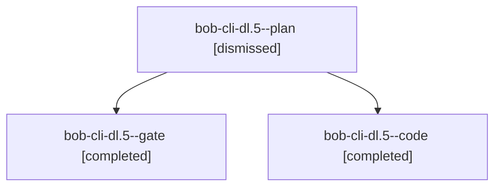

# Session: bob-cli-dl.5

[Agent Hoods](../README.md) / [bbugyi200](../users/bbugyi200/README.md) / [apollo](../users/bbugyi200/machines/apollo/README.md) / [bob-cli-dl](../users/bbugyi200/machines/apollo/hoods/bob-cli-dl/README.md) / bob-cli-dl.5

Owner: `bbugyi200.apollo` · Hood: `bob-cli-dl` · Members: 3 · Bead: [bob-cli-dl.5](https://github.com/bobs-org/bob-cli--beads/blob/main/pages/bob-cli-dl/bob-cli-dl.5.md)

## Lineage

The diagram is an optional enhancement; the ordered table below contains the same lineage in accessible text.

| Role | Agent | State | Model / provider | Timing | Commits | Prompt | Chat |
|---|---|---|---|---|---:|---|---|
| plan | bob-cli-dl.5--plan | dismissed | gpt-6-astra / codex | 2026-10-28T09:08:01.627845 → 2026-10-28T10:18:02.055993 | 0 | [Prompt](../agents/bbugyi200.apollo.bob-cli-dl.5--plan/prompt.md) | [Chat](../agents/bbugyi200.apollo.bob-cli-dl.5--plan/chat.md) |
| gate | bob-cli-dl.5--gate | completed | gpt-6-astra / codex | 2026-10-28T13:17:29.283813+00:00 → 2026-10-28T13:17:39.760739+00:00 | 0 | — | [Chat](../agents/bbugyi200.apollo.bob-cli-dl.5--gate/chat.md) |
| code | bob-cli-dl.5--code | completed | grok-4.6 / grok | 2026-10-28T13:17:53.524425+00:00 → 2026-10-28T14:18:02.030308+00:00 | 0 | — | [Chat](../agents/bbugyi200.apollo.bob-cli-dl.5--code/chat.md) |

## Neighbors

| Agent | Relation | State |
|---|---|---|
| [bob-cli-dl.1](bbugyi200.apollo.bob-cli-dl.1.md) (session · 3) | bob-cli-dl hood | completed 1, dismissed 2 |
| [bob-cli-dl.2](bbugyi200.apollo.bob-cli-dl.2.md) (session · 7) | bob-cli-dl hood | completed 3, dismissed 3, failed 1 |
| [bob-cli-dl.3](../agents/bbugyi200.apollo.bob-cli-dl.3/README.md) | bob-cli-dl hood | dismissed |
| [bob-cli-dl.4](../agents/bbugyi200.apollo.bob-cli-dl.4/README.md) | bob-cli-dl hood | dismissed |
| [bob-cli-dl.6](bbugyi200.apollo.bob-cli-dl.6.md) (session · 3) | bob-cli-dl hood | completed 1, dismissed 2 |
| [bob-cli-dl.7](../agents/bbugyi200.apollo.bob-cli-dl.7/README.md) | bob-cli-dl hood | dismissed |
| [bob-cli-dl.8](../agents/bbugyi200.apollo.bob-cli-dl.8/README.md) | bob-cli-dl hood | dismissed |
| [bob-cli-dl.land](bbugyi200.apollo.bob-cli-dl.land.md) (session · 3) | bob-cli-dl hood | completed 2, dismissed 1 |
