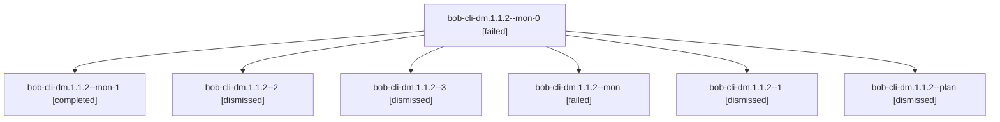

# Session: bob-cli-dm.1.1.2

[Agent Hoods](../README.md) / [bbugyi200](../users/bbugyi200/README.md) / [apollo](../users/bbugyi200/machines/apollo/README.md) / [bob-cli-dm](../users/bbugyi200/machines/apollo/hoods/bob-cli-dm/README.md) / bob-cli-dm.1.1.2

Owner: `bbugyi200.apollo` · Hood: `bob-cli-dm` · Members: 7 · Bead: [bob-cli-dm.1.1.2](https://github.com/bobs-org/bob-cli--beads/blob/main/pages/bob-cli-dm/bob-cli-dm.1.1.2.md)

## Lineage



The diagram is an optional enhancement; the ordered table below contains the same lineage in accessible text.

| Role | Agent | State | Model / provider | Timing | Commits | Prompt | Chat |
|---|---|---|---|---|---:|---|---|
| <a id="member-mon-0"></a>mon-0 | bob-cli-dm.1.1.2--mon-0 | failed | gpt-6-astra / codex | 2026-10-28T19:13:11.087139+00:00 → 2026-10-28T19:34:13.574229+00:00 | 0 | — | [Chat](../agents/bbugyi200.apollo.bob-cli-dm.1.1.2--mon-0/chat.md) |
| <a id="member-mon-1"></a>mon-1 | bob-cli-dm.1.1.2--mon-1 | completed | gpt-6-astra / codex | 2026-10-28T19:41:17.912834+00:00 → 2026-10-28T19:55:13.945001+00:00 | 0 | — | [Chat](../agents/bbugyi200.apollo.bob-cli-dm.1.1.2--mon-1/chat.md) |
| <a id="member-2"></a>2 | bob-cli-dm.1.1.2--2 | dismissed | gpt-6-astra / codex | 2026-10-28T15:34:23.219055 → 2026-10-28T15:42:24.725004 | 0 | [Prompt](../agents/bbugyi200.apollo.bob-cli-dm.1.1.2--2/prompt.md) | [Chat](../agents/bbugyi200.apollo.bob-cli-dm.1.1.2--2/chat.md) |
| <a id="member-3"></a>3 | bob-cli-dm.1.1.2--3 | dismissed | gpt-6-astra / codex | 2026-10-28T15:55:13.738856 → 2026-10-28T16:04:41.207428 | [1](../agents/bbugyi200.apollo.bob-cli-dm.1.1.2--3/README.md#commits) | [Prompt](../agents/bbugyi200.apollo.bob-cli-dm.1.1.2--3/prompt.md) | [Chat](../agents/bbugyi200.apollo.bob-cli-dm.1.1.2--3/chat.md) |
| <a id="member-mon"></a>mon | bob-cli-dm.1.1.2--mon | failed | gpt-6-astra / codex | 2026-10-28T18:51:25.049729+00:00 → 2026-10-28T19:07:46.204100+00:00 | 0 | — | [Chat](../agents/bbugyi200.apollo.bob-cli-dm.1.1.2--mon/chat.md) |
| <a id="member-1"></a>1 | bob-cli-dm.1.1.2--1 | dismissed | gpt-6-astra / codex | 2026-10-28T15:07:45.921387 → 2026-10-28T15:14:20.868322 | 0 | [Prompt](../agents/bbugyi200.apollo.bob-cli-dm.1.1.2--1/prompt.md) | [Chat](../agents/bbugyi200.apollo.bob-cli-dm.1.1.2--1/chat.md) |
| <a id="member-plan"></a>plan | bob-cli-dm.1.1.2--plan | dismissed | gpt-6-astra / codex | 2026-10-28T14:29:39.035417 → 2026-10-28T14:52:59.437883 | 0 | [Prompt](../agents/bbugyi200.apollo.bob-cli-dm.1.1.2--plan/prompt.md) | [Chat](../agents/bbugyi200.apollo.bob-cli-dm.1.1.2--plan/chat.md) |

## Commits

| Role | Repo | Commit | Subject | Committed |
|---|---|---|---|---|
| 3 | — | `9409bfa` | feat(themes): explain task suggestions and cache unknown note defaults | 2026-10-28 16:01:52 EDT |

## Variables

| Role | Variable | Value |
|---|---|---|
| 3 | `artifacts` | \[{bead: bob-cli-dm.1.1.2, kind: file, label: Task theme CLI benchmark and verification evidence, path: /home/bryan/.sase/artifacts/agents/gh\_bobs-org\_\_bob-cli/20261028155420/phase-verification-eviden… |

#### artifacts

**Role:** `3`

```yaml
- bead: bob-cli-dm.1.1.2
  kind: file
  label: Task theme CLI benchmark and verification evidence
  path: /home/bryan/.sase/artifacts/agents/gh_bobs-org__bob-cli/20261028155420/phase-verification-evidence-27d0b381d296.json
  ref: file:explicit:babfd9c7f9ecf3f6fe7fddcf
  source_path: /home/bryan/.local/state/sase/workspaces/bobs-org/bob-cli/bob-cli_10/target/theme-default-benchmark/phase-verification-evidence.json
```

Values are truncated for display; see each member's agent meta.json for the full values.

## Neighbors

| Agent | Relation | State |
|---|---|---|
| [bob-cli-dm.1](bbugyi200.apollo.bob-cli-dm.1.md) (session · 3) | ancestor | completed 1, dismissed 2 |
| [bob-cli-dm.1.1.1](bbugyi200.apollo.bob-cli-dm.1.1.1.md) (session · 3) | bob-cli-dm.1.1 hood | completed 1, dismissed 2 |
| [bob-cli-dm.1.1.3](../agents/bbugyi200.apollo.bob-cli-dm.1.1.3/README.md) | bob-cli-dm.1.1 hood | dismissed |
| [bob-cli-dm.1.1.land](bbugyi200.apollo.bob-cli-dm.1.1.land.md) (session · 3) | bob-cli-dm.1.1 hood | completed 2, dismissed 1 |
| [bob-cli-dm.2](bbugyi200.apollo.bob-cli-dm.2.md) (session · 3) | bob-cli-dm hood | completed 1, dismissed 2 |
| [bob-cli-dm.3](../agents/bbugyi200.apollo.bob-cli-dm.3/README.md) | bob-cli-dm hood | dismissed |
| [bob-cli-dm.4](bbugyi200.apollo.bob-cli-dm.4.md) (session · 5) | bob-cli-dm hood | completed 2, dismissed 2, failed 1 |
| [bob-cli-dm.5](bbugyi200.apollo.bob-cli-dm.5.md) (session · 3) | bob-cli-dm hood | completed 1, dismissed 2 |
| [bob-cli-dm.5.1.1](../agents/bbugyi200.apollo.bob-cli-dm.5.1.1/README.md) | bob-cli-dm hood | dismissed |
| [bob-cli-dm.5.1.2](../agents/bbugyi200.apollo.bob-cli-dm.5.1.2/README.md) | bob-cli-dm hood | dismissed |
| [bob-cli-dm.5.1.3](../agents/bbugyi200.apollo.bob-cli-dm.5.1.3/README.md) | bob-cli-dm hood | dismissed |
| [bob-cli-dm.5.1.land](bbugyi200.apollo.bob-cli-dm.5.1.land.md) (session · 3) | bob-cli-dm hood | completed 2, dismissed 1 |
| [bob-cli-dm.6](bbugyi200.apollo.bob-cli-dm.6.md) (session · 3) | bob-cli-dm hood | completed 1, dismissed 2 |
| [bob-cli-dm.6.1.1](../agents/bbugyi200.apollo.bob-cli-dm.6.1.1/README.md) | bob-cli-dm hood | dismissed |
| [bob-cli-dm.6.1.2](../agents/bbugyi200.apollo.bob-cli-dm.6.1.2/README.md) | bob-cli-dm hood | dismissed |
| [bob-cli-dm.6.1.3](../agents/bbugyi200.apollo.bob-cli-dm.6.1.3/README.md) | bob-cli-dm hood | dismissed |
| [bob-cli-dm.6.1.land](bbugyi200.apollo.bob-cli-dm.6.1.land.md) (session · 9) | bob-cli-dm hood | completed 4, dismissed 4, failed 1 |
| [bob-cli-dm.7](bbugyi200.apollo.bob-cli-dm.7.md) (session · 3) | bob-cli-dm hood | completed 1, dismissed 2 |
| [bob-cli-dm.7.1.1](../agents/bbugyi200.apollo.bob-cli-dm.7.1.1/README.md) | bob-cli-dm hood | dismissed |
| [bob-cli-dm.7.1.2](../agents/bbugyi200.apollo.bob-cli-dm.7.1.2/README.md) | bob-cli-dm hood | dismissed |
| [bob-cli-dm.7.1.3](../agents/bbugyi200.apollo.bob-cli-dm.7.1.3/README.md) | bob-cli-dm hood | dismissed |
| [bob-cli-dm.7.1.4](../agents/bbugyi200.apollo.bob-cli-dm.7.1.4/README.md) | bob-cli-dm hood | dismissed |
| [bob-cli-dm.7.1.land](bbugyi200.apollo.bob-cli-dm.7.1.land.md) (session · 3) | bob-cli-dm hood | completed 2, dismissed 1 |
| [bob-cli-dm.8](../agents/bbugyi200.apollo.bob-cli-dm.8/README.md) | bob-cli-dm hood | dismissed |
| [bob-cli-dm.9](../agents/bbugyi200.apollo.bob-cli-dm.9/README.md) | bob-cli-dm hood | dismissed |
| [bob-cli-dm.land](../agents/bbugyi200.apollo.bob-cli-dm.land/README.md) | bob-cli-dm hood | dismissed |
