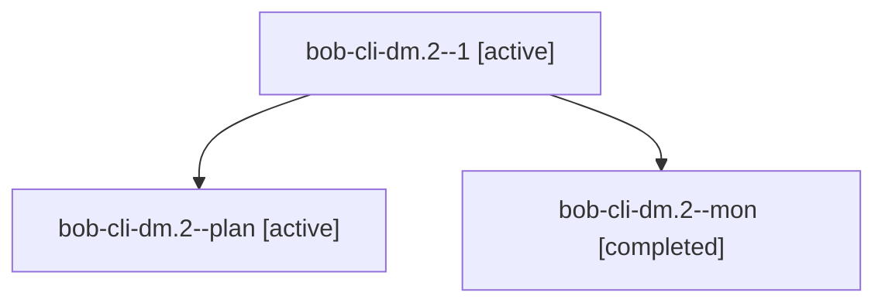

# Session: bob-cli-dm.2

[Agent Hoods](../README.md) / [bbugyi200](../users/bbugyi200/README.md) / [apollo](../users/bbugyi200/machines/apollo/README.md) / [bob-cli-dm](../users/bbugyi200/machines/apollo/hoods/bob-cli-dm/README.md) / bob-cli-dm.2

Owner: `bbugyi200.apollo` · Hood: `bob-cli-dm` · Members: 3 · Bead: [bob-cli-dm.2](https://github.com/bobs-org/bob-cli--beads/blob/main/pages/bob-cli-dm/bob-cli-dm.2.md)

## Lineage

The diagram is an optional enhancement; the ordered table below contains the same lineage in accessible text.

| Role | Agent | State | Model / provider | Timing | Commits | Prompt | Chat |
|---|---|---|---|---|---:|---|---|
| 1 | bob-cli-dm.2--1 | active | gpt-6-luna / codex | 2026-10-28T22:28:55.484495+00:00 | [1](../agents/bbugyi200.apollo.bob-cli-dm.2--1/README.md#commits) | [Prompt](../agents/bbugyi200.apollo.bob-cli-dm.2--1/prompt.md) | [Chat](../agents/bbugyi200.apollo.bob-cli-dm.2--1/chat.md) |
| plan | bob-cli-dm.2--plan | active | gpt-6-luna / codex | 2026-10-28T21:38:45.915749+00:00 | 0 | [Prompt](../agents/bbugyi200.apollo.bob-cli-dm.2--plan/prompt.md) | [Chat](../agents/bbugyi200.apollo.bob-cli-dm.2--plan/chat.md) |
| mon | bob-cli-dm.2--mon | completed | gpt-6-luna / codex | 2026-10-28T22:21:10.070495+00:00 → 2026-10-28T22:28:55.725860+00:00 | 0 | — | [Chat](../agents/bbugyi200.apollo.bob-cli-dm.2--mon/chat.md) |

## Commits

| Role | Repo | Commit | Subject | Committed |
|---|---|---|---|---|
| 1 | bob-cli | [`ac13ab5`](https://github.com/bobs-org/bob-cli/commit/ac13ab543347f173aa729744bd08b98d637fc804) | feat(capture): suggest task themes in completion and ref today | 2026-10-28 18:35:38 EDT |

## Neighbors

| Agent | Relation | State |
|---|---|---|
| [bob-cli-dm.1](bbugyi200.apollo.bob-cli-dm.1.md) (session · 3) | bob-cli-dm hood | active 2, completed 1 |
| [bob-cli-dm.1.1.1](bbugyi200.apollo.bob-cli-dm.1.1.1.md) (session · 3) | bob-cli-dm hood | active 2, completed 1 |
| [bob-cli-dm.1.1.2](bbugyi200.apollo.bob-cli-dm.1.1.2.md) (session · 7) | bob-cli-dm hood | active 4, completed 1, failed 2 |
| [bob-cli-dm.1.1.3](../agents/bbugyi200.apollo.bob-cli-dm.1.1.3/README.md) | bob-cli-dm hood | active |
| [bob-cli-dm.1.1.land](bbugyi200.apollo.bob-cli-dm.1.1.land.md) (session · 3) | bob-cli-dm hood | active 1, completed 2 |
| [bob-cli-dm.3](../agents/bbugyi200.apollo.bob-cli-dm.3/README.md) | bob-cli-dm hood | active |
| [bob-cli-dm.4](bbugyi200.apollo.bob-cli-dm.4.md) (session · 5) | bob-cli-dm hood | active 2, completed 2, failed 1 |
| [bob-cli-dm.5](bbugyi200.apollo.bob-cli-dm.5.md) (session · 3) | bob-cli-dm hood | active 2, completed 1 |
| [bob-cli-dm.5.1.1](../agents/bbugyi200.apollo.bob-cli-dm.5.1.1/README.md) | bob-cli-dm hood | active |
| [bob-cli-dm.5.1.2](../agents/bbugyi200.apollo.bob-cli-dm.5.1.2/README.md) | bob-cli-dm hood | active |
| [bob-cli-dm.5.1.3](../agents/bbugyi200.apollo.bob-cli-dm.5.1.3/README.md) | bob-cli-dm hood | active |
| [bob-cli-dm.5.1.land](bbugyi200.apollo.bob-cli-dm.5.1.land.md) (session · 3) | bob-cli-dm hood | active 1, completed 2 |
| [bob-cli-dm.6](bbugyi200.apollo.bob-cli-dm.6.md) (session · 3) | bob-cli-dm hood | active 2, completed 1 |
| [bob-cli-dm.6.1.1](../agents/bbugyi200.apollo.bob-cli-dm.6.1.1/README.md) | bob-cli-dm hood | active |
| [bob-cli-dm.6.1.2](../agents/bbugyi200.apollo.bob-cli-dm.6.1.2/README.md) | bob-cli-dm hood | active |
| [bob-cli-dm.6.1.3](../agents/bbugyi200.apollo.bob-cli-dm.6.1.3/README.md) | bob-cli-dm hood | active |
| [bob-cli-dm.6.1.land](bbugyi200.apollo.bob-cli-dm.6.1.land.md) (session · 9) | bob-cli-dm hood | active 4, completed 4, failed 1 |
| [bob-cli-dm.7](bbugyi200.apollo.bob-cli-dm.7.md) (session · 3) | bob-cli-dm hood | active 2, completed 1 |
| [bob-cli-dm.7.1.1](../agents/bbugyi200.apollo.bob-cli-dm.7.1.1/README.md) | bob-cli-dm hood | active |
| [bob-cli-dm.7.1.2](../agents/bbugyi200.apollo.bob-cli-dm.7.1.2/README.md) | bob-cli-dm hood | active |
| [bob-cli-dm.7.1.3](../agents/bbugyi200.apollo.bob-cli-dm.7.1.3/README.md) | bob-cli-dm hood | active |
| [bob-cli-dm.7.1.4](../agents/bbugyi200.apollo.bob-cli-dm.7.1.4/README.md) | bob-cli-dm hood | active |
| [bob-cli-dm.7.1.land](bbugyi200.apollo.bob-cli-dm.7.1.land.md) (session · 3) | bob-cli-dm hood | active 1, completed 2 |
| [bob-cli-dm.8](../agents/bbugyi200.apollo.bob-cli-dm.8/README.md) | bob-cli-dm hood | active |
| [bob-cli-dm.9](../agents/bbugyi200.apollo.bob-cli-dm.9/README.md) | bob-cli-dm hood | active |
| [bob-cli-dm.land](../agents/bbugyi200.apollo.bob-cli-dm.land/README.md) | bob-cli-dm hood | active |
