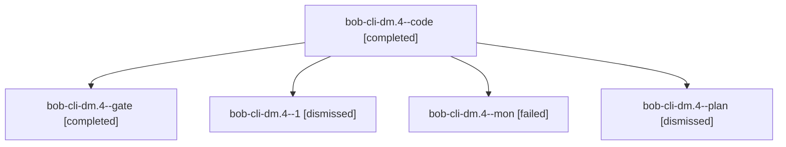

# Session: bob-cli-dm.4

[Agent Hoods](../README.md) / [bbugyi200](../users/bbugyi200/README.md) / [apollo](../users/bbugyi200/machines/apollo/README.md) / [bob-cli-dm](../users/bbugyi200/machines/apollo/hoods/bob-cli-dm/README.md) / bob-cli-dm.4

Owner: `bbugyi200.apollo` · Hood: `bob-cli-dm` · Members: 5 · Bead: [bob-cli-dm.4](https://github.com/bobs-org/bob-cli--beads/blob/main/pages/bob-cli-dm/bob-cli-dm.4.md)

## Lineage

The diagram is an optional enhancement; the ordered table below contains the same lineage in accessible text.

| Role | Agent | State | Model / provider | Timing | Commits | Prompt | Chat |
|---|---|---|---|---|---:|---|---|
| code | bob-cli-dm.4--code | completed | gpt-6-luna / codex | 2026-10-28T22:44:35.596542+00:00 → 2026-10-28T23:08:02.036174+00:00 | 0 | — | [Chat](../agents/bbugyi200.apollo.bob-cli-dm.4--code/chat.md) |
| gate | bob-cli-dm.4--gate | completed | gpt-6-astra / codex | 2026-10-28T22:44:11.902163+00:00 → 2026-10-28T22:44:22.478710+00:00 | 0 | — | [Chat](../agents/bbugyi200.apollo.bob-cli-dm.4--gate/chat.md) |
| 1 | bob-cli-dm.4--1 | dismissed | gpt-6-luna / codex | 2026-10-28T19:08:05.278228 → 2026-10-28T19:48:56.058216 | [1](../agents/bbugyi200.apollo.bob-cli-dm.4--1/README.md#commits) | [Prompt](../agents/bbugyi200.apollo.bob-cli-dm.4--1/prompt.md) | [Chat](../agents/bbugyi200.apollo.bob-cli-dm.4--1/chat.md) |
| mon | bob-cli-dm.4--mon | failed | gpt-6-luna / codex | 2026-10-28T23:06:17.151807+00:00 → 2026-10-28T23:08:05.459115+00:00 | 0 | — | [Chat](../agents/bbugyi200.apollo.bob-cli-dm.4--mon/chat.md) |
| plan | bob-cli-dm.4--plan | dismissed | gpt-6-astra / codex | 2026-10-28T18:38:49.839930 → 2026-10-28T19:08:02.064680 | 0 | [Prompt](../agents/bbugyi200.apollo.bob-cli-dm.4--plan/prompt.md) | [Chat](../agents/bbugyi200.apollo.bob-cli-dm.4--plan/chat.md) |

## Commits

| Role | Repo | Commit | Subject | Committed |
|---|---|---|---|---|
| 1 | — | `41cc4ac` | feat(capture): add task-theme capture writes | 2026-10-28 19:45:54 EDT |

## Neighbors

| Agent | Relation | State |
|---|---|---|
| [bob-cli-dm.1](bbugyi200.apollo.bob-cli-dm.1.md) (session · 3) | bob-cli-dm hood | completed 1, dismissed 2 |
| [bob-cli-dm.1.1.1](bbugyi200.apollo.bob-cli-dm.1.1.1.md) (session · 3) | bob-cli-dm hood | completed 1, dismissed 2 |
| [bob-cli-dm.1.1.2](bbugyi200.apollo.bob-cli-dm.1.1.2.md) (session · 7) | bob-cli-dm hood | completed 1, dismissed 4, failed 2 |
| [bob-cli-dm.1.1.3](../agents/bbugyi200.apollo.bob-cli-dm.1.1.3/README.md) | bob-cli-dm hood | dismissed |
| [bob-cli-dm.1.1.land](bbugyi200.apollo.bob-cli-dm.1.1.land.md) (session · 3) | bob-cli-dm hood | completed 2, dismissed 1 |
| [bob-cli-dm.2](bbugyi200.apollo.bob-cli-dm.2.md) (session · 3) | bob-cli-dm hood | completed 1, dismissed 2 |
| [bob-cli-dm.3](../agents/bbugyi200.apollo.bob-cli-dm.3/README.md) | bob-cli-dm hood | dismissed |
| [bob-cli-dm.5](bbugyi200.apollo.bob-cli-dm.5.md) (session · 3) | bob-cli-dm hood | completed 1, dismissed 2 |
| [bob-cli-dm.5.1.1](../agents/bbugyi200.apollo.bob-cli-dm.5.1.1/README.md) | bob-cli-dm hood | dismissed |
| [bob-cli-dm.5.1.2](../agents/bbugyi200.apollo.bob-cli-dm.5.1.2/README.md) | bob-cli-dm hood | dismissed |
| [bob-cli-dm.5.1.3](../agents/bbugyi200.apollo.bob-cli-dm.5.1.3/README.md) | bob-cli-dm hood | dismissed |
| [bob-cli-dm.5.1.land](bbugyi200.apollo.bob-cli-dm.5.1.land.md) (session · 3) | bob-cli-dm hood | completed 2, dismissed 1 |
| [bob-cli-dm.6](bbugyi200.apollo.bob-cli-dm.6.md) (session · 3) | bob-cli-dm hood | completed 1, dismissed 2 |
| [bob-cli-dm.6.1.1](../agents/bbugyi200.apollo.bob-cli-dm.6.1.1/README.md) | bob-cli-dm hood | dismissed |
| [bob-cli-dm.6.1.2](../agents/bbugyi200.apollo.bob-cli-dm.6.1.2/README.md) | bob-cli-dm hood | dismissed |
| [bob-cli-dm.6.1.3](../agents/bbugyi200.apollo.bob-cli-dm.6.1.3/README.md) | bob-cli-dm hood | dismissed |
| [bob-cli-dm.6.1.land](bbugyi200.apollo.bob-cli-dm.6.1.land.md) (session · 9) | bob-cli-dm hood | completed 4, dismissed 4, failed 1 |
| [bob-cli-dm.7](bbugyi200.apollo.bob-cli-dm.7.md) (session · 3) | bob-cli-dm hood | completed 1, dismissed 2 |
| [bob-cli-dm.7.1.1](../agents/bbugyi200.apollo.bob-cli-dm.7.1.1/README.md) | bob-cli-dm hood | dismissed |
| [bob-cli-dm.7.1.2](../agents/bbugyi200.apollo.bob-cli-dm.7.1.2/README.md) | bob-cli-dm hood | dismissed |
| [bob-cli-dm.7.1.3](../agents/bbugyi200.apollo.bob-cli-dm.7.1.3/README.md) | bob-cli-dm hood | dismissed |
| [bob-cli-dm.7.1.4](../agents/bbugyi200.apollo.bob-cli-dm.7.1.4/README.md) | bob-cli-dm hood | dismissed |
| [bob-cli-dm.7.1.land](bbugyi200.apollo.bob-cli-dm.7.1.land.md) (session · 3) | bob-cli-dm hood | completed 2, dismissed 1 |
| [bob-cli-dm.8](../agents/bbugyi200.apollo.bob-cli-dm.8/README.md) | bob-cli-dm hood | dismissed |
| [bob-cli-dm.9](../agents/bbugyi200.apollo.bob-cli-dm.9/README.md) | bob-cli-dm hood | dismissed |
| [bob-cli-dm.land](../agents/bbugyi200.apollo.bob-cli-dm.land/README.md) | bob-cli-dm hood | dismissed |
